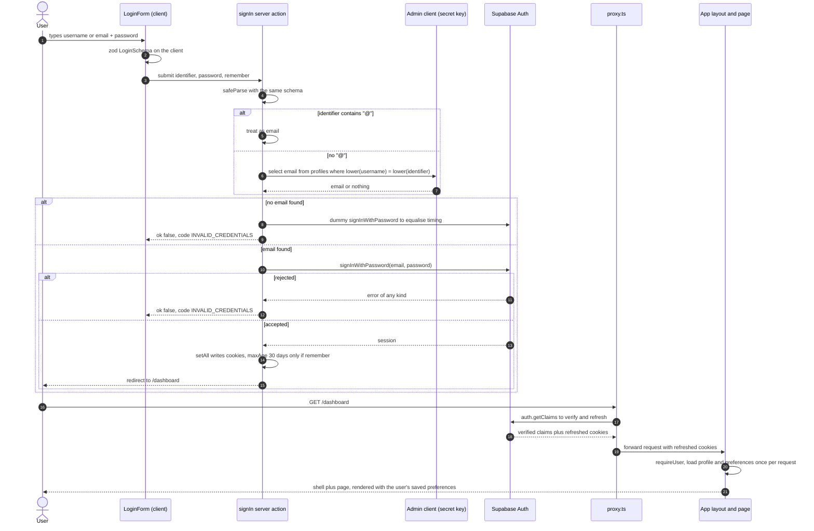
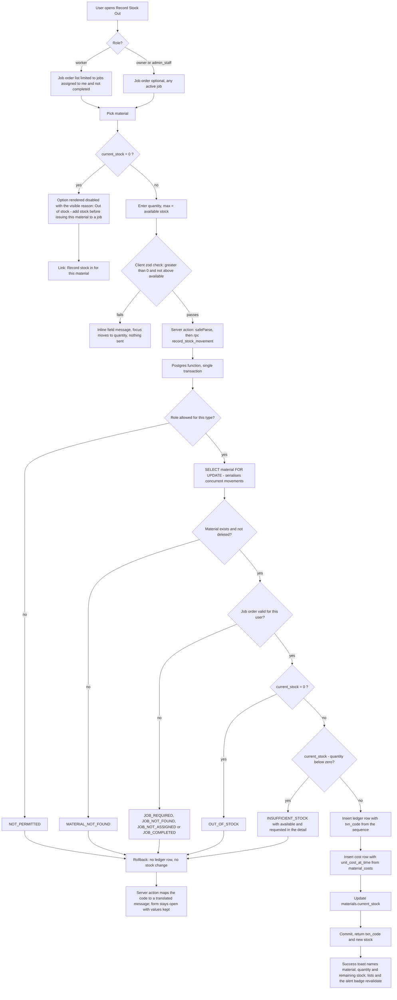
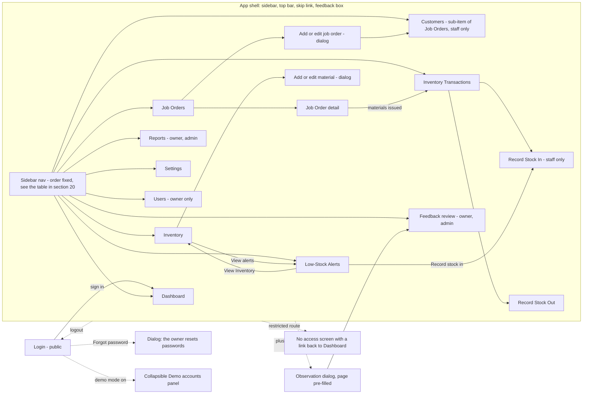

# Design — RJM Furniture Job & Inventory Management System

Prototype v0.1 · College HCI research prototype · Written 10 November 2026 · Companion to `requirements.md`

## 1. Overview

RJM Furniture is a single Next.js application (App Router, React Server Components) talking to one Supabase project. Every page is rendered on the server with the signed-in user's own database session, so what a person can see is decided by Postgres row level security rather than by hidden buttons. The browser gets a small amount of JavaScript: forms, dialogs, toolbars and the preference switches. All writes go through server actions that validate with the same zod schema the form used, and the three writes that must be atomic (create a job order, save a material, record a stock movement) go through Postgres functions so the ledger and the stock figure can never disagree.

The product is graded on its interface, so the design treats three things as load-bearing rather than decorative: one token set with every colour pairing contrast-checked by a script in the repository, one set of reusable patterns (page header, toolbar, card, data table, dialog, toast, empty state, form field) that every screen reuses without variation, and a preference system where each switch in Settings measurably changes the rendered HTML on the first paint.

Two deliberate schema decisions carry most of the security design. First, money lives in its own tables (`job_pricing`, `material_costs`, `inventory_transaction_costs`) rather than as columns on `jobs`, `materials` and `inventory_transactions`, because Supabase gives every signed-in user the same Postgres role (`authenticated`), which makes per-role column privileges impossible; a separate table lets one ordinary RLS policy hide costs from carpenters, and a column that is not in the table cannot leak. Second, `materials.current_stock` is not writable by the application at all: the `UPDATE` privilege is granted column by column and `current_stock` is left out, so the only path to changing stock is the `record_stock_movement` function.

Section 2 states the exact versions this design was written against and what was verified against vendor documentation on 10 November 2026. Everything after that is concrete enough to implement without further architectural decisions.

## 2. Technology stack and verified versions

The stack is mandated by the brief and is **locked** once this design is approved. The versions below are the latest published releases on 10 November 2026, read from the npm registry, with the version-sensitive APIs checked against vendor documentation (see §24, Verification notes).

| Area | Package / tool | Version designed against | Notes on the API used |
| --- | --- | --- | --- |
| Framework | `next` | 16.4.6 | App Router. In Next 16 the former `middleware.ts` is **`proxy.ts`** exporting `export async function proxy(request)`. `cookies()`, `headers()` and route `params` are async and must be awaited. Turbopack is the default dev and build bundler. |
| UI runtime | `react`, `react-dom` | 19.3.1 | Server Components by default; `useActionState` / `useFormStatus` for form pending states. |
| Language | `typescript` | 7.0.2 | `strict: true`. Fallback rule: if `next build` or ESLint fails with a compiler-version error, pin `typescript@5.9.x` — it is a one-line change and nothing in this design depends on TS 7 features. |
| Styling | `tailwindcss`, `@tailwindcss/postcss` | 4.3.5 | Tailwind v4 is **CSS-first**: no `tailwind.config.ts`. `globals.css` starts with `@import "tailwindcss";` and declares tokens in `@theme`. PostCSS config is `postcss.config.mjs` with the `@tailwindcss/postcss` plugin. |
| Components | `shadcn` CLI | 4.23.0 | `npx shadcn@latest init --template next --base radix`, then `npx shadcn@latest add <component>`. Writes `components.json` (`"iconLibrary": "lucide"`, `"tailwind": { "css": "src/app/globals.css", "cssVariables": true }`). Runtime deps it installs: `class-variance-authority` 0.7.1, `cn` (re-exported from `src/lib/utils.ts`), `tw-animate-css`, `lucide-react`. `--base radix` keeps the long-standing Radix primitives, which is what nearly all shadcn/ui examples and accessibility notes describe. |
| Icons | `lucide-react` | 1.71.0 | The only icon set. A second icon library is a defect (Requirement 18.8). |
| Database / auth | `@supabase/supabase-js` | 2.119.0 | Typed with generated `Database` types. |
| SSR auth | `@supabase/ssr` | 0.12.7 | `createBrowserClient` and `createServerClient` with the **`cookies: { getAll, setAll }`** adapter. The older `get`/`set`/`remove` adapter and `@supabase/auth-helpers-nextjs` are not used. Session verification uses `supabase.auth.getClaims()`; `getSession()` is never trusted on the server. |
| i18n | `next-intl` | 4.14.10 | `createNextIntlPlugin()` in `next.config.ts`, `getRequestConfig` in `src/i18n/request.ts`, `NextIntlClientProvider` in the root layout. **No `[locale]` route segment and no `requestLocale`** — the locale comes from the user's saved preference (cookie + profile), which is the documented "provide a locale" setup. `requestLocale` is now documented as legacy. |
| Forms | `react-hook-form` 7.91.0 + `@hookform/resolvers` 7.0.5 + `zod` 4.6.7 | — | `zodResolver(schema)` on the client, `schema.safeParse()` in the server action, one schema file per entity. |
| Toasts | `sonner` | 2.0.8 | shadcn's current toast component. Toasts are mirrored into an `aria-live` region (§18.6). |
| Unit tests | `vitest` | 5.1.0 | Two projects: `node` for pure logic, `jsdom` + `@vitejs/plugin-react` 6.3.0 for component tests. |
| E2E and a11y | `@playwright/test` 1.65.0 + `@axe-core/playwright` 4.14.0 | — | Every route, both languages. |
| Lint | `eslint` 10.14.0, `eslint-config-next` 16.4.6, `eslint-plugin-jsx-a11y` 6.10.2 | — | Flat config `eslint.config.mjs`; a11y rules at `error`. |
| DB tooling | `supabase` CLI | 3.1.0 | `supabase link --project-ref twplmgailygbucbgjilc`; `supabase db push --remote=<ref> --include-seed`; types via `npx supabase gen types typescript --remote="<ref>" --schema public > src/types/database.types.ts`. In CLI 3.x the project is selected with `--remote`, not the old `--project-id`. |
| Scripts | `tsx` | 4.23.15 | Runs `scripts/seed.ts` and `scripts/check-contrast.ts`. |
| Hosting | Vercel + Supabase cloud | — | Project ref `twplmgailygbucbgjilc`. |

Environment variables (exactly these four — Requirement 26.1):

```
NEXT_PUBLIC_SUPABASE_URL=https://twplmgailygbucbgjilc.supabase.co
NEXT_PUBLIC_SUPABASE_PUBLISHABLE_KEY=sb_publishable_T9fjMHZtUooFNlXL3GRniA_7rZXUwVO
SUPABASE_SECRET_KEY=            # server only — paste locally, never commit, never in any document
NEXT_PUBLIC_DEMO_MODE=true
```

One more value is needed **only** on the student's own machine, and only when running `supabase db push` non-interactively: `SUPABASE_DB_PASSWORD` (the same thing as the CLI's `-p, --password` flag, which the CLI reference documents as "database password for the project selected with `--remote`"; if it is absent the CLI simply prompts for it). It is local tooling configuration, not application configuration: it never reaches Vercel, never appears in `.env.example`, and Requirement 26.1's list of four application variables is unaffected by it. The secret key is deliberately absent from this document and from every file in the repository.

**`src/lib/env.ts` validates in two halves, and the split is load-bearing.** Requirement 26.2 says `.env.local` ships with `SUPABASE_SECRET_KEY=` blank for the user to paste, so a single schema validated at module load would throw on `npm run dev` before the first page ever rendered — the student would meet a crash instead of the app:

```ts
// src/lib/env.ts
export const publicEnv = z.object({                   // validated at module load
  NEXT_PUBLIC_SUPABASE_URL: z.url(),                  // zod 4 top-level format, not .string().url()
  NEXT_PUBLIC_SUPABASE_PUBLISHABLE_KEY: z.string().min(20),
  NEXT_PUBLIC_DEMO_MODE: z.enum(["true", "false"]).catch("false"),
}).parse(process.env);                                // throws naming the missing variable

export function requireSecretKey(): string {          // validated lazily, server only
  const v = process.env.SUPABASE_SECRET_KEY;
  if (!v) throw new Error(
    "Paste SUPABASE_SECRET_KEY into .env.local — the Users page, the seed script " +
    "and login by username need it. Until then, sign in with the demo email.");
  return v;
}
```

`requireSecretKey()` is called from exactly three places, all server-only: `src/lib/supabase/admin.ts`, `api/admin/users/route.ts` and `scripts/seed.ts`. Every page and every list runs on `publicEnv` alone, so the app boots and every screen renders with the secret key still blank.

**Three things, not two, stop working while it is blank, and login is one of them.** `admin.ts` is where the username → email lookup happens (§14.2 step 2), so a blank key breaks:

1. the Users page (create or edit an account),
2. `npm run seed`,
3. **login by username** — because the no-`@` branch goes through the admin client. Login by **email** still works.

That matters more than it sounds: Requirement 26.2 prescribes a blank placeholder in a fresh `.env.local`, and §18.2 maps every login failure to the one generic message, so without this note the student types the correct seeded username and gets "Incorrect username/email or password" with nothing to point at. The login action therefore catches the throw, logs a server-side sentence that names the cause, and still returns the generic code to the browser (§14.2). The README's setup step says it in one line: *until you paste the secret key, sign in with the demo email (`owner@rjm.local`), not the username.* The three public variables are fatal at startup because nothing works without them (§18.3).

> **Loud warning, repeated because it breaks everything silently.** This Supabase project has **Data API ON, "Automatically expose new tables" OFF, automatic RLS ON**. A new table therefore starts life with RLS enabled, no grants and no policies, which means the API returns `permission denied` or an empty result for every query against it — and it looks like a bug in the app, not a missing migration. Every migration must enable RLS, add explicit `GRANT`s for `authenticated` (and `service_role`), and add explicit policies. The checklist in §9 is not optional.
>
> **Three Auth settings are just as load-bearing, and one of them is the front door.**
>
> ```
> Authentication → Sign In / Providers → Email
>   • "Allow new users to sign up"   : OFF     ← the important one
>   • "Confirm email"                : ON      (harmless; createUser() passes email_confirm: true)
>   • no other provider enabled
> ```
>
> `supabase.auth.signUp()` is part of GoTrue and is callable with the publishable key that ships in the browser bundle. Whether it works is a **project setting**, not a code decision: the CLI configuration reference names it `auth.enable_signup` and documents it as "Allow/disallow new user signups to your project", **default `true`** (verified 10 November 2026, §24). So on a fresh project, a stranger can POST to GoTrue, arrive as the `authenticated` Postgres role, and the `using (true)` select policies in §10 then hand them the whole shop's customers, job orders, materials and ledger. Owner-provisioned accounts (§14.4) close the *provisioning* door; this setting closes the *self-service* one, and both are needed for the brief's "no public sign-up" rule to be true. With the setting off, GoTrue refuses `signUp()` outright (its own message is "Signups not allowed for this instance"), so the only route to an account is the Owner's Users page. The integration test in §22 asserts the refusal rather than the message text, because the wording belongs to GoTrue and may change.
>
> Local `supabase/config.toml` carries the same switch as `[auth] enable_signup = false`, so a future local stack matches the hosted project instead of quietly allowing what the hosted one forbids.

## 3. Architecture

### 3.1 Route groups and rendering

```
src/app/
  layout.tsx                      server · <html lang + preference attributes>, NextIntlClientProvider, Toaster
  page.tsx                        server · the site root: redirect(await isSignedIn() ? "/dashboard" : "/login")
  globals.css                     Tailwind v4 @theme tokens, preference CSS, print styles
  error.tsx / not-found.tsx       friendly error + 404 screens
  (public)/
    login/page.tsx                server · redirects to /dashboard when a session already resolves,
                                  otherwise renders <LoginForm> (client) and <DemoAccountsPanel>
  (app)/
    layout.tsx                    server · auth gate, loads profile + preferences, renders AppShell
    dashboard/page.tsx + loading.tsx
    jobs/page.tsx + loading.tsx   list (searchParams drive the query)
    jobs/[id]/page.tsx + loading.tsx   detail + status history + materials issued
    customers/page.tsx + loading.tsx
    inventory/page.tsx + loading.tsx
    transactions/page.tsx + loading.tsx
    alerts/page.tsx + loading.tsx
    reports/page.tsx + loading.tsx     owner + admin_staff
    settings/page.tsx
    users/page.tsx + loading.tsx       owner only
    feedback/page.tsx + loading.tsx    owner + admin_staff
    no-access/page.tsx            the "You do not have access to this page" screen
  api/admin/users/route.ts        POST/PATCH · the only place the secret key is used at runtime
```

Pages are **server components**. They read data with the request-scoped Supabase server client and pass plain objects to client components.

**`src/app/page.tsx` is not optional furniture.** Route groups contribute nothing to the URL, so `(public)/login` serves `/login` and `(app)/dashboard` serves `/dashboard` — and with nothing else, **no file matches `/`**. The professor opening the bare Vercel address would get `not-found.tsx`, which breaks Requirement 1.1 ("any address … SHALL show the Login screen"). The root page therefore exists and does one thing: `redirect(await isSignedIn() ? "/dashboard" : "/login")`, where `isSignedIn()` is the cheap claims-only check from `src/lib/auth.ts` (no profile load). The login page performs the mirror redirect, so an already-signed-in user who reopens `/login` lands on the Dashboard rather than on a sign-in form for a session they already have.

**Loading boundaries are part of the architecture, not an afterthought** (Requirement 7.11, indicator 8). A server component that awaits its own query renders nothing until the data arrives, so a `Skeleton` component with no boundary above it can never appear. Two rules, applied to every route without exception:

1. **Every route has a `loading.tsx`** whose shape matches the final layout — same page header, same card frames, same number of table rows — so the first paint is the page's silhouette rather than a blank area. `settings/page.tsx` is the one route without one, because it renders from the profile the layout already loaded and has no query of its own.
2. **Every independently-failing data section is its own async child inside `<Suspense>`**, so one slow or broken section cannot blank the page. This is the same seam as the per-section `ErrorCard` rule in §18.3: the `Suspense` fallback covers "not here yet", the `ErrorCard` covers "did not arrive".

```tsx
// src/app/(app)/dashboard/page.tsx — header is instant, each section streams
<PageHeader eyebrow="OVERVIEW" title={t("title")} purpose={t("purpose")} />
<GreetingCard name={greetingName(profile.full_name)} />                   {/* no query */}
<Suspense fallback={<KpiGridSkeleton />}><KpiGrid /></Suspense>           {/* async child */}
<Suspense fallback={<TableSkeleton rows={5} />}><RecentJobs /></Suspense>
<Suspense fallback={<ListSkeleton rows={3} />}><LowStockPanel /></Suspense>
```

`greetingName()` is why the greeting reads "Good morning, Mang Roger." rather than "Good morning, Rogelio Mendoza." Requirement 7.2 asks for the first name or nickname and `profiles` holds only `full_name`, so the card is passed `greetingName(profile.full_name)` — one helper in `src/lib/format.ts` (§16.1) that keeps a leading Filipino honorific with the name after it and otherwise takes the first token. The demo owner is seeded as `"Mang Roger Mendoza"` (§21.2), which is what the shop actually calls him, so the wireframe's line comes out exactly. No nickname column is added: one more field to keep in step, for one line of copy, is not worth it in four days — and a unit test pins the two cases (`"Mang Roger Mendoza"` → `"Mang Roger"`, `"Ana Cruz"` → `"Ana"`).

`KpiGrid`, `RecentJobs` and `LowStockPanel` are async server components that each call their own query (all three read the single `dashboard_summary()` result through a `cache()`-wrapped helper, so streaming three sections still costs one round trip). List routes use the route-level `loading.tsx` instead of per-section `Suspense`, because the table *is* the page; the toolbar and header come from the skeleton so the controls do not jump when the rows arrive. Anything with state is a **client component** and is named `*.client.tsx`: `LoginForm`, `JobForm`, `MaterialForm`, `StockMovementForm`, `ListToolbar`, `DataTable`, `ConfirmDialog`, `ObservationDialog`, `PreferenceForm`, `MobileNav`, `UserMenu`.

List filtering lives in the URL (`/jobs?q=santos&status=in_progress&page=2`). The toolbar is a client component that debounces input by 300 ms and calls `router.replace(...)`; the server component re-runs the query. Benefits: filters survive a refresh and a shared link, the heavy table stays server-rendered, and Playwright can navigate straight to a filtered state.

### 3.2 Data access layers

Four layers, each with one job:

1. **Clients** — `src/lib/supabase/`
   - `client.ts` → `createBrowserClient(url, publishableKey)` for client components.
   - `server.ts` → `createServerClient` with the `getAll`/`setAll` cookie adapter over `await cookies()`; wrapped in React `cache()` so one request reuses one client.
   - `proxy.ts` → the variant used by `src/proxy.ts` that refreshes the token and writes cookies onto the response.
   - `admin.ts` → `createClient(url, secretKey, { auth: { persistSession: false } })`, used only by `api/admin/users/route.ts`, the login username lookup and `scripts/seed.ts`. The file begins with `import "server-only";` so importing it from a client component is a build error (Requirement 26.5).
2. **Queries** — `src/lib/queries/*.ts`. Pure read functions (`listJobs(params)`, `listTransactions(params)`, `getDashboardSummary()`, `listLowStock()`). They receive the server client, always filter `deleted_at is null` for normal lists, and return typed rows. One file per entity so a reviewer can find every read path for a table.

   **The two list functions whose search spans more than one table read a view, not a table** (§7.3). Requirements 8.3/8.5 ask the Job Orders toolbar to match a typed string against the job code **or** the customer name **or** the project name, and Requirement 11.3 asks the Transactions toolbar to match the transaction code **or** the material name **or** the job code. PostgREST cannot express that: the resource-embedding reference states that a filter on an embedded resource does not change the parent rows unless `!inner` promotes it to an inner join, which is AND semantics — so `.or("job_code.ilike.*q*,customers.name.ilike.*q*")` is not a request PostgREST will honour (verified 10 November 2026, §24). Flattening the join into a view makes the search single-table and the filter trivial:

   ```ts
   // src/lib/queries/jobs.ts — listJobs(params)
   let query = client.from("v_jobs_list").select("*", { count: "exact" });
   if (params.q) query = query.or(
     `job_code.ilike.%${esc(params.q)}%,project_name.ilike.%${esc(params.q)}%,` +
     `customer_name.ilike.%${esc(params.q)}%`);
   if (params.status) query = query.eq("status", params.status);
   query = query.order("order_date", { ascending: false })
                .range((params.page - 1) * PAGE_SIZE, params.page * PAGE_SIZE - 1);
   ```

   ```ts
   // src/lib/queries/transactions.ts — listTransactions(params)
   query.or(`txn_code.ilike.%${q}%,material_name.ilike.%${q}%,job_code.ilike.%${q}%`)
   ```

   `esc(q)` strips PostgREST's filter metacharacters from the user's string before it is interpolated, so a character typed into the search box cannot change the shape of the filter:

   ```ts
   // src/lib/queries/_filter.ts
   const FORBIDDEN = /["\\,().:*%]/g;     // PostgREST filter metacharacters + the two wildcards
   export const esc = (q: string) => q.replace(FORBIDDEN, " ").trim().slice(0, 80);
   // unit test: esc('2" Common Nails, 3/4"') === '2 Common Nails 3/4'
   ```

   **The double quote and the backslash are in that set for a concrete reason.** Inside an `or=(…)` filter the double quote is PostgREST's value-quoting delimiter, so an unbalanced one makes the whole filter unparseable and the request comes back `400 PGRST100`, which §18.2 maps to `UNEXPECTED` — an error card in answer to a reasonable search. And the seeded material names contain quotes: `3/4" Marine Plywood` and `2" Common Nails`. Typing `2"` is exactly what someone does right after the Alerts screen names the out-of-stock nails, so this is the first search a grader is likely to try. Backslash behaves the same way. Stripping rather than escaping means the quote character itself is not searchable — `2"` matches as `2` — which is acceptable because `ilike %…%` still matches the rest of the name, and it keeps one simple rule instead of a per-character escaping scheme that has to be right under two layers of quoting. The `q` value is also capped at 80 characters here and by §18.4.

   **The two views do not filter alike, and that is deliberate.** `v_jobs_list` carries `where j.deleted_at is null`, so `listJobs` adds no `deleted_at` filter of its own. `v_transactions_list` filters **nothing**: the ledger is append-only and has no `deleted_at` column, and Requirement 10.12 requires a soft-deleted material's history to stay readable (as does the "materials issued to this job" panel of Requirement 9.12 on a deleted job), so its rows must survive the parent's deletion. Adding a parent `deleted_at` filter to that view would silently break both. Every other list query keeps its own `deleted_at is null` filter through the helpers in `src/lib/queries/` (§13.5).
3. **Actions** — `src/actions/*.ts` (`"use server"`). Every write: parse input with the entity's zod schema, check the caller's role, call either PostgREST or an RPC, map errors to i18n keys (§18.2), `revalidatePath(...)`, return `{ ok: true, … }` or `{ ok: false, code, fieldErrors }`.
4. **Database** — tables, RLS policies, functions. The last line of defence and the only one that cannot be bypassed.

### 3.3 Where zod schemas live and how they are shared

One file per entity in `src/schemas/`: `job.ts`, `customer.ts`, `material.ts`, `transaction.ts`, `user.ts`, `preferences.ts`, `feedback.ts`. Each exports the schema plus `z.infer` types. The client imports it for `zodResolver`; the server action imports the same object and calls `safeParse`. Error messages are **i18n keys, not sentences** (`z.string().min(2, { message: "Validation.nameTooShort" })`), and both layers translate the key at render time, so a validation message is never hardcoded English (Requirement 16.1).

### 3.4 Authentication boundary

`src/proxy.ts` (Next 16's renamed middleware) runs on every request the matcher lets through, refreshes the Supabase token with `getClaims()`, and copies the refreshed cookies onto the response. **A proxy sees pathnames, not route groups**, so "redirect `(app)` routes" is not a rule it can implement — it needs an explicit public allowlist, or the first redirect loops on `/login` itself:

```ts
// src/proxy.ts
export const config = {
  matcher: ["/((?!_next/static|_next/image|favicon.ico|rjm-logo.jpg).*)"],
};
const PUBLIC_PATHS = ["/login"];              // everything else needs a session

// unauthenticated and the path is not in PUBLIC_PATHS  → redirect to /login
// authenticated   and the path is "/login"             → redirect to /dashboard
// otherwise                                            → continue, carrying refreshed cookies
```

The negative lookahead is the pattern Next's own proxy reference recommends, for the stated reason that without a matcher the proxy runs on every request including `_next/static`, `_next/image` and files in `public/`, so auth redirects can block CSS, JS and images from loading (verified 10 November 2026, §24). `rjm-logo.jpg` is named explicitly because the login page renders it before anyone is signed in. `PUBLIC_PATHS` holds **one** entry, not a family: this app has no auth-callback route to allow, because there is no OAuth provider, no magic link and no password-reset email (§14.2's honest dialog, settled decision D4). If one is ever added, it is added to this array and nowhere else. `/` is deliberately not in it: an unauthenticated visitor to the root is redirected to `/login` by the proxy, and a signed-in one reaches `src/app/page.tsx`, which sends them to `/dashboard` (§3.1).

The proxy does **not** make role decisions — that is `(app)/layout.tsx` (`requireUser()`) and each page (`requireRole([...])`), backed by RLS. Three layers, each cheap to explain in a viva: the proxy keeps you signed in, the layout decides which pages and nav items you see, Postgres decides which rows and columns you get.

## 4. Folder structure

```
rjm-furniture-system/
├─ public/rjm-logo.jpg
├─ messages/{en.json,fil.json}
├─ docs/
│  ├─ personas-and-scenarios.md   design-rationale.md     heuristic-checklist.md
│  ├─ evaluation-traceability.md  accessibility-report.md  usability-test-plan.md
│  └─ translation-review.md
├─ scripts/{seed.ts,seed-reset.ts,check-contrast.ts,check-secrets.ts,check-translations.ts}
├─ supabase/
│  ├─ config.toml                 # [db.seed] sql_paths = ["./seed/*.sql"]
│  ├─ migrations/                 # 0001_… → 0012_… (§9)
│  └─ seed/010_business_data.sql
├─ src/
│  ├─ proxy.ts
│  ├─ app/                        # §3.1
│  ├─ components/
│  │  ├─ ui/                      # shadcn-generated, edited only to add a11y defaults
│  │  ├─ layout/                  # AppShell, Sidebar, TopBar, MobileNav, SkipLink, FeedbackBox
│  │  ├─ patterns/                # PageHeader, Toolbar, DataTable, EmptyState, StatusBadge,
│  │  │                           # ConfirmDialog, FormField, StatCard, SectionCard, ErrorCard
│  │  └─ features/                # jobs/, inventory/, transactions/, settings/, users/, feedback/
│  ├─ actions/  queries/  schemas/
│  ├─ i18n/request.ts
│  ├─ lib/{env,utils,auth,prefs,format,errors,design-tokens,constants,csv}.ts
│  └─ types/database.types.ts
├─ tests/{unit,e2e,integration}
├─ CHANGELOG.md  README.md  .env.example  .gitignore  eslint.config.mjs
├─ next.config.ts  postcss.config.mjs  components.json  playwright.config.ts  vitest.config.ts
```

`src/lib/constants.ts` holds the single version constant used by the sidebar box, the login footer, the dashboard chip and the changelog header: `export const APP_VERSION = "Prototype v0.1";` (Requirement 6.10).

## 5. Design tokens

### 5.1 The three brand colours and their ramps

The brand colours are fixed: **Dusk Blue `#9FB4E3`**, **Midnight Navy `#0D1A33`**, **Sunset Orange `#FF6A2B`**. Each ramp was generated by mixing the brand colour towards white (lighter steps) or towards Midnight Navy / a deep burnt brown `#4A1500` (darker steps) in sRGB, so every step stays visibly part of the same family. The generating mix factors are recorded in `src/lib/design-tokens.ts` next to the hex values, so the ramp can be regenerated rather than guessed at.

| Step | Dusk (`--dusk-*`) | Navy (`--navy-*`) | Orange (`--orange-*`) |
| --- | --- | --- | --- |
| 50 | `#F8FAFD` | `#96ABD8` | `#FFF3EE` |
| 100 | `#F0F3FB` | `#8DA2CE` | `#FFE4D9` |
| 200 | `#E0E7F6` | `#7C8FB9` | `#FFC9B3` |
| 300 | `#CBD6F0` | `#65769D` | `#FFA984` |
| 400 | `#B4C4E9` | `#4D5E80` | `#FF8855` |
| 500 | **`#9FB4E3`** (brand) | `#394868` | **`#FF6A2B`** (brand) |
| 600 | `#8295C0` | `#2A3956` | `#DE5B23` |
| 700 | `#65769D` | `#1F2C48` | `#C14D1C` |
| 800 | `#445576` | `#16233E` | `#A13E15` |
| 900 | `#2A3956` | **`#0D1A33`** (brand) | `#84300E` |

The navy ramp runs the other way round (900 is the brand colour) because Midnight Navy is the darkest colour in the system; its lighter steps are used for muted text and for sidebar dividers. `--dusk-900` and `--navy-600` are the same hex by construction; both names are kept because they are used for different purposes (dark text on a dusk tint vs. a sidebar hover surface) and keeping the names makes the CSS self-documenting.

**Derived accessible orange (Requirement 18.5): `--orange-700 = #C14D1C`, measured 4.83:1 on white.** This is the only orange allowed for text, links and thin icon strokes on a light surface. `#FF6A2B` is 2.86:1 on white and is therefore allowed only as a fill behind Midnight Navy text, or as a fill on the navy sidebar. On the `--dusk-100` table-header tint even `#C14D1C` drops to 4.35:1, so orange text there uses `--orange-800 #A13E15` (5.88:1). The script in §5.6 enforces both rules.

Neutral ramp (slightly navy-tinted greys, so the "dusk" feel survives in borders and disabled states):

| Token | Hex | Use |
| --- | --- | --- |
| `--neutral-0` | `#FFFFFF` | page and card background |
| `--neutral-50` | `#F8FAFD` | zebra rows, subtle panels (same hex as `--dusk-50`) |
| `--neutral-100` | `#F0F3FB` | table header tint, toolbar strip |
| `--neutral-200` | `#E0E7F6` | hairline dividers, progress-bar track |
| `--neutral-300` | `#CBD6F0` | decorative card border, selected row fill |
| `--neutral-500` | `#65769D` | **border-strong**: input, select and checkbox outlines |
| `--neutral-700` | `#4D5E80` | muted / secondary text |
| `--neutral-900` | `#0D1A33` | primary text |

The neutral ramp is not a fourth set of colours: each step is an alias of a dusk or navy step with the same hex (`--neutral-500` = `--dusk-700`, `--neutral-700` = `--navy-400`, `--neutral-900` = `--navy-900`). `globals.css` declares **all three brand ramps in full, 50–900, thirty variables** (Requirement 18.1 asks for them, and the contrast script in §5.6 asserts that every hex in the token file appears in the stylesheet, so a partial declaration would fail `npm run check:contrast` on its first run). The neutral names are not declared as separate variables; they exist in this table, and in `design-tokens.ts` as a named alias list, so the *purpose* of each grey is written down somewhere. The contrast script checks hexes, so an alias cannot drift.

Status colours (colour-blind safe only in combination with the icon and label defined in §5.5):

| Role | Surface | Text + icon | Border / 3:1 accent | Used for |
| --- | --- | --- | --- | --- |
| success | `#E6F4EC` | `#0B5C38` (7.12:1) | `#0F7A4A` | In Stock, Completed, Stock In |
| warning | `#FFF4E0` | `#7A4A00` (6.86:1) | `#B26B00` | Low Stock, On Hold |
| danger | `#FDECEA` | `#A1180F` (6.92:1) | `#C62828` | Out of Stock, Stock Out |
| **neutral** | `#E0E7F6` (dusk-200) | `#0D1A33` (13.96:1, §5.4 row 4) | `#65769D` | **Pending**, Adjustment |
| **info** | `#E8EEFB` | `#1F2C48` (11.94:1, §5.4 row 34) | `#65769D` | **In Progress** |

**Neutral and info are two separate pairs, not one.** Requirement 19.3 distinguishes Pending (neutral) from In Progress (info) deliberately, and an earlier draft gave both the same surface and text, so the two chips differed only by icon and word. On a 42-row list that defeats the point of having status colours at all. The pairs above are both already computed and passing in §5.4, so the split costs nothing: neutral is the dusk-200 badge fill the rest of the system already uses for secondary chips, info is the slightly cooler `#E8EEFB` surface with navy-700 text. Nothing depends on colour alone either way — the icon and the text label from §5.5 are always present (indicator 14).

### 5.2 Semantic tokens mapped onto shadcn names

shadcn/ui components read `--background`, `--foreground`, `--primary`, and friends. The brand ramps feed those names so no component needs a bespoke class:

| shadcn token | Value | Why |
| --- | --- | --- |
| `--background` / `--foreground` | `--neutral-50` (`#F8FAFD`) / `--navy-900` | the page sits on the faintest dusk tint, 16.56:1 body text |
| `--card` / `--card-foreground` | `#FFFFFF` / `--navy-900` | white cards lift off that tint; 17.32:1 |
| `--primary` / `--primary-foreground` | `--orange-500` / `--navy-900` | 6.06:1; orange fill with navy text, never white text |
| `--primary-border` (app-level) | `--orange-700` | gives the orange button a 4.83:1 edge against white, satisfying non-text contrast |
| `--secondary` / `--secondary-foreground` | `--dusk-200` / `--navy-900` | 13.96:1 |
| `--muted` / `--muted-foreground` | `--neutral-100` / `--neutral-700` | 5.86:1 muted text on tint |
| `--accent` / `--accent-foreground` | `--dusk-300` / `--navy-900` | hover and selected rows, 11.89:1 |
| `--destructive` / `--destructive-foreground` | `#C62828` / `#FFFFFF` | 5.62:1 |
| `--border` | `--neutral-200` | decorative dividers only |
| `--input` | `--neutral-500` | real control outlines, 4.53:1 |
| `--ring` | `--orange-700` | focus ring on light surfaces, 4.83:1 |
| `--sidebar` / `--sidebar-foreground` | `--navy-900` / `#FFFFFF` | 17.32:1 |
| `--sidebar-accent` / `--sidebar-accent-foreground` | `--navy-700` / `#FFFFFF` | 13.89:1 hover row |
| `--sidebar-ring` | `--orange-400` | focus ring inside the dark sidebar, 7.34:1 on navy |
| `--radius` | `0.625rem` | one radius scale: `sm .375rem`, `md .5rem`, `lg .625rem`, `xl 1rem`, `full` |

### 5.3 Tailwind v4 token declaration (`src/app/globals.css`)

Tailwind v4 has no `tailwind.config.ts`. Tokens are CSS, and the `inline` form of `@theme` is what makes the text-size preference work: an inline theme variable emits `var(--app-text-base)` at the point of use, so changing that variable at runtime on `<html>` re-scales every `text-base` utility without rebuilding CSS.

```css
@import "tailwindcss";
@import "tw-animate-css";
@import "shadcn/tailwind.css";

@custom-variant dark (&:is(.dark *));           /* declared but unused: no dark mode in v0.1 */

:root {
  /* brand ramps — full tables in §5.1 */
  --dusk-50:#F8FAFD;  --dusk-100:#F0F3FB; --dusk-200:#E0E7F6; --dusk-300:#CBD6F0;
  --dusk-400:#B4C4E9; --dusk-500:#9FB4E3; --dusk-600:#8295C0; --dusk-700:#65769D;
  --dusk-800:#445576; --dusk-900:#2A3956;
  --navy-50:#96ABD8;  --navy-100:#8DA2CE; --navy-200:#7C8FB9; --navy-300:#65769D;
  --navy-400:#4D5E80; --navy-500:#394868; --navy-600:#2A3956; --navy-700:#1F2C48;
  --navy-800:#16233E; --navy-900:#0D1A33;
  --orange-50:#FFF3EE;  --orange-100:#FFE4D9; --orange-200:#FFC9B3; --orange-300:#FFA984;
  --orange-400:#FF8855; --orange-500:#FF6A2B; --orange-600:#DE5B23; --orange-700:#C14D1C;
  --orange-800:#A13E15; --orange-900:#84300E;
  --success-surface:#E6F4EC; --success-text:#0B5C38; --success-accent:#0F7A4A;
  --warning-surface:#FFF4E0; --warning-text:#7A4A00; --warning-accent:#B26B00;
  --danger-surface:#FDECEA;  --danger-text:#A1180F;  --danger-accent:#C62828;
  --info-surface:#E8EEFB;    --info-text:#1F2C48;    --info-accent:#65769D;
  --neutral-surface:var(--dusk-200); --neutral-text:var(--navy-900);
  --neutral-accent:var(--dusk-700);

  /* the two colours high-contrast mode needs that no ramp provides (§15.2).
     Declared here so they are part of the one token set and the contrast
     script owns them like any other hex (§5.4 rows 44 and 46). */
  --hc-text:#0A0A0A; --hc-sidebar:#000000;

  /* semantic (shadcn) — §5.2 */
  --background:var(--dusk-50); --foreground:var(--navy-900);
  --card:#FFFFFF; --card-foreground:var(--navy-900);
  --primary:var(--orange-500); --primary-foreground:var(--navy-900);
  --secondary:var(--dusk-200); --secondary-foreground:var(--navy-900);
  --muted:var(--dusk-100); --muted-foreground:var(--navy-400);
  --accent:var(--dusk-300); --accent-foreground:var(--navy-900);
  --destructive:var(--danger-accent); --destructive-foreground:#FFFFFF;
  --border:var(--dusk-200); --input:var(--dusk-700); --ring:var(--orange-700);
  --sidebar:var(--navy-900); --sidebar-foreground:#FFFFFF;
  --sidebar-accent:var(--navy-700); --sidebar-accent-foreground:#FFFFFF;
  --sidebar-ring:var(--orange-400);
  --radius:0.625rem;

  /* runtime-switchable type scale (preference: text size) */
  --app-text-base:1rem;      /* 16px minimum body text — Requirement 17.1 */
  --app-scale:1;
}

@theme inline {
  --color-background:var(--background);   --color-foreground:var(--foreground);
  --color-card:var(--card);               --color-card-foreground:var(--card-foreground);
  --color-primary:var(--primary);         --color-primary-foreground:var(--primary-foreground);
  --color-secondary:var(--secondary);     --color-secondary-foreground:var(--secondary-foreground);
  --color-muted:var(--muted);             --color-muted-foreground:var(--muted-foreground);
  --color-accent:var(--accent);           --color-accent-foreground:var(--accent-foreground);
  --color-destructive:var(--destructive); --color-border:var(--border);
  --color-input:var(--input);             --color-ring:var(--ring);
  --color-sidebar:var(--sidebar);         --color-sidebar-foreground:var(--sidebar-foreground);
  --color-dusk-500:var(--dusk-500);       /* …one entry per ramp step… */
  --color-success:var(--success-accent);  --color-success-surface:var(--success-surface);
  --color-warning:var(--warning-accent);  --color-warning-surface:var(--warning-surface);
  --color-danger:var(--danger-accent);    --color-danger-surface:var(--danger-surface);

  --text-xs:calc(0.75rem * var(--app-scale));   --text-sm:calc(0.875rem * var(--app-scale));
  --text-base:calc(var(--app-text-base) * var(--app-scale));
  --text-lg:calc(1.125rem * var(--app-scale));  --text-xl:calc(1.375rem * var(--app-scale));
  --text-2xl:calc(1.75rem * var(--app-scale));  --text-3xl:calc(2.25rem * var(--app-scale));
  --radius-sm:0.375rem; --radius-md:0.5rem; --radius-lg:var(--radius); --radius-xl:1rem;
}

@layer base {
  * { @apply border-border outline-ring/50; }
  body { @apply bg-background text-foreground text-base; }
}
```

**One type scale** (`xs 12 · sm 14 · base 16 · lg 18 · xl 22 · 2xl 28 · 3xl 36`, all multiplied by `--app-scale`), **one spacing scale** (Tailwind's default 4 px rhythm, restricted in use to `1 2 3 4 6 8 12 16`), **one radius scale** and **one elevation set** (`shadow-none`, `shadow-sm` for cards, `shadow-md` for popovers, `shadow-lg` for dialogs). Nothing else is permitted; a one-off value in a component is a review finding.

### 5.4 Contrast table (computed, WCAG 2.1 relative luminance)

Every ratio below was computed with the WCAG formula — channel ≤ 0.03928 → `c/12.92`, otherwise `((c+0.055)/1.055)^2.4`; `L = 0.2126R + 0.7152G + 0.0722B`; ratio `(L_lighter + 0.05) / (L_darker + 0.05)` — not estimated. Thresholds: **4.5:1** normal text, **3:1** large text (≥ 18.66 px bold or ≥ 24 px) and user-interface components / graphical objects.

| # | Where it is used | Foreground | Background | Ratio | Needs | Pass |
| --- | --- | --- | --- | --- | --- | --- |
| 1 | Body text, headings on a card | `#0D1A33` | `#FFFFFF` | **17.32** | 4.5 | ✅ |
| 2 | Body text on the page background | `#0D1A33` | `#F8FAFD` | **16.56** | 4.5 | ✅ |
| 3 | Table header text on the dusk tint | `#0D1A33` | `#F0F3FB` | **15.60** | 4.5 | ✅ |
| 4 | Text on a secondary/badge fill — **the `neutral` status pair**: "Pending", "Adjustment" | `#0D1A33` | `#E0E7F6` | **13.96** | 4.5 | ✅ |
| 5 | Text on a selected / hovered row | `#0D1A33` | `#CBD6F0` | **11.89** | 4.5 | ✅ |
| 6 | Muted helper text on white | `#4D5E80` | `#FFFFFF` | **6.50** | 4.5 | ✅ |
| 7 | Muted helper text on the dusk tint | `#4D5E80` | `#F0F3FB` | **5.86** | 4.5 | ✅ |
| 8 | Muted text on a zebra row | `#4D5E80` | `#F8FAFD` | **6.22** | 4.5 | ✅ |
| 9 | Orange link / inline orange text | `#C14D1C` | `#FFFFFF` | **4.83** | 4.5 | ✅ |
| 10 | Orange link on a zebra row | `#C14D1C` | `#F8FAFD` | **4.62** | 4.5 | ✅ |
| 11 | Orange text on the header tint — **rejected** | `#C14D1C` | `#F0F3FB` | 4.35 | 4.5 | ❌ use #11a |
| 11a | Orange text on the header tint — adopted | `#A13E15` | `#F0F3FB` | **5.88** | 4.5 | ✅ |
| 12 | Primary button label on the orange fill | `#0D1A33` | `#FF6A2B` | **6.06** | 4.5 | ✅ |
| 13 | Primary button **edge** against the page | `#C14D1C` | `#FFFFFF` | **4.83** | 3 | ✅ |
| 14 | Primary button fill against the page — **why the edge exists** | `#FF6A2B` | `#FFFFFF` | 2.86 | 3 | ❌ fill alone fails |
| 15 | Hovered primary button label | `#0D1A33` | `#DE5B23` | **4.64** | 4.5 | ✅ |
| 16 | Destructive button label | `#FFFFFF` | `#C62828` | **5.62** | 4.5 | ✅ |
| 17 | Input / select / checkbox outline | `#65769D` | `#FFFFFF` | **4.53** | 3 | ✅ |
| 18 | Input outline inside a tinted card | `#65769D` | `#F0F3FB` | **4.08** | 3 | ✅ |
| 19 | Focus ring on light surfaces | `#C14D1C` | `#FFFFFF` | **4.83** | 3 | ✅ |
| 20 | Focus ring inside the sidebar | `#FF8855` | `#0D1A33` | **7.34** | 3 | ✅ |
| 21 | Sidebar primary text / nav labels | `#FFFFFF` | `#0D1A33` | **17.32** | 4.5 | ✅ |
| 22 | Sidebar secondary text ("Job & Inventory System") | `#E0E7F6` | `#0D1A33` | **13.96** | 4.5 | ✅ |
| 23 | Sidebar muted text (dashed feedback box) | `#B4C4E9` | `#0D1A33` | **9.91** | 4.5 | ✅ |
| 24 | Sidebar hover row label | `#FFFFFF` | `#1F2C48` | **13.89** | 4.5 | ✅ |
| 25 | Sidebar dividers / dashed border | `#8295C0` | `#0D1A33` | **5.78** | 3 | ✅ |
| 26 | Low-stock count badge in the sidebar (fill vs navy) | `#FF6A2B` | `#0D1A33` | **6.06** | 3 | ✅ |
| 27 | Low-stock badge number on that fill | `#0D1A33` | `#FF6A2B` | **6.06** | 4.5 | ✅ |
| 28 | "In Stock" chip text and icon | `#0B5C38` | `#E6F4EC` | **7.12** | 4.5 | ✅ |
| 29 | "In Stock" chip border | `#0F7A4A` | `#FFFFFF` | **5.38** | 3 | ✅ |
| 30 | "Low Stock" chip text and icon | `#7A4A00` | `#FFF4E0` | **6.86** | 4.5 | ✅ |
| 31 | "Low Stock" chip border | `#B26B00` | `#FFFFFF` | **4.20** | 3 | ✅ |
| 32 | "Out of Stock" chip text and icon | `#A1180F` | `#FDECEA` | **6.92** | 4.5 | ✅ |
| 33 | "Out of Stock" chip border | `#C62828` | `#FFFFFF` | **5.62** | 3 | ✅ |
| 34 | **The `info` status pair**: "In Progress" chip text and icon | `#1F2C48` | `#E8EEFB` | **11.94** | 4.5 | ✅ |
| 34a | `info` chip border against white | `#65769D` | `#FFFFFF` | **4.53** | 3 | ✅ |
| 34b | `neutral` chip border against white | `#65769D` | `#FFFFFF` | **4.53** | 3 | ✅ |
| 35 | Chip label on a warning banner surface | `#0D1A33` | `#FFF4E0` | **15.89** | 4.5 | ✅ |
| 36 | Chip label on a danger banner surface | `#0D1A33` | `#FDECEA` | **15.14** | 4.5 | ✅ |
| 37 | Progress bar: completed segment vs track | `#0F7A4A` | `#E0E7F6` | **4.34** | 3 | ✅ |
| 38 | Progress bar: in-progress segment vs track | `#C14D1C` | `#E0E7F6` | **3.90** | 3 | ✅ |
| 39 | Progress bar: pending segment vs track | `#4D5E80` | `#E0E7F6` | **5.24** | 3 | ✅ |
| 40 | Progress bar: orange-500 vs track — **rejected** | `#FF6A2B` | `#E0E7F6` | 2.30 | 3 | ❌ |
| 41 | Disabled control label (kept readable on purpose) | `#4D5E80` | `#F0F3FB` | **5.86** | — | ✅ |
| 42 | Dusk Blue as text on white — **forbidden pairing** | `#9FB4E3` | `#FFFFFF` | 2.08 | 4.5 | ❌ never used |
| 43 | Dusk-300 hairline as a control outline — **forbidden** | `#CBD6F0` | `#FFFFFF` | 1.46 | 3 | ❌ decorative only |
| 44 | High-contrast mode: body text | `#0A0A0A` | `#FFFFFF` | **19.80** | 4.5 | ✅ |
| 45 | High-contrast mode: primary button | `#FFFFFF` | `#84300E` | **8.71** | 4.5 | ✅ |
| 46 | High-contrast mode: sidebar text | `#FFFFFF` | `#000000` | **21.00** | 4.5 | ✅ |
| 47 | High-contrast mode: control outline | `#0D1A33` | `#FFFFFF` | **17.32** | 3 | ✅ |
| 48 | `outline` / `secondary` button **edge** against a card (§6.1) | `#65769D` | `#FFFFFF` | **4.53** | 3 | ✅ |
| 49 | Any control outline against the page rather than a card — the `outline`/`secondary` button edge **and** an input or select that sits outside a white card | `#65769D` | `#F8FAFD` | **4.34** | 3 | ✅ |
| 50 | `secondary` fill alone against white — **why the edge exists** | `#E0E7F6` | `#FFFFFF` | 1.24 | 3 | ❌ edge required |
| 51 | `secondary` fill alone against the page — same reason | `#E0E7F6` | `#F8FAFD` | 1.19 | 3 | ❌ edge required |
| 52 | High-contrast mode: muted text on a muted surface (`--muted-foreground` on `--muted`) | `#1F2C48` | `#FFFFFF` | **13.89** | 4.5 | ✅ |

Rows 11, 14, 40, 42, 43, 50 and 51 are kept in the table on purpose: they are the pairings a designer would reach for naturally and they fail, so the table records the failure and the replacement next to it. They are the reason the primary button has an `--orange-700` border, the `outline` and `secondary` buttons have an `--input` border rather than shadcn's default `--border` (§6.1), the progress bar uses `--orange-700` rather than the brand orange, and Dusk Blue never carries text. Rows 48–52 were computed on the third revision pass with the same formula and added to `PAIRINGS`, so `npm run check:contrast` enforces them like every other row — row 49 is written once and names both of its usages, because the same two hexes measured twice would be the same number and a second entry would only drift.

### 5.5 Status, icon and label set (colour is never alone)

Every status renders through one component, `<StatusBadge kind="stock|job|txn" value="…" />`, which always emits a lucide icon, a translated text label and the surface/text pair from §5.1. `aria-hidden="true"` sits on the icon because the label already says the word.

| Kind | Value | Colour role | lucide icon | English label | Filipino label |
| --- | --- | --- | --- | --- | --- |
| stock | in_stock | success | `check-circle` | In Stock | In Stock |
| stock | low_stock | warning | `alert-triangle` | Low Stock | Low Stock |
| stock | out_of_stock | danger | `x-octagon` | Out of Stock | Out of Stock |
| job | pending | **neutral** (`#E0E7F6` / `#0D1A33`) | `clock` | Pending | Naghihintay |
| job | in_progress | **info** (`#E8EEFB` / `#1F2C48`) | `loader` | In Progress | Ginagawa |
| job | on_hold | warning | `pause-circle` | On Hold | Naka-hold |
| job | completed | success | `check-circle` | Completed | Tapos na |
| txn | stock_in | success | `arrow-down-to-line` | Stock In | Stock In |
| txn | stock_out | danger-leaning | `arrow-up-from-line` | Stock Out | Stock Out |
| txn | adjustment | **neutral** (`#E0E7F6` / `#0D1A33`) | `settings-2` | Adjustment | Adjustment |

Stock statuses and transaction types keep their English words in Filipino by the settled register decision (Requirement 16.3). The `loader` icon does not spin when reduce-motion is active.

### 5.6 Contrast-checking script

`scripts/check-contrast.ts` (run with `npm run check:contrast`, also in CI):

1. imports `PAIRINGS` and `TOKENS` from `src/lib/design-tokens.ts` — the same table as §5.4, as data;
2. parses `src/app/globals.css` and asserts every hex in `TOKENS` appears against its **primary** CSS variable name, which is what stops the stylesheet and the token file drifting apart. The assertion keys on the primary name because three hexes are deliberately shared: `#65769D` is `--dusk-700` (primary), `--navy-300` and the neutral-ramp name `--neutral-500`; `#4D5E80` is `--navy-400` (primary) and `--neutral-700`; `#0D1A33` is `--navy-900` (primary) and `--neutral-900`. `TOKENS` records each entry as `{ name, hex, aliases: [] }`, the check requires the `name` to be present in the CSS and ignores the aliases, and a `TOKENS` entry whose hex appears in the CSS under a *different* primary name is reported as a drift error. All thirty ramp steps, the twelve status colours and the two high-contrast colours `--hc-text` / `--hc-sidebar` are declared in the stylesheet (§5.1, §5.3), so nothing in `TOKENS` is exempt from the check;
3. computes each ratio with the WCAG formula and compares it to the pairing's declared threshold and expected pass/fail;
4. rewrites the block between `<!-- contrast:start -->` and `<!-- contrast:end -->` in `docs/accessibility-report.md` with the resulting table and the run date;
5. exits `1` if any pairing marked `expect: "pass"` fails, or if a hex mismatch is found, so a careless token edit breaks the build rather than the grade.

The same module exports `contrastRatio(hexA, hexB)`, which the Vitest suite tests against the published reference values (black/white = 21, `#777` on white = 4.48) so the checker itself is trustworthy.

### 5.7 Logo handling

`public/rjm-logo.jpg` is a raster JPG: **black background, yellow "RJM FURNITURE" lettering**. Black and yellow belong to neither the dusk palette nor the orange accent, and a JPG cannot have a transparent background, so dropping it onto a white card shows a hard black rectangle that reads as a mistake.

Handling (Requirement 18.11), implemented once in `<BrandLogo size="sm|md" />`:

- the image is placed inside a **Midnight Navy (`--navy-900`) rounded container** (`rounded-lg p-2`), so the black edge of the JPG blends into a deliberate dark tile instead of fighting a white surface;
- **fixed render size**: 40 × 40 px in the sidebar and top bar, 64 × 64 px on the login card, declared as `width`/`height` on `next/image` so there is no layout shift;
- `alt="RJM Furniture logo"` exactly (Requirement 17.9), and `priority` on the login page only;
- the navy tile is also what makes the logo legible in high-contrast mode, where the surrounding chrome turns pure white;
- **recommendation recorded in `docs/design-rationale.md`**: export an SVG or transparent PNG of the wordmark after the deadline and swap the file; nothing else changes because only `BrandLogo` touches the asset. No alternative logo is invented.

## 6. Component inventory

### 6.1 shadcn/ui components and the variants we allow

Generated with `npx shadcn@latest add …` and then left alone except for accessibility defaults noted below. Allowed variants are defined once in the component file; a screen may not invent a variant.

| Component | Variants / sizes we use | Accessibility defaults added | Used on |
| --- | --- | --- | --- |
| `button` | `default` (orange fill + `--orange-700` border, navy text), `secondary` (`bg-[--dusk-200]` + `border-[--dusk-700]`), `outline` (`border-[--input]` + `bg-card`), `ghost` (no edge), `destructive`, `link`; sizes `default` (h-11 = 44 px), `lg` (h-12, used when Simple mode is on), `icon` (44 × 44 px) | `size="icon"` requires `aria-label`; `min-h-11 min-w-11` is baked into every size so Requirement 17.2 cannot be missed | everywhere |
| `input`, `textarea`, `select`, `checkbox`, `radio-group`, `switch` | one visual style each | `aria-invalid` + `aria-describedby` wired by `FormField`; 44 px hit area | all forms |
| `card` | `SectionCard` wrapper only | heading level passed in, never hardcoded | every screen |
| `table` | one style | `<caption>`, `<th scope>` enforced by `DataTable` | 7 list screens |
| `dialog`, `alert-dialog` | `sm` (confirm), `md` (forms), `lg` (stepped forms) | focus trap and restore come from Radix; `aria-labelledby`; destructive confirm is **not** the default-focused button | create/edit, confirms, observation |
| `dropdown-menu` | user menu, row actions (Simple mode off) | arrow-key roving focus, Escape closes | top bar, tables |
| `badge` | `success`, `warning`, `danger`, `neutral`, `info` — only through `StatusBadge` | icon `aria-hidden`, text always present | tables, dashboard |
| `sonner` toaster | `success`, `error`, `info` with optional action | duration 8 s for undo toasts, 5 s otherwise; mirrored to a polite live region | all writes |
| `skeleton` | row, card, tile | `aria-busy` on the container | loading states |
| `tabs`, `accordion` | Settings grouping on mobile, demo-accounts panel | native Radix semantics | settings, login |
| `popover`, `tooltip` | tooltips are **never** the only source of information | tooltip content duplicated as `aria-describedby` text | toolbars |
| `pagination` | one style | `aria-label` per control, `aria-current` on the page | all lists |
| `progress` | horizontal bars on the dashboard | `role="img"` with an `aria-label` carrying the same text shown beside the bar | dashboard, reports |

**Every button variant's edge is pinned to a token, because shadcn's defaults fail here.** Out of the box the `outline` variant draws `border-border`, which in this token set is `--dusk-200` `#E0E7F6` — measured at **1.24:1 on white** and **1.19:1 on the `--dusk-50` page**. For that variant the border *is* the whole affordance, so a 1.24:1 edge means an invisible control: it fails WCAG 1.4.11 and Requirement 17.1's 3:1 threshold on graded indicators 1 and 14, and it is *lower* contrast than the `--dusk-300` hairline that row 43 of §5.4 already forbids as a control outline. The same hex as a `secondary` fill has the same number. So:

| Variant | Edge and fill | Edge ratio |
| --- | --- | --- |
| `default` | `bg-[--primary]` + `border-[--orange-700]`, navy label | 4.83:1 (rows 13/14) |
| `outline` | `border-[--input]` (`#65769D`) + `bg-card` | **4.53:1** on a card, 4.34:1 on the page (rows 48/49) |
| `secondary` | `bg-[--dusk-200]` + `border-[--dusk-700]` (`#65769D`) | same 4.53 / 4.34 edge; the fill alone is 1.24:1 (row 50) |
| `ghost` | no edge **by design** — text only, and never the only affordance in a content area (one primary action per area, §18.10) | — |
| `destructive` | `bg-[--destructive]`, white label | 5.62:1 (rows 16/33) |

`--border` stays what §5.2 says it is: decorative dividers. Anything a user can click or type into takes `--input`.

### 6.2 Application patterns (`src/components/patterns/`)

| Pattern | Props (shape) | Behaviour that makes it reusable |
| --- | --- | --- |
| `PageHeader` | `eyebrow, title, purpose, actions?, versionChip?` | renders the eyebrow label, the single `<h1>`, the one-line purpose statement (Requirement 6.9) and at most one primary action |
| `Toolbar` | `searchKey, filters[], primaryAction` | writes to `searchParams`, debounced 300 ms; announces "N results" into a live region; hides secondary filters when Simple mode is on |
| `DataTable` | `columns[{key,header,priority,cell,scopeRow?}], rows, caption, emptyState, pagination` | one real `<table>`; `priority` drives responsive column hiding (§17); the identifier column is a `<th scope="row">` |
| `EmptyState` | `icon, title, body, action?` | every list and dashboard section has one; the body always names the next step |
| `StatusBadge` | `kind, value` | the §5.5 table, nothing else |
| `StatCard` | `label, value, subNote?, icon, tone?` | six dashboard KPIs and the report tiles |
| `SectionCard` | `title, subtitle?, headingLevel, action?` | the card header pattern repeated on every screen |
| `ConfirmDialog` | `title, body, confirmLabel, tone` | destructive confirmations; confirm button carries the verb, focus starts on Cancel |
| `FormField` | `name, label, hint?, required?, children` | label/description/error wiring, the `*` marker, `aria-describedby` |
| `StepForm` | `steps[], onSubmit` | used when a form has more than six fields or Simple mode is on |
| `ErrorCard` | `title, body, onRetry` | the inline "Try again" card used by every failed data section |
| `UndoToast` | `message, onUndo` | 8-second soft-delete undo (Requirement 20.2) |
| `AppShell` | `profile, prefs, alertCount, children` | skip link, sidebar, top bar, mobile drawer, feedback box, `<main id="main">` |

Every screen is assembled from these; no screen defines its own table, card or toolbar markup. That is what Requirement 18.9 ("identical patterns across screens") is measured against.

## 7. Database schema

Postgres on Supabase (Postgres 15+, so `gen_random_uuid()` is built in and views support `security_invoker`). All timestamps are `timestamptz` stored in UTC and formatted for Asia/Manila in the UI. Money is `numeric(12,2)`, quantities are `numeric(14,4)`; no floating point anywhere (Requirement 22.13).

### 7.1 Deviation from the brief's data model, and why

The brief lists `jobs.quoted_price`, `materials.unit_cost` and `inventory_transactions.unit_cost_at_time` as columns on the parent tables. **This design moves those three values into their own tables** — `job_pricing`, `material_costs`, `inventory_transaction_costs` — each keyed one-to-one on the parent row. The logical data model is unchanged (one quoted price per job, one unit cost per material, one historical unit cost per ledger row); only the physical placement changes. The reason is in §8: Supabase gives every signed-in user the same Postgres role, so per-role column privileges are impossible, and a value that must be invisible to one app role has to live in a row that RLS can refuse.

**This change requires amending Requirements 4.1, 4.5 and 22.1, and the amendment is not silent.** 4.1 named the three values as columns on the parent tables; 4.5 asked the design to pick one of two offered mechanisms (column-level `GRANT`/`REVOKE`, or role-filtered views) and this design picks a third; 22.1 lists the tables the schema must contain. `requirements.md` has been edited accordingly (4.1 now names `job_pricing.quoted_price`, `material_costs.unit_cost` and `inventory_transaction_costs.unit_cost_at_time`; 4.5 now asks for one justified data-layer mechanism with the trade-off stated against *both* offered options; 22.1 now lists the three money tables with this section as the justification). The amendment is also recorded in the deviation register in `docs/design-rationale.md`, and **it needs the user's approval before Phase 2 starts**, because Phase 2 is where the migrations get written. A gate stated only in prose is a gate nobody walks through, so `tasks.md` carries it as the **first item of Phase 2, marked as a stop point**: *"Confirm the money-in-side-tables amendment to Requirements 4.1, 4.5 and 22.1 before writing migration 0004."* If the answer is no, the fallback is the role-filtered views of §8.3 and the change is contained in §§7–10 plus the two write functions. The intent the user settled is untouched: the restricted values are the same three, and "a worker can never receive them" is the same rule — only enforced structurally instead of by discipline.

**One further requirement amendment, unrelated to the schema, is recorded here because this is where this document keeps that list.** Requirement **7.8** named three status bars (Completed, Pending, In Progress) on the Dashboard's Job Status Overview. The design renders one bar per status present in the data — up to four — because the wireframe's own Job Orders list contains an On Hold job that its bars omit, and the seed keeps that job (§20, §21.3). Rendering three bars over four-status data would show 41 of 42 jobs and a percentage set that does not add up. `requirements.md` 7.8 is amended to "one horizontal bar per job status present in the data (up to four…)", with the amendment note pointing back here. No criterion was loosened: the count and percentage beside each bar are still required, and are still read from `dashboard_summary()`.

Three further schema additions, all justified:

- `profiles.email` — so username → email login resolution is one indexed lookup instead of a query against the `auth` schema.
- `job_code_counters` — the per-year job number counter (§11).
- `job_status_history` — **this resolves open decision O12 the other way**, and the reason is cost: the writer is a ten-line `after update` trigger on `jobs` (§13.4), it is the only way to satisfy Requirement 9.12's "status history, where available", and the whole user interface it needs is one panel already drawn on the job detail page. O12's recommendation (store `updated_at` only) was written before that panel existed in §20, so it was comparing against a cheaper screen than the one being built. `requirements.md` marks O12 **DECIDED — build it** with this reasoning. If the four days get tight, the table and trigger stay (they cost nothing at runtime) and only the panel is dropped.

`inventory_transactions.delta` is added as the signed effect of a movement so that `sum(delta) = materials.current_stock` is a single checkable invariant.

### 7.2 SQL sketches

These are sketches for the design document, not the migration files. The migrations in `supabase/migrations/` follow the template in §9 and add the grants and policies from §10. The filenames below are the canonical list, repeated verbatim in §9; nothing in the repository uses any other name.

Every `security definer` function in this document carries `set search_path = public, pg_temp` — the setting Supabase's own database linter recommends, because a definer function that inherits the caller's `search_path` can be tricked into resolving an unqualified name to an object the caller planted. The rule is applied uniformly so the difference between two functions never reads as an oversight.

```sql
-- 0001_helpers.sql ---------------------------------------------------------
create or replace function public.current_app_role()
returns text language sql stable security definer set search_path = public, pg_temp as $$
  select p.role from public.profiles p where p.id = auth.uid()
$$;
-- SECURITY DEFINER on purpose: the policies on `profiles` themselves call this
-- function, and an invoker-rights function would recurse into those policies.

create or replace function public.is_staff()
returns boolean language sql stable security definer set search_path = public, pg_temp as $$
  select public.current_app_role() in ('owner','admin_staff')
$$;

create or replace function public.touch_updated_at() returns trigger
language plpgsql as $$ begin new.updated_at := now(); return new; end $$;

-- 0002_profiles.sql --------------------------------------------------------
create table public.profiles (
  id             uuid primary key references auth.users(id) on delete cascade,
  full_name      text not null check (char_length(full_name) between 2 and 120),
  username       text not null check (username ~ '^[a-z0-9._-]{3,30}$'),
  email          text not null,
  role           text not null check (role in ('owner','admin_staff','worker')),
  preferences    jsonb not null default '{}'::jsonb,
  deactivated_at timestamptz,
  created_at     timestamptz not null default now(),
  updated_at     timestamptz not null default now()
);
create unique index profiles_username_key on public.profiles (lower(username));
create unique index profiles_email_key    on public.profiles (lower(email));
create trigger profiles_touch before update on public.profiles
  for each row execute function public.touch_updated_at();

-- 0003_customers.sql -------------------------------------------------------
create table public.customers (
  id         uuid primary key default gen_random_uuid(),
  name       text not null check (char_length(name) between 2 and 120),
  phone      text check (phone is null or char_length(phone) <= 20),
  address    text check (address is null or char_length(address) <= 300),
  notes      text check (notes is null or char_length(notes) <= 1000),
  created_by uuid references public.profiles(id) on delete set null,
  created_at timestamptz not null default now(),
  updated_at timestamptz not null default now(),
  deleted_at timestamptz
);
create index customers_active_name_idx on public.customers (lower(name))
  where deleted_at is null;

-- 0004_jobs_pricing_history.sql -------------------------------------------
create table public.jobs (
  id                  uuid primary key default gen_random_uuid(),
  job_code            text not null unique,                      -- JO-YYYY-NNN
  customer_id         uuid not null references public.customers(id) on delete restrict,
  project_name        text not null check (char_length(project_name) between 2 and 120),
  description         text check (description is null or char_length(description) <= 2000),
  order_date          date not null,
  expected_completion date,
  assigned_to         uuid references public.profiles(id) on delete set null,
  status              text not null default 'pending'
                      check (status in ('pending','in_progress','on_hold','completed')),
  status_changed_at   timestamptz not null default now(),   -- written only by
                      -- jobs_set_status_changed_at (§13.4); in no client grant

  created_by          uuid references public.profiles(id) on delete set null,
  created_at          timestamptz not null default now(),
  updated_at          timestamptz not null default now(),
  deleted_at          timestamptz,
  constraint jobs_dates_ordered
    check (expected_completion is null or expected_completion >= order_date)
);
create index jobs_list_idx     on public.jobs (order_date desc) where deleted_at is null;
create index jobs_status_idx   on public.jobs (status)          where deleted_at is null;
create index jobs_assigned_idx on public.jobs (assigned_to)     where deleted_at is null;

create table public.job_pricing (                       -- money, owner + admin only
  job_id       uuid primary key references public.jobs(id) on delete cascade,
  quoted_price numeric(12,2) not null check (quoted_price >= 0 and quoted_price <= 9999999.99),
  updated_by   uuid references public.profiles(id) on delete set null,
  updated_at   timestamptz not null default now()
);

create table public.job_status_history (                -- feeds Requirement 9.12
  id         bigserial primary key,
  job_id     uuid not null references public.jobs(id) on delete cascade,
  from_status text,
  to_status   text not null,
  changed_by  uuid references public.profiles(id) on delete set null,
  changed_at  timestamptz not null default now()
);

-- 0005_materials_costs.sql -------------------------------------------------
create table public.materials (
  id             uuid primary key default gen_random_uuid(),
  material_code  text not null unique,                           -- MAT-NNN
  name           text not null check (char_length(name) between 2 and 120),
  category       text not null check (category in                -- mirrors the zod enum, §18.4
                   ('Lumber','Plywood','Fasteners','Adhesives',
                    'Finishing','Hardware','Consumables')),
  unit           text not null check (unit in
                   ('board ft','sheets','kg','liters','boxes','pairs','pieces')),
  current_stock  numeric(14,4) not null default 0 check (current_stock >= 0),
  minimum_level  numeric(14,4) not null default 0 check (minimum_level >= 0),
  created_by     uuid references public.profiles(id) on delete set null,
  created_at     timestamptz not null default now(),
  updated_at     timestamptz not null default now(),
  deleted_at     timestamptz
);
create unique index materials_name_per_category_key
  on public.materials (lower(name), lower(category)) where deleted_at is null;
create index materials_low_stock_idx on public.materials (current_stock, minimum_level)
  where deleted_at is null;

create table public.material_costs (                    -- money, owner + admin only
  material_id uuid primary key references public.materials(id) on delete cascade,
  unit_cost   numeric(12,2) not null check (unit_cost >= 0),
  updated_by  uuid references public.profiles(id) on delete set null,
  updated_at  timestamptz not null default now()
);

-- 0006_inventory_transactions.sql -----------------------------------------
create table public.inventory_transactions (
  id          uuid primary key default gen_random_uuid(),
  txn_code    text not null unique,                              -- TXN-NNNN
  material_id uuid not null references public.materials(id) on delete restrict,
  type        text not null check (type in ('stock_in','stock_out','adjustment')),
  quantity    numeric(14,4) not null check (quantity > 0),        -- always a magnitude
  delta       numeric(14,4) not null,                            -- signed effect on stock
  reason      text check (reason is null or char_length(reason) <= 300),
  job_id      uuid references public.jobs(id) on delete set null,
  created_by  uuid references public.profiles(id) on delete set null,
  created_at  timestamptz not null default now(),
  constraint txn_delta_matches_type check (
    (type = 'stock_in'  and delta =  quantity) or
    (type = 'stock_out' and delta = -quantity) or
    (type = 'adjustment' and abs(delta) = quantity)),
  constraint txn_reason_required check (
    type = 'stock_out' or (reason is not null and char_length(btrim(reason)) > 0))
);
create index txn_recent_idx   on public.inventory_transactions (created_at desc);
create index txn_material_idx on public.inventory_transactions (material_id, created_at desc);
create index txn_job_idx      on public.inventory_transactions (job_id);

create table public.inventory_transaction_costs (       -- money, owner + admin only
  transaction_id    uuid primary key
                      references public.inventory_transactions(id) on delete cascade,
  unit_cost_at_time numeric(12,2)                       -- nullable only for legacy rows: a
                      -- material created by hand before upsert_material() required a cost (§13.3)
);

-- 0011_usability_feedback.sql ---------------------------------------------
create table public.usability_feedback (
  id         uuid primary key default gen_random_uuid(),
  user_id    uuid not null references public.profiles(id) on delete cascade,
  page       text not null check (char_length(page) <= 120),
  rating     smallint not null check (rating between 1 and 5),
  note       text check (note is null or char_length(note) <= 1000),
  created_at timestamptz not null default now()
);

-- 0012_job_tasks.sql — created, no UI in v0.1 (settled decision D3) -------
create table public.job_tasks (
  id          uuid primary key default gen_random_uuid(),
  job_id      uuid not null references public.jobs(id) on delete cascade,
  title       text not null check (char_length(title) between 2 and 120),
  assigned_to uuid references public.profiles(id) on delete set null,
  status      text not null default 'pending'
              check (status in ('pending','in_progress','completed')),
  due_date    date,
  created_at  timestamptz not null default now()
);
```

Derived values are never stored: **stock status** is computed (`current_stock = 0` → out of stock; `current_stock <= minimum_level` → low stock; else in stock) in one SQL expression inside `v_material_status` and in one TypeScript function `stockStatus(current, minimum)` used by the UI, with a unit test pinning the boundary case `current = minimum` to "Low Stock" (Requirement 10.10).

### 7.3 Views

```sql
create view public.v_material_status with (security_invoker = true) as
  select m.id, m.material_code, m.name, m.category, m.unit,
         m.current_stock, m.minimum_level, m.updated_at, m.deleted_at,
         case when m.current_stock = 0 then 'out_of_stock'
              when m.current_stock <= m.minimum_level then 'low_stock'
              else 'in_stock' end as stock_status,
         (m.minimum_level - m.current_stock) as shortfall
  from public.materials m
  where m.deleted_at is null;
```

Two more views exist so that the toolbar search on Job Orders and on Inventory Transactions can be a single-table filter (§3.2):

```sql
create view public.v_jobs_list with (security_invoker = true) as
  select j.id, j.job_code, j.customer_id, j.project_name, j.description,
         j.order_date, j.expected_completion, j.assigned_to, j.status,
         j.status_changed_at, j.created_at, j.updated_at,
         c.name        as customer_name,
         p.full_name   as assigned_name
  from public.jobs j
  join public.customers c on c.id = j.customer_id
  left join public.profiles p on p.id = j.assigned_to
  where j.deleted_at is null;

create view public.v_transactions_list with (security_invoker = true) as
  select t.id, t.txn_code, t.material_id, t.type, t.quantity, t.delta,
         t.reason, t.job_id, t.created_by, t.created_at,
         m.name  as material_name,
         m.unit  as unit,
         j.job_code as job_code
  from public.inventory_transactions t
  join public.materials m on m.id = t.material_id
  left join public.jobs j on j.id = t.job_id;
```

Both carry **no money column** — `v_jobs_list` does not touch `job_pricing` and `v_transactions_list` does not touch `inventory_transaction_costs` — so both are safe for all three roles, which is also why they can be plain `security_invoker` views over tables everyone may read. **All three views project their columns explicitly, never `m.*` or `j.*`**, so a column added to `materials` or `jobs` later cannot appear in a view, and therefore in `database.types.ts`, by accident. `v_material_status` was the exception until the third review pass and is now written out like its siblings; it deliberately omits `created_by`, which is the one column there that a future money-adjacent change could touch. The customer join is an inner join because `jobs.customer_id` is `not null`; the two profile/job joins are left joins because `assigned_to` and `job_id` are nullable, and an inner join there would silently hide unassigned jobs and non-job stock movements from their own lists.

`security_invoker = true` matters: the view runs with the privileges and RLS of whoever queries it, so it cannot become a side door around the policies on `materials` and `jobs`. It carries no money column, so it is safe for all three roles. The alerts screen, the sidebar badge and the dashboard all read `v_material_status`, which is how the banner count and the row count are guaranteed to agree (Requirement 13.3).

`security_invoker` also means the caller needs the **column** privileges on the base tables, which is why `v_jobs_list` selects `p.full_name` and not `p.email`: `authenticated` has no `select` on `profiles.email` (§10's grants matrix), so a view that reached for it would fail for every signed-in user rather than just for workers. The columns these two views project were chosen against that matrix, not against the base tables' full column lists.

> **A view inherits policies, not privileges.** `security_invoker` means the *policies* of the underlying tables apply to the caller — it says nothing about who may `select` from the view itself. With "Automatically expose new tables" OFF, a freshly created view has no grants, so all three of these views need their own `grant select … to authenticated` (and `grant all … to service_role`) in the migration that creates them, or the Alerts screen, the sidebar badge, the Dashboard low-stock panel and both searchable lists fail with `permission denied for view …`. The statements are in the grants matrix in §10 and the rule is box 3 of the §9 checklist.

## 8. Keeping prices and costs away from workers

### 8.1 The decision

**Chosen: the three money values live in their own one-to-one tables, protected by ordinary RLS policies** (`job_pricing`, `material_costs`, `inventory_transaction_costs`).

The allowed operations are stated once here, because §9, §10 and §13.1 must agree with them: `job_pricing` and `material_costs` each get **three policies — one `for select`, one `for insert`, one `for update`** — all conditioned on `public.is_staff()`; `inventory_transaction_costs` gets one `for select` policy only, because its rows are written by `record_stock_movement`. Three policies instead of one `for all` because a Postgres policy covers exactly one command or all of them, and the `delete` half of `all` is precisely what must not exist. **No client anywhere gets a `delete` grant or a `delete` policy on any of the three.** Clearing a quoted price *does* delete the `job_pricing` row, but that delete happens **inside `update_job_order`**, a `security definer` function (§13.1), so the privilege lives with the function rather than with the browser. A `for all` policy plus a delete grant would hand clients a delete path that nothing in the application needs.

### 8.2 Why the obvious alternative does not work

Column-level `GRANT`/`REVOKE` is the first thing a Postgres manual suggests, and the brief offers it as an option. It cannot do this job: Postgres privileges are attached to **database roles**, and Supabase puts every signed-in user — owner, admin staff and carpenter alike — into the single `authenticated` role. `revoke select (quoted_price) on jobs from authenticated` would hide the price from the owner too. There is no per-user column privilege in Postgres, so this mechanism is structurally incapable of expressing "workers cannot see this column". It is used in this design for a rule that *is* uniform across all app users (nobody may write `materials.current_stock`, §12.3) — which is exactly where column privileges fit.

### 8.3 Why not role-filtered views

The other offered option is a view per role (`v_jobs_for_worker` without the price). It works, but it has two sharp edges for a student maintaining it alone. First, the base table still contains the column and workers still need to read job rows, so the worker-facing view must either be `security_invoker = false` (a definer view that re-implements its own row filtering — flagged by Supabase's own linter and awkward to defend in a viva) or the base table must deny `SELECT` to workers entirely, which means two different read paths and a per-query role branch in the application. Second, the failure mode is silent: one query that forgets to use the worker view leaks the price, and nothing in the database objects.

### 8.4 The trade-off being accepted

| | Side tables (chosen) | Role-filtered views (rejected) |
| --- | --- | --- |
| Mechanism a student must explain | one: RLS policies | two: RLS plus view security semantics |
| Failure mode if a query is written carelessly | impossible — the column is not in the table | silent leak |
| Reads for owner/admin | one extra embedded resource: `.select("*, job_pricing(quoted_price)")` | plain select |
| Writes that touch money | two rows, so job and material writes go through a Postgres function to stay atomic | single insert |
| Reports needing cost | one extra join | plain select |
| Schema shape | three extra narrow tables | brief's shape unchanged |

The cost is real but bounded: three small tables, one extra join on the owner's reports, and two writes wrapped in a function that was needed anyway for code generation. The benefit is that Requirement 4.2 ("no query path available to a worker returns the restricted columns") becomes a structural fact rather than a discipline. Requirement 4.4's "Some details are not available for your role" note is then only needed for the rare case where a staff-only embed returns null.

Computed money (a job's material cost) is produced only by `public.job_material_cost(uuid)`, which starts with `if not public.is_staff() then raise exception 'NOT_PERMITTED' using detail = '{}'; end if;` — so the aggregate cannot be reached by the role that may not see its inputs (Requirement 4.6).

## 9. Migration checklist and template

Every file in `supabase/migrations/` is named `NNNN_subject.sql` and follows the template below. The checklist exists because of the project's settings: **Data API ON, "Automatically expose new tables" OFF, automatic RLS ON**. A table created without the three middle steps is enabled for RLS, has no grants and no policies, and every query against it returns `permission denied for table …` or an empty array. That symptom looks like an application bug and has cost many hours; the template prevents it.

**Checklist — all seven boxes, every migration, no exceptions**

1. ☐ Create or alter the object (table, column, index, constraint, function, view).
2. ☐ `alter table … enable row level security;` on **every new table** (even ones only a function writes).
3. ☐ Explicit `GRANT`s for `authenticated`, listing columns where writes must be partial; `grant all on … to service_role;` so the seed script and admin route work. **Views count.** A `security_invoker` view inherits the underlying tables' *policies*, not their *privileges*, so every new view needs its own `grant select … to authenticated` — a view with no grant is exactly the `permission denied` symptom this checklist exists to prevent. The exact statement for every object in this schema is in the grants matrix in §10; copy it from there rather than inventing one.
4. ☐ Explicit `CREATE POLICY` statements for every operation a user is allowed to perform — **one policy per command**, because `create policy … for …` names a single command (or `all`), and `for all` quietly includes `delete`, which almost nothing in this schema should allow. No policy = no rows, by design.
5. ☐ A SQL comment above each policy saying, in plain English, **who** may do **what** and **why** — this is the text that gets copied into §10 and defended in the viva.
6. ☐ Function privileges, both directions. `grant execute` to `authenticated` on the functions a client calls (the list is in §10), and **`revoke execute … from public, anon, authenticated` on every function it must not call** — `CREATE FUNCTION` grants `EXECUTE` to `PUBLIC` by default, so silence means "everybody". The three code functions of §11 are the case in point: they are called only from inside other `security definer` functions, so they need no caller privilege at all and the revoke is what makes that true.
7. ☐ A smoke query at the bottom of the file, commented out, that the student can paste into the SQL editor to prove the policy behaves (one allowed and one forbidden case) — **plus one read of each new object with the `anon` key**, expecting `permission denied`. `anon` is given nothing anywhere in this schema, but that is the *absence* of a grant rather than an explicit revoke, so it is worth one line of proof per object instead of one assumption.

```sql
-- supabase/migrations/0005_materials_costs.sql
-- Purpose: materials (workshop stock) + the owner/admin-only unit cost table.
-- Roles: everyone signed in may read materials; owner and admin_staff may add
-- and edit them; nobody may write current_stock directly (see 0008 stock RPC).

begin;

-- 1. objects -------------------------------------------------------------
create table public.materials ( ... );                      -- §7.2
create table public.material_costs ( ... );

-- 2. RLS on, always ------------------------------------------------------
alter table public.materials      enable row level security;
alter table public.material_costs enable row level security;

-- 3. explicit grants ("auto expose new tables" is OFF) -------------------
grant select on public.materials to authenticated;
-- No INSERT grant: a material is created only by upsert_material(), which is
-- where MAT-NNN is minted. No code-bearing column is ever client-writable.
grant update (deleted_at, updated_at)
  on public.materials to authenticated;      -- soft delete + Undo only;
                                             -- current_stock deliberately absent
grant select, insert, update on public.material_costs to authenticated;
grant all on public.materials, public.material_costs to service_role;

-- 4. + 5. policies, each with its plain-English note ---------------------
-- Everyone signed in can read the material list: carpenters need to know what
-- is in the workshop, and the list carries no money column.
create policy materials_select_all on public.materials
  for select to authenticated using (true);

-- Only the owner and admin staff soft-delete or restore a material. The column
-- grant above narrows this to deleted_at/updated_at, so name, category, unit,
-- minimum level and (above all) current_stock cannot be written from a client
-- at all: editing those goes through upsert_material() (§13.3). There is no
-- INSERT policy because there is no INSERT grant and no client insert path.
create policy materials_update_staff on public.materials
  for update to authenticated using (public.is_staff()) with check (public.is_staff());

-- Unit cost is money: only the owner and admin staff may read, add or change it.
-- Carpenters get no policy at all, so the table returns zero rows for them.
-- Three policies rather than one, because a Postgres policy covers exactly one
-- command (or ALL) — and we deliberately do not want the DELETE half of ALL.
-- Together with the grant above (no `delete`), a cost can be corrected but
-- never erased from the browser (§8.1).
create policy material_costs_select_staff on public.material_costs
  for select to authenticated using (public.is_staff());
create policy material_costs_insert_staff on public.material_costs
  for insert to authenticated with check (public.is_staff());
create policy material_costs_update_staff on public.material_costs
  for update to authenticated using (public.is_staff()) with check (public.is_staff());

commit;

-- 7. smoke test (paste into the SQL editor while signed in as each demo user)
-- select count(*) from materials;        -- worker: > 0
-- select count(*) from material_costs;   -- worker: 0 ; owner: > 0
-- update materials set current_stock = 999 where material_code = 'MAT-001';
--                                        -- everyone: ERROR, no privilege
-- insert into materials (material_code, name, category, unit, minimum_level)
--   values ('MAT-999','Hand-written','Lumber','sheets',1);
--                                        -- everyone incl. owner: ERROR, no privilege
```

**Canonical migration filenames** (this list and the comments in §7.2 are the same list; nothing uses another name). Each is one focused session's work and they run in this order:

```
0001_helpers.sql                  current_app_role, is_staff, touch_updated_at
0002_profiles.sql                 profiles + the self-edit guard trigger
0003_customers.sql                customers
0004_jobs_pricing_history.sql     jobs + job_pricing + job_status_history + all four job triggers (guard → set_status_changed_at → touch_updated_at → log_status_change)
0005_materials_costs.sql          materials + material_costs + materials_block_stock_write
0006_inventory_transactions.sql   inventory_transactions + inventory_transaction_costs
0007_codes.sql                    sequences + job_code_counters + the three code functions
0008_stock_rpc.sql                record_stock_movement
0009_job_material_rpcs.sql        create_job_order, update_job_order, update_job_status, upsert_material
0010_views_and_reporting.sql      v_material_status, v_jobs_list, v_transactions_list (each with
                                  its own grant select), dashboard_summary, report_summary,
                                  job_material_cost
0011_usability_feedback.sql       usability_feedback
0012_job_tasks.sql                job_tasks (schema only, no UI in v0.1)
```

## 10. Every RLS policy in plain English

The table below is the viva script. "Signed in" means the `authenticated` Postgres role; `current_app_role()` reads the caller's `profiles.role`; `is_staff()` is true for `owner` and `admin_staff`.

| Table | Policy | Operation | Condition | What it means in plain English |
| --- | --- | --- | --- | --- |
| `profiles` | `profiles_select_all` | select | `true` | Anyone signed in can read the staff list. The app needs names for the "Assigned Worker" dropdown, the "created by" labels and the user menu. **The policy is open to every row, but the grant is not open to every column**: `authenticated` is granted `select` on `(id, full_name, username, role, created_at, deactivated_at)` only, so `email` is unreachable from any client. That matters because `email` is a login identifier (§7.1 added it for exactly that reason), and handing every carpenter the full list of sign-in addresses is a disclosure the app has no use for — the username → email resolution at login runs through the admin client instead (§14.2 step 2). The columns that remain are genuinely not secrets in a five-person shop, and the rule is the same for every app user, which is what makes a column privilege the right tool here (§8.2). |
| `profiles` | `profiles_update_self` | update | `id = auth.uid()` | You may edit your own profile row — in practice your display name and your Settings preferences. A trigger (§13.4) refuses any attempt to change your own `role`, `username`, `email` or `deactivated_at`, so this cannot be used to promote yourself. |
| `profiles` | `profiles_update_owner` | update | `current_app_role() = 'owner'` | Only the shop owner can change someone's role, username or email, or deactivate them. The same trigger stops the owner from demoting or deactivating themselves, so the shop always keeps one owner. |
| `profiles` | *(no insert/delete grant)* | — | — | Accounts are never created or deleted from the browser. The Users page calls a server route that uses the secret key, because creating an auth user needs the Admin API. |
| `customers` | `customers_select_all` | select | `true` | Everyone signed in can read customers. A carpenter looking at a job order has to see whose dining set it is. |
| `customers` | `customers_insert_staff`, `customers_update_staff` | insert / update | `is_staff()` | Only the owner and admin staff add or edit customers, including setting `deleted_at` for a soft delete. Carpenters are read-only. Two policies because a Postgres policy names one command; there is no delete policy, so a customer can only ever be soft-deleted. |
| `jobs` | `jobs_select_all` | select | `true` | Everyone signed in can read **every** job order. This is the settled "slightly wider" worker permission: jobs get reassigned and shared on the floor, so hiding other people's jobs would hurt more than it helps. No money column exists on this table. |
| `jobs` | *(no insert grant, no insert policy)* | — | — | A job order is created **only** by `create_job_order()`, because the row and its `JO-YYYY-NNN` code must be minted in one transaction (§13.1). There is deliberately no client insert path: if there were, someone could `POST` a job with a hand-typed `job_code`, the counter would fall behind the table, and the concurrency guarantee in §11 would be true only of the path the app happens to use. A `security definer` function runs as the table owner, so it needs no insert policy. |
| `jobs` | `jobs_update_staff` | update | `is_staff()` | The owner and admin staff may **soft-delete or restore** a job order, and may change its status. The column grant (below) limits every client to `status`, `deleted_at` and `updated_at`, so customer, project name, dates, assignee and anything else are editable only through `update_job_order()`. `status_changed_at` is not in that grant either: a trigger stamps it (§13.4), so no client has to be trusted with the time a status changed. |
| `jobs` | `jobs_update_assigned_worker` | update | `current_app_role() = 'worker' and assigned_to = auth.uid() and status <> 'completed'` | A carpenter may update **only a job assigned to them, and only while it is not finished**. The row filter is here; the column restriction is split between the column grant (nothing but the three columns above is writable by anyone) and the trigger in §13.4, which refuses a worker's change to `deleted_at` — the one column in the grant a carpenter must not touch (Requirement 3.5). The policy is live, not decorative: the trigger needs it, because RLS alone cannot say "only this column" and a column grant alone cannot say "only your own job". |
| `jobs` | *(no delete grant)* | — | — | Nothing is ever hard-deleted from the app. Deleting is setting `deleted_at`, which keeps Undo possible and keeps history readable. |
| `job_pricing` | `job_pricing_select_staff`, `job_pricing_insert_staff`, `job_pricing_update_staff` | select / insert / update (no delete) | `is_staff()` | The quoted price is money, so only the owner and admin staff can read, add or change it. A carpenter has no policy here at all: the table returns zero rows, and because the price is not a column on `jobs`, there is no other way to reach it. There is deliberately no delete policy and no delete grant: when staff clear a price, the row is removed inside `update_job_order` (a `security definer` function, §13.1), so the browser never needs that privilege. Three policies rather than one `for all` because a policy covers one command and the `delete` half of `all` is the one we do not want. |
| `job_status_history` | `job_history_select_all` | select | `true` | Everyone can read the status history of a job; it is the shop's record of progress. |
| `job_status_history` | *(no insert grant)* | — | — | Rows are written only by the trigger on `jobs`, so the history cannot be faked or edited. |
| `materials` | `materials_select_all` | select | `true` | Everyone signed in can read the material list; carpenters need to know what is in stock. |
| `materials` | *(no insert grant, no insert policy)* | — | — | Same rule as `jobs`, same reason: a material is created only by `upsert_material()`, which is where `MAT-NNN` comes from. No client can mint a material code. |
| `materials` | `materials_update_staff` | update | `is_staff()` | Only the owner and admin staff soft-delete or restore a material. The column grant is `(deleted_at, updated_at)` and nothing else, so name, category, unit and minimum level are edited through `upsert_material()`, and `current_stock` is not writable by anyone at all — stock moves only through a recorded transaction (§12.3). |
| `material_costs` | `material_costs_select_staff`, `material_costs_insert_staff`, `material_costs_update_staff` | select / insert / update (no delete) | `is_staff()` | Unit cost is money: owner and admin staff only, read and write, no delete — same shape and same reasoning as `job_pricing`. |
| `inventory_transactions` | `txn_select_all` | select | `true` | Everyone signed in can read the whole ledger. It is the shop's traceability record and carries no money column. |
| `inventory_transactions` | *(no insert, update or delete grant)* | — | — | The ledger is append-only and must stay in step with `materials.current_stock`, so the only writer is `record_stock_movement()`, a `security definer` function that performs both writes in one transaction. A direct insert from the app is refused by the missing privilege, not by a policy — one less thing to get wrong. |
| `inventory_transaction_costs` | `txn_costs_select_staff` | select | `is_staff()` | The historical unit cost is money: owner and admin staff only. Written by the stock function, never by a client. |
| `usability_feedback` | `feedback_insert_self` | insert | `user_id = auth.uid()` | Anyone signed in may record an observation, and only as themselves — you cannot file feedback under someone else's name. |
| `usability_feedback` | `feedback_select_own_or_staff` | select | `user_id = auth.uid() or is_staff()` | You can read back your own observations; the owner and admin staff can read all of them, because they are the ones who review and export the research data. |
| `usability_feedback` | *(no update/delete grant)* | — | — | Research data is not editable after the fact. |
| `job_code_counters` | *(no grants to `authenticated`)* | — | — | The per-year job-number counter is machinery, not data. Only the `security definer` code function touches it, so nobody can hand out a duplicate job code. |
| `job_tasks` | `job_tasks_select_all`, `job_tasks_insert_staff`, `job_tasks_update_staff`, `job_tasks_update_assignee` | select / insert / update / update | `true` / `is_staff()` / `is_staff()` / `assigned_to = auth.uid()` | Designed now, no interface in v0.1. `job_tasks` has no generated code, so unlike `jobs` it keeps an ordinary staff insert policy and grant; everyone reads, staff write, the assignee may move their own task along. |
| `v_material_status`, `v_jobs_list`, `v_transactions_list` | *(no policies of their own — policies are inherited, privileges are not)* | select | — | All three are `security_invoker = true` views, so the policies on `materials`, `jobs`, `customers`, `profiles` and `inventory_transactions` apply to whoever queries them and they cannot be used to get around those policies. They are **not** exempt from grants: each needs its own `grant select … to authenticated` (see the matrix below), because privileges are not inherited through a view and this project creates every object with no grants. None of the three carries a money column. |

### The grants matrix

§10 above says which policies exist; this says which privileges exist. Both halves are needed — a policy with no grant returns `permission denied`, and a grant with no policy returns zero rows — and the exact statements are written out here so no migration has to guess. Every object also gets `grant all on <object> to service_role;` so the seed script and the admin route can work; `anon` gets nothing anywhere.

| Object | Statement for `authenticated` |
| --- | --- |
| `profiles` | `grant select (id, full_name, username, role, created_at, deactivated_at) on public.profiles to authenticated;`<br>`grant update (full_name, preferences, updated_at) on public.profiles to authenticated;` *(self-edit: Settings and display name)*<br>`grant update (role, username, email, deactivated_at, updated_at) on public.profiles to authenticated;` *(owner path, still checked by `profiles_update_owner` and the trigger)*<br>no `insert`, no `delete` |
| `customers` | `grant select, insert, update on public.customers to authenticated;` — all columns, because customers carry no code and no money; no `delete` |
| `jobs` | `grant select on public.jobs to authenticated;`<br>`grant update (status, deleted_at, updated_at) on public.jobs to authenticated;`<br>no `insert`, no `delete`, and **not** `status_changed_at` — `jobs_set_status_changed_at` owns that column (§13.4) |
| `job_pricing` | `grant select, insert, update on public.job_pricing to authenticated;` — no `delete` (§8.1) |
| `job_status_history` | `grant select on public.job_status_history to authenticated;` — no `insert`; the trigger is the only writer |
| `materials` | `grant select on public.materials to authenticated;`<br>`grant update (deleted_at, updated_at) on public.materials to authenticated;`<br>no `insert`, no `delete`, and `current_stock` in no grant at all |
| `material_costs` | `grant select, insert, update on public.material_costs to authenticated;` — no `delete` |
| `inventory_transactions` | `grant select on public.inventory_transactions to authenticated;` — no `insert`, `update` or `delete`: the ledger is append-only and `record_stock_movement()` is its only writer |
| `inventory_transaction_costs` | `grant select on public.inventory_transaction_costs to authenticated;` — written by the stock function only |
| `usability_feedback` | `grant select, insert on public.usability_feedback to authenticated;` — no `update`, no `delete` |
| `job_tasks` | `grant select, insert, update on public.job_tasks to authenticated;` — no `delete` |
| `job_code_counters`, `material_code_seq`, `transaction_code_seq` | **nothing to `authenticated`.** The code machinery is reachable only through the `security definer` code functions. |
| `v_material_status`, `v_jobs_list`, `v_transactions_list` | `grant select on public.v_material_status, public.v_jobs_list, public.v_transactions_list to authenticated;` |

**One consequence of the column-scoped `select` on `profiles`:** `client.from("profiles").select("*")` fails with `permission denied for column email`, so every profile read in `src/lib/queries/profiles.ts` names its columns (`select("id, full_name, username, role, deactivated_at")`). That is one lint-able rule in one file, and it is why the login lookup for an email goes through the admin client. The seed script and the admin route are unaffected: `service_role` holds `grant all`.

**One write rule, stated once.** Job orders and materials are created and field-edited **only** through `create_job_order`, `update_job_order`, `update_job_status` and `upsert_material`. The narrow `update` grants above exist for the two things that are not field edits — soft delete with Undo, and the worker's status change, whose row rule is `jobs_update_assigned_worker` — and they deliberately contain no code column, no money column and not `current_stock`. So the claim in §11.3 ("a client can never mint a code") is a property of the schema, not of the code path the application happens to take. The server actions in `src/actions/` call the RPCs for everything except the soft-delete and restore writes on `jobs`, `materials` and `customers`, which go through PostgREST because keeping Undo a plain symmetrical `set deleted_at = now()` / `set deleted_at = null` is worth more than funnelling it through a fifth function (§13.5). `customers` is the one entity with an unrestricted `insert`/`update` grant, because it has no generated code and no money column, so there is nothing a function would be protecting.

Functions: `grant execute` to `authenticated` on exactly these ten — `current_app_role`, `is_staff`, `record_stock_movement`, `create_job_order`, `update_job_order`, `update_job_status`, `upsert_material`, `dashboard_summary`, `report_summary`, `job_material_cost` — and `revoke execute … from public, anon` on all of them. **The three code functions (`next_job_code`, `next_material_code`, `next_transaction_code`) are deliberately absent from that list** and carry `revoke execute … from public, anon, authenticated` instead (§11.3): they are called only from inside other `security definer` functions, which run as the function owner and need no caller privilege, so an `execute` grant would add nothing but a way to burn codes. The revoke is required rather than optional because `CREATE FUNCTION` grants `EXECUTE` to `PUBLIC` by default. `anon` keeps exactly one capability in the whole schema: calling `auth.signInWithPassword` through GoTrue, which is not a table at all. There is therefore no anonymous read path anywhere.

## 11. Generated codes: `JO-YYYY-NNN`, `MAT-NNN`, `TXN-NNNN`

### 11.1 Why not `max() + 1`

Reading the current highest code and adding one is the natural first idea and it is wrong. Two people pressing "Save" at the same moment both read `JO-2026-018`, both compute `019`, and both try to insert it. With a unique index one of them gets a confusing database error after filling in a long form; without a unique index the shop ends up with two different jobs carrying the same code, which quietly destroys the traceability the whole system exists to provide. Under Postgres's default `read committed` isolation there is no locking in a plain `select max(...)`, so this is a race that will happen on a shop floor where two people record work at the same time.

### 11.2 Materials and transactions: sequences

```sql
create sequence public.material_code_seq    as integer start 1    owned by none;
create sequence public.transaction_code_seq as integer start 1000 owned by none;

create or replace function public.next_material_code()
returns text language sql security definer set search_path = public, pg_temp as $$
  select 'MAT-' || lpad(nextval('public.material_code_seq')::text, 3, '0')
$$;

create or replace function public.next_transaction_code()
returns text language sql security definer set search_path = public, pg_temp as $$
  select 'TXN-' || lpad(nextval('public.transaction_code_seq')::text, 4, '0')
$$;
```

`nextval` is atomic and never hands the same number to two callers, which is exactly the guarantee needed. The accepted cost is **gaps**: a number consumed by a transaction that later rolls back is not reused, so the shop may go from `TXN-1057` to `TXN-1059`. That is correct behaviour for an audit trail (a missing number proves nothing was hidden) and is written into the README so nobody thinks a record was deleted. The transaction sequence starts at 1000 so that live codes sit in the `TXN-10xx` range shown in the wireframe; the seed writes its own codes as literals and then advances the sequence past them with `setval` (§21.3), so the sequence and the seeded rows cannot collide in either direction. `MAT-NNN` uses three digits, which covers 999 materials — past that the `lpad` simply produces a four-digit code, so nothing breaks.

### 11.3 Job orders: a counter row per year

`JO-YYYY-NNN` restarts at `001` every January, so a single sequence cannot express it. A sequence per year would mean running `CREATE SEQUENCE` from inside a function at the first insert of a new year, which is DDL in a hot path and has its own first-use race.

The chosen mechanism is one tiny counter table and one atomic upsert:

```sql
create table public.job_code_counters (
  year     integer primary key,
  last_seq integer not null default 0
);
-- no grants to `authenticated`: only the function below ever touches it.

create or replace function public.next_job_code()
returns text language plpgsql security definer set search_path = public, pg_temp as $$
declare
  v_year integer := extract(year from (now() at time zone 'Asia/Manila'))::int;
  v_seq  integer;
begin
  insert into public.job_code_counters (year, last_seq)
  values (v_year, 1)
  on conflict (year) do update
    set last_seq = job_code_counters.last_seq + 1   -- bare table name: inside
  returning last_seq into v_seq;                    -- ON CONFLICT DO UPDATE a
                                                    -- schema-qualified reference
                                                    -- is not accepted, and this
                                                    -- function must never fail

  return 'JO-' || v_year::text || '-' || lpad(v_seq::text, 3, '0');
end $$;
```

Why this is safe and why it resets:

- `insert … on conflict … do update … returning` is a single statement. Postgres takes a row lock on that year's counter row for the duration of the statement, so two concurrent job creations are serialised and get `019` and `020`. No application-level locking, no retry loop, no duplicate.
- The reset is structural rather than scheduled: the first job order of 2027 finds no row for `2027`, inserts one with `last_seq = 1`, and produces `JO-2027-001`. There is no cron job to forget and nothing to run at midnight on New Year's Eve.
- The year comes from `now() at time zone 'Asia/Manila'`, so a job saved at 11 p.m. on 31 December in the workshop gets the Manila year, not the UTC year. This is the only place in the schema where local time changes a stored value, and it is deliberate.
- `jobs.job_code` carries a `unique` constraint as the last line of defence. If a code ever collides — which can only happen if the counter has drifted behind the table, for example because someone edited `job_code_counters` by hand in the Supabase dashboard, restored a backup, or imported rows — the insert fails loudly instead of corrupting the ledger. `create_job_order` then **heals the counter from the table and retries** (the loop in §13.1), because simply calling `next_job_code()` again would hand back the same number; only after three attempts does it surface `CODE_GENERATION_FAILED`.
- Contention is one row lock per job creation, held for microseconds. For a shop creating tens of jobs a month this is free; the design note exists so the student can say why it would still be fine at a hundred times the volume.

**The three code functions get no `execute` grant to `authenticated`, and that needs a `revoke` to be true.** They are `security definer` and are called **only from inside** `create_job_order`, `upsert_material` and `record_stock_movement`. A definer function runs as its owner, so those inner calls need no privilege on the caller's side — granting `execute` to `authenticated` would only add a way for any signed-in user to call `nextval` or the counter upsert on their own, burning codes and drifting `job_code_counters` ahead of `jobs`, which is precisely the drift the heal-then-retry loop in §13.1 exists to repair. So `0007_codes.sql` ends with:

```sql
revoke execute on function
  public.next_job_code(), public.next_material_code(), public.next_transaction_code()
  from public, anon, authenticated;
grant  execute on function
  public.next_job_code(), public.next_material_code(), public.next_transaction_code()
  to service_role;                      -- the seed script's own code arithmetic, nothing else
```

The `revoke from public` is not padding: **`CREATE FUNCTION` grants `EXECUTE` to `PUBLIC` by default**, so staying silent here means "everyone can call it" rather than "nobody can". This is the one place in the schema where absence of a grant is not enough, which is why §9's checklist box 6 names it. With the revoke in place, a client cannot mint a code without creating the row that belongs to it, and the grants matrix in §10 (which lists the ten functions `authenticated` may call, and does not list these three) is the complete picture.

## 12. The stock movement function

### 12.1 Contract

```sql
create or replace function public.record_stock_movement(
  p_material_id uuid,
  p_type        text,                  -- 'stock_in' | 'stock_out' | 'adjustment'
  p_quantity    numeric,               -- positive magnitude
  p_reason      text    default null,
  p_job_id      uuid    default null,  -- stock_out only
  p_direction   smallint default null   -- adjustment only: +1 raises, -1 lowers
) returns table (
  transaction_id uuid, txn_code text, new_stock numeric, material_name text, unit text
) language plpgsql security definer set search_path = public, pg_temp;
```

`security definer` is required because the function is the *only* writer of `inventory_transactions`, `inventory_transaction_costs` and `materials.current_stock`, and the calling user has no privilege on any of them. The function therefore re-checks the caller's role itself — a definer function must never trust that RLS did the work.

**Running as the owner also bypasses the staff-only policy on `material_costs`, and that is deliberate, not a leak.** Step 9 below stamps `unit_cost_at_time` by reading `material_costs`, a table a carpenter cannot select from. A definer function runs as the table owner and so is not subject to RLS on tables the owner owns, which is exactly how a carpenter's stock-out still records the historical cost the owner's reports need (Requirement 12.8). The carpenter never sees the value: the row lands in `inventory_transaction_costs`, which has a staff-only `select` policy, and the function's own return value (§12.1) contains no money. Anyone later tempted to "fix" this apparent leak would break the cost side of every report recorded by a worker.

### 12.2 Algorithm, in order

1. `v_uid := auth.uid()`; if null → `AUTH_REQUIRED`.
2. `v_role := current_app_role()`; if null (no profile row) → `AUTH_REQUIRED`.
3. **Authorise by type.** `stock_in` and `adjustment` require `is_staff()`, else `NOT_PERMITTED`. `stock_out` is allowed for all three roles.
4. **Validate the input.** `p_type` in the allowed set, else `INVALID_TYPE`. `p_quantity > 0` and `scale(p_quantity) <= 4`, else `INVALID_QUANTITY`. `p_reason` required and non-blank for `stock_in` and `adjustment`, else `REASON_REQUIRED`; trimmed to 300 characters. `adjustment` requires `p_direction in (1,-1)`, else `INVALID_DIRECTION`.
5. **Lock the material.** `select id, name, unit, current_stock into … from materials where id = p_material_id and deleted_at is null for update;` — not found → `MATERIAL_NOT_FOUND`. The `for update` row lock is what makes step 7 safe.
6. **Validate the job order** when `p_job_id` is not null: the job must exist and not be soft-deleted (`JOB_NOT_FOUND`); if `v_role = 'worker'` the job must have `assigned_to = v_uid` (`JOB_NOT_ASSIGNED`) and `status <> 'completed'` (`JOB_COMPLETED`). A worker recording `stock_out` **must** supply `p_job_id` (`JOB_REQUIRED`) — a carpenter takes material for a specific job, never "in general".
7. **Compute and guard the new figure.** `v_delta := case p_type when 'stock_in' then p_quantity when 'stock_out' then -p_quantity else p_direction * p_quantity end;` For `stock_out`: if `current_stock = 0` → `OUT_OF_STOCK` (the dedicated code the UI turns into "Out of stock — add stock before issuing this material to a job"). Then if `current_stock + v_delta < 0` → `INSUFFICIENT_STOCK` with `detail = json_build_object('available', current_stock, 'requested', p_quantity, 'unit', unit, 'material', name)`, which is what lets the message name the real numbers.
8. **Write the ledger row**: `insert into inventory_transactions (txn_code, material_id, type, quantity, delta, reason, job_id, created_by) values (next_transaction_code(), …) returning id`.
9. **Write the cost row**: `insert into inventory_transaction_costs (transaction_id, unit_cost_at_time) select v_txn_id, mc.unit_cost from material_costs mc where mc.material_id = p_material_id;` — in normal operation this always writes a row, because `upsert_material` requires a unit cost (§13.3) and is the only way a material can exist. The `select` form is kept rather than a plain `values` list purely as a **legacy-row guard**: a material imported by hand into the dev project before that rule existed would have no `material_costs` row, and a missing cost must not be allowed to block a carpenter's stock-out. In that one case no row is written and the reports show "—" rather than a false zero.
10. **Update the stock**, with the trigger flag open for exactly one statement: `set local app.stock_rpc = 'on';` → `update materials set current_stock = current_stock + v_delta, updated_at = now() where id = p_material_id;` → `set local app.stock_rpc = 'off';`. The `check (current_stock >= 0)` constraint on the table is the final backstop if step 7 is ever edited carelessly. Closing the flag again matters because `SET LOCAL` lasts until the end of the *transaction*, not the end of the function: `upsert_material` (§13.3) calls this function and then carries on writing, and anything after it must find the door shut. The trigger treats any value other than `'on'` — `'off'`, unset, empty — as "not the RPC".
11. Return the new figure so the UI can say "Mahogany Lumber · 12 board ft issued · 6 board ft left" without a second query.

Steps 5 to 10 are one implicit transaction: the function body either completes or rolls back entirely, so a ledger row without a stock change (or the reverse) cannot exist (Requirements 12.1, 12.2).

### 12.3 Why the client cannot write `current_stock` directly

Two independent locks:

- **Privilege.** The migration grants `update` on `materials` **column by column** (`deleted_at, updated_at` — §10's grants matrix) and omits `current_stock`. Any `PATCH` that includes that column fails with `permission denied for column current_stock` before RLS is even consulted. This is the one place where column privileges are the right tool, because the rule is the same for every app user — nobody types a stock figure.
- **Path.** `inventory_transactions` has no `insert` grant at all, so the only way to create a ledger row is the function, and the function is the only thing that moves stock. There is no combination of client calls that changes one without the other.

Opening stock is not an exception: `upsert_material` with a non-zero opening quantity calls `record_stock_movement(type => 'adjustment', p_direction => 1, p_reason => 'Opening stock count')`, so `sum(delta) = current_stock` holds from the very first row (Requirement 23.8).

### 12.4 Concurrency

The `select … for update` in step 5 serialises every movement of the same material. Two carpenters issuing 5 board ft each from a stock of 12 produce 12 → 7 → 2, in whatever order they arrive, and never 12 → 7 twice. Movements of *different* materials never block each other, because the lock is on one row. Requirement 12.11 ("no lost update") is therefore satisfied by the database, and an integration test asserts it by firing two concurrent RPC calls and checking both the final figure and that two ledger rows exist.

### 12.5 Error codes this function can raise

Each is raised as `raise exception '%', '<CODE>' using errcode = 'P0001', detail = <json>`. `supabase-js` surfaces the code in `error.message` and the JSON in `error.details`; `src/lib/errors.ts` maps the code to an i18n key and interpolates the detail (§18.2).

| Code | Meaning | Recoverable by the user? |
| --- | --- | --- |
| `AUTH_REQUIRED` | no session or no profile row | no — sign in again |
| `NOT_PERMITTED` | a carpenter tried a stock-in or an adjustment | no — the message names who can do it |
| `INVALID_TYPE`, `INVALID_QUANTITY`, `INVALID_DIRECTION`, `REASON_REQUIRED` | bad input that got past the client | yes — field-level message |
| `MATERIAL_NOT_FOUND` | material deleted while the dialog was open | yes — reload the list |
| `JOB_REQUIRED`, `JOB_NOT_FOUND`, `JOB_NOT_ASSIGNED`, `JOB_COMPLETED` | job-order problems on a stock-out | yes — pick another job order |
| `OUT_OF_STOCK` | issuing from a material at zero | yes — record a stock-in first |
| `INSUFFICIENT_STOCK` | the amount exceeds what is available | yes — the message gives the available quantity |

## 13. Other write functions and triggers

### 13.1 `create_job_order` and `update_job_order`

```sql
create or replace function public.create_job_order(
  p_customer_id uuid, p_project_name text, p_description text,
  p_order_date date, p_expected_completion date, p_assigned_to uuid,
  p_status text, p_quoted_price numeric default null
) returns table (job_id uuid, job_code text)
language plpgsql security definer set search_path = public, pg_temp;
```

Why a function rather than two PostgREST inserts: the job row and its price row must appear together or not at all, and the job code must be minted in the same transaction as the row that uses it. The body: check `is_staff()` (`NOT_PERMITTED`); re-validate everything zod already checked (`INVALID_INPUT` with a field name in the detail — a definer function cannot assume the client validated); verify the customer exists and is not soft-deleted (`CUSTOMER_NOT_FOUND`) and that `p_assigned_to`, if given, is an existing active profile (`ASSIGNEE_NOT_FOUND`); insert the job with the retry loop below; if `p_quoted_price is not null`, insert the `job_pricing` row; return the id and code.

**The insert is a heal-then-retry loop, not a plain retry.** This detail is easy to get wrong and silently useless: in PL/pgSQL, catching an exception rolls back everything the enclosing `begin … exception` block did — *including* the `job_code_counters` increment that `next_job_code()` performed inside it. A retry that just calls `next_job_code()` again therefore mints the **same** code, hits the same unique violation, and the function always ends in `CODE_GENERATION_FAILED`. The handler runs after that rollback, so the fix is to re-synchronise the counter with the table there, where the update survives:

```sql
for attempt in 1..3 loop
  begin
    v_code := public.next_job_code();
    insert into public.jobs (job_code, customer_id, project_name, description,
                             order_date, expected_completion, assigned_to,
                             status, created_by)
    values (v_code, p_customer_id, …, auth.uid())
    returning id into v_job_id;
    exit;                                        -- success: leave the loop
  exception when unique_violation then
    -- the counter has drifted behind reality (hand edit, restore, import):
    -- catch it up to the highest code actually present for the Manila year,
    -- then loop. This update is outside the rolled-back attempt, so it sticks.
    update public.job_code_counters c
       set last_seq = greatest(c.last_seq, (
             select coalesce(max(split_part(j.job_code, '-', 3)::int), 0)
             from public.jobs j
             where j.job_code like 'JO-' || c.year || '-%'))
     where c.year = extract(year from (now() at time zone 'Asia/Manila'))::int;
    if attempt = 3 then
      raise exception 'CODE_GENERATION_FAILED' using errcode = 'P0001';
    end if;
  end;
end loop;
```

Three attempts rather than one because the first collision is what triggers the healing and the second is the one expected to succeed; the third exists only so a genuinely broken counter fails loudly instead of looping. Nothing is saved on failure — the whole function rolls back — which is exactly what the `CODE_GENERATION_FAILED` message promises the user in §18.2.

`update_job_order` is the same shape for the staff path: it updates the job, and inserts, updates or **deletes** the `job_pricing` row when the price changes or is cleared. The delete lives here on purpose: because this function is `security definer`, clients need no `delete` grant and no `delete` policy on `job_pricing` (§8.1), so the only way a price row disappears is a staff member clearing the field on the job form.

```sql
create or replace function public.update_job_order(
  p_job_id uuid,
  p_customer_id uuid,
  p_project_name text,
  p_description text,
  p_order_date date,
  p_expected_completion date,
  p_assigned_to uuid,
  p_status text,
  p_quoted_price numeric default null,
  p_clear_price boolean default false     -- true = remove the job_pricing row
) returns table (job_id uuid, job_code text, old_status text, new_status text)
language plpgsql security definer set search_path = public, pg_temp;
```

`p_clear_price` exists because `null` is ambiguous over the wire: "leave the price alone" and "there is no price any more" are different intentions and a single nullable numeric cannot carry both. The form sends `p_clear_price = true` only when the field was non-empty and the user emptied it. Checks, in order: `is_staff()` (`NOT_PERMITTED`); the job exists and is not soft-deleted (`JOB_NOT_FOUND`); the same input re-validation as `create_job_order` (`INVALID_INPUT` with the field name in the detail); customer and assignee exist and are active (`CUSTOMER_NOT_FOUND`, `ASSIGNEE_NOT_FOUND`); `p_status` is one of the four (`INVALID_STATUS`). It returns the old and new status so one call can feed both the "saved" toast and the "Pending → In Progress" wording (Requirement 9.9); the `job_status_history` row is written by the trigger, not by this function, so there is one writer whichever path changed the status.

### 13.2 `update_job_status` — the carpenter's one write

```sql
create or replace function public.update_job_status(p_job_id uuid, p_status text)
returns table (job_id uuid, old_status text, new_status text)
language plpgsql security definer set search_path = public, pg_temp;
```

Checks: the status is one of the four (`INVALID_STATUS`); the job exists and is not soft-deleted (`JOB_NOT_FOUND`); if the caller is a worker, the job is assigned to them (`JOB_NOT_ASSIGNED`) and is not already `completed` (`JOB_COMPLETED`, which the UI renders as "This job order is finished, so it is closed for editing. Ask the owner or admin staff if it needs to change."). Returns both statuses so the toast can say "Pending → In Progress" (Requirement 9.9).

Workers do have a direct RLS `update` policy on `jobs` as well (§10), so the trigger in §13.4 still has to exist: the policy and the function are two doors into the same room, and both must be locked.

### 13.3 `upsert_material`

```sql
create or replace function public.upsert_material(
  p_name          text,
  p_category      text,
  p_unit          text,
  p_minimum_level numeric,
  p_material_id   uuid    default null,   -- null = create, otherwise update
  p_unit_cost     numeric default null,
  p_opening_stock numeric default 0       -- honoured on create only
) returns table (material_id uuid, material_code text, current_stock numeric)
language plpgsql security definer set search_path = public, pg_temp;
```

(The parameters without defaults come first, because PostgreSQL requires that; `supabase-js` calls RPCs by name, so the order is invisible to the caller.) Checks `is_staff()` (`NOT_PERMITTED`); validates name length, `p_category` against the seven-value list, `p_unit` against the seven units and `p_minimum_level >= 0` (`INVALID_INPUT` with the field name); a duplicate name within a category surfaces as `23505`, which §18.2 maps to `MATERIAL_NAME_TAKEN`.

**`p_unit_cost` is required, and the function says so.** Requirement 10.7 is `[MUST]` and makes unit cost required for Owner and Admin, and open decision O6 recommends "required, defaulting to 0". The parameter keeps its `default null` only so the signature stays callable by name, and the body rejects a missing or negative value exactly as it rejects a missing unit:

```sql
if p_unit_cost is null or p_unit_cost < 0 then
  raise exception 'INVALID_INPUT' using errcode = 'P0001',
    detail = json_build_object('field','unit_cost')::text;
end if;
```

This function is the **only** creation path for a material, and it already re-validates every other field on the stated ground that a definer function cannot assume the client validated. Exempting the one field that feeds Requirement 12.9's cost arithmetic would mean a material created through a hand-made RPC call stamps `unit_cost_at_time = null` on every stock-out it ever has, and the owner's reports would show a dash for work that really did consume money. The material form defaults the field to `0`, so a shop that genuinely does not track a cost still passes a value and nothing blocks them.

On create it mints `MAT-NNN` via `next_material_code()`, inserts the row with `current_stock = 0`, writes the `material_costs` row (always, since the cost is required), and — if `p_opening_stock > 0` — calls `record_stock_movement(p_type => 'adjustment', p_direction => 1, p_reason => 'Opening stock count')` so that `sum(delta) = current_stock` holds from the first row (Requirement 23.8). On update it writes the four descriptive columns and upserts the cost row; `p_opening_stock` is ignored with no error, because stock after creation moves only through a transaction and silently discarding it is safer than a half-applied edit. It returns the resulting stock figure so the form can close with the real number. One function, so a material and its cost can never half-exist (which is why §8.4's "two writes" cost is paid once, here, rather than in every form).

### 13.4 Triggers

| Trigger | Table | When | What it enforces |
| --- | --- | --- | --- |
| `jobs_guard_worker_update` | `jobs` | `before update` | If `current_app_role() = 'worker'`, every column except `status`, `status_changed_at` and `updated_at` must be unchanged (`new.customer_id is distinct from old.customer_id or new.project_name is distinct from old.project_name or … or new.deleted_at is distinct from old.deleted_at`), else `raise exception 'WORKER_STATUS_ONLY'`. This is the **column-level** half of Requirement 3.6 that RLS cannot express, and it also stops a carpenter from soft-deleting a job (Requirement 3.5). |
| `jobs_set_status_changed_at` | `jobs` | `before update` | `if new.status is distinct from old.status then new.status_changed_at := now(); end if; return new;` — the **only** writer of `status_changed_at`, which is what makes Requirement 9.9 ("record the change time") true on every path. |
| `jobs_log_status_change` | `jobs` | `after update` | When `status` changed, insert a `job_status_history` row with the old and new value and `auth.uid()`. The history table has no insert grant, so this trigger is its only writer. **This one function is `security definer` (with `set search_path = public, pg_temp`)** — `job_status_history` has no client insert grant, so running as the table owner is what makes the trigger its only possible writer on every path, including a direct `PATCH` of `jobs.status` through the `jobs_update_staff`/`jobs_update_assigned_worker` policies, not only through the two RPCs. The other three triggers on this table are plain invoker-rights functions, because each of them only inspects or sets a column on `NEW` and needs no privilege on any other table — the one exception is a decision, not an oversight. |
| `profiles_guard_self_edit` | `profiles` | `before update` | **First, an exemption** (see below), then: nobody may change their own `role`, `username`, `email` or `deactivated_at` (`SELF_ROLE_CHANGE`); only an `owner` may change those on another row (`NOT_PERMITTED`); an `owner` may not deactivate or demote themselves (`LAST_OWNER`), which is Requirement 5.10; `preferences` is validated as an object and unknown keys are dropped. |
| `touch_updated_at` | `profiles`, `customers`, `jobs`, `materials` | `before update` | Keeps `updated_at` honest without trusting the client. |
| `materials_block_stock_write` | `materials` | `before update` | Belt and braces next to the column grant: if `new.current_stock is distinct from old.current_stock` and the transaction is not inside `record_stock_movement`, raise `STOCK_NOT_DIRECTLY_EDITABLE`. Implemented with a transaction-local flag that the function opens for one statement and closes again (§12.2 step 10); the trigger reads `current_setting('app.stock_rpc', true)` and treats **any** value other than `'on'` as "not the RPC". |

**Firing order on `jobs`, and why `status_changed_at` belongs to a trigger.** Postgres fires same-timing triggers in name order, so the four are named to run as: `jobs_guard_worker_update` → `jobs_set_status_changed_at` → `touch_updated_at` → (after the row is written) `jobs_log_status_change`. The guard runs first so a worker's forbidden write is rejected before anything is stamped.

Requirement 9.9 is `[MUST]`, and before this trigger existed the column had three plausible owners — the two RPCs, a trigger, or the client through the column grant — and no stated one, which is how a column sits at its `default now()` for ever and the detail page reports the creation time as the last status change. A trigger wins over the RPCs because there are **two** status paths (`update_job_order` for staff, `update_job_status` for the carpenter) plus the narrow `update` grant, and one writer that sees every path cannot be bypassed by adding a third. Two consequences follow: `status_changed_at` is **dropped from the `authenticated` update grant** in §10 (no client needs to write a value a trigger owns), and it **stays in `jobs_guard_worker_update`'s allow-list**, because the trigger changes that column during a carpenter's own legitimate status write and the guard must not reject its own sibling's work.

**The `service_role` exemption on `profiles_guard_self_edit`, and why a trigger needs one.** Postgres fires triggers for every role, including `service_role` and the table owner — privileges have no bearing on whether a trigger body runs. Both the seed script (§21.2 step 3, which upserts `role`, `username` and `email`) and the Owner's user-management route (§14.4) can reach this table through the secret key, where `auth.uid()` is null, so `current_app_role()` returns null, the "only an owner may do this" branch fails, and the write raises `NOT_PERMITTED`. That would break Requirement 23.9 (re-running the seed must be safe) and Requirements 5.8–5.10 (change a role, set a new temporary password, deactivate a user). The trigger therefore returns early for the two server-side identities, which have already been authorised in application code:

```sql
-- first statement in the trigger body, before any other check.
-- The secret key arrives at Postgres as the `service_role` database role, so
-- current_user alone identifies it. The JWT claim is read from the whole
-- `request.jwt.claims` JSON object, not from the per-claim
-- `request.jwt.claim.role` GUC, which PostgREST now treats as legacy and may
-- simply not set.
if current_user in ('service_role', 'postgres', 'supabase_admin')
   or coalesce(current_setting('request.jwt.claims', true)::jsonb ->> 'role', '')
      = 'service_role' then
  return new;        -- seed script and admin route: authorisation happened in app code
end if;
```

The role-name check comes first because it is the one that cannot be absent: `current_user` is always set, whereas `request.jwt.claims` is null outside a PostgREST request (for example in the seed script's direct connection), and `null::jsonb ->> 'role'` would be null rather than an error. The `coalesce(..., '')` keeps the comparison from evaluating to null and silently falling through.

This is a deliberate hole with a named owner: because the secret key bypasses RLS *and* now bypasses this trigger, `POST`/`PATCH /api/admin/users` must verify for itself that the caller is a signed-in `owner` from the request's own cookies (§14.4). Every other path into `profiles` — the browser, the Settings page, a client component — still goes through the full trigger.

### 13.5 Soft delete and restore

Deleting is an ordinary `update … set deleted_at = now()` through the staff policies — no special function, which keeps Undo trivially symmetrical (`set deleted_at = null`). Every list query in `src/lib/queries/` adds `.is("deleted_at", null)`. That filter is owned by the query layer rather than by RLS on purpose: a policy that hid soft-deleted rows would also hide them from the Undo action and from the job-order detail page that still has to show the materials issued to a deleted job. The trade-off is that a future ad-hoc query could forget the filter, so the filter lives in exactly one helper per entity (`activeJobs(client)`) and the Playwright tests assert a deleted record disappears from its list.

Materials and customers referenced by history are protected by `on delete restrict`, so even a future hard delete cannot orphan a ledger row (Requirement 22.11).

### 13.6 Read functions for the dashboard and reports

```sql
create or replace function public.dashboard_summary()
returns jsonb language sql stable security invoker set search_path = public, pg_temp as $$ … $$;
```

One round trip returns every dashboard figure (Requirement 7.6), so the Dashboard's three `<Suspense>` children (§3.1) cost one query between them rather than six. `security invoker` keeps RLS in force, so the function cannot leak anything the caller could not read directly, and it contains no money.

**The low-stock and out-of-stock counts are read from the view, not re-derived.** Inside the function they are `select count(*) from public.v_material_status where stock_status = 'low_stock'` and `… = 'out_of_stock'`, so the boundary rule (`current_stock = 0` → out of stock; `<= minimum_level` → low stock) has exactly two definitions in the whole system — one SQL expression in `v_material_status` and one TypeScript function `stockStatus()` for presentation (§18.5). A third copy inside this function is how the sidebar badge, the Alerts banner and the Dashboard KPI would eventually disagree.

**The payload contract.** A `jsonb` return generates the TypeScript type `Json`, so without a written contract the implementer invents the key names and the Dashboard, its three children and the KPI tests can each invent a different one. The keys are fixed here and parsed once:

```ts
// src/lib/queries/dashboard.ts
export const DashboardSummarySchema = z.object({
  jobs_total:        z.number().int(),
  jobs_pending:      z.number().int(),
  jobs_in_progress:  z.number().int(),
  jobs_completed:    z.number().int(),
  jobs_on_hold:      z.number().int(),
  jobs_this_month:   z.number().int(),          // order_date in date_trunc('month', current_date)
  due_this_week:     z.number().int(),          // in_progress, expected_completion ≤ current_date + 7
  completion_rate:   z.number().min(0).max(100),// completed / total, rounded to a whole percent
  materials_total:   z.number().int(),
  category_count:    z.number().int(),          // distinct category over non-deleted materials
  low_stock_count:   z.number().int(),          // from v_material_status
  out_of_stock_count: z.number().int(),         // from v_material_status
  txn_this_month:    z.number().int(),
  recent_jobs: z.array(z.object({
    id: z.uuid(), job_code: z.string(), customer_name: z.string(),   // zod 4 top-level format
    project_name: z.string(), expected_completion: z.string().nullable(),
    status: z.enum(["pending", "in_progress", "on_hold", "completed"]),
  })).max(5),
  recent_transactions: z.array(z.object({
    id: z.uuid(), txn_code: z.string(), material_name: z.string(),
    type: z.enum(["stock_in", "stock_out", "adjustment"]),
    quantity: z.number(), unit: z.string(),
    job_code: z.string().nullable(), created_at: z.string(),
  })).max(5),
});
export type DashboardSummary = z.infer<typeof DashboardSummarySchema>;

export const getDashboardSummary = cache(async () => {
  const { data, error } = await (await getServerClient()).rpc("dashboard_summary");
  if (error) throw mapError(error);
  return DashboardSummarySchema.parse(data);      // the TS type comes from here, not from Json
});
```

`completion_rate` is a whole percent computed in SQL (`round(100.0 * completed / nullif(total, 0))`, `0` when there are no jobs) rather than in the component, so the Reports tile and the Dashboard sub-note cannot round differently. `recent_jobs` and `recent_transactions` are built from `v_jobs_list` and `v_transactions_list`, which is where `customer_name`, `material_name`, `unit` and `job_code` come from without a second query. `cache()` is what lets the three streaming sections share one round trip; a parse failure is a developer error and surfaces as the section's `ErrorCard` plus a server-side `error` log (§18.3).

```sql
create or replace function public.report_summary(p_from date, p_to date)
returns jsonb language plpgsql stable security invoker
set search_path = public, pg_temp;

create or replace function public.job_material_cost(p_job_id uuid)
returns numeric language plpgsql stable security invoker
set search_path = public, pg_temp;
```

`report_summary` starts with `if not public.is_staff() then raise exception 'NOT_PERMITTED' using errcode = 'P0001'; end if;` — a carpenter has no Reports page and no data path to its figures either (Requirement 14.2) — then validates `p_from <= p_to` and a span of at most 366 days (`INVALID_RANGE`), and returns one object with the four job tiles (`jobs_total`, `jobs_completed`, `jobs_pending`, `jobs_in_progress`, each with its percentage of the total), the inventory summary (`materials_total`, `category_count`, `low_stock_count` from `v_material_status`, `txn_in_range`), `top_materials` (an array of `{ material_name, unit, total_quantity }`, the four most-issued materials by summed `stock_out` quantity inside the range) and `low_stock` (an array of `{ material_name, material_code, current_stock, minimum_level, unit, stock_status }` from `v_material_status`, ordered the same way the Alerts screen orders it). It is `security invoker` — the explicit `is_staff()` check is the gate, and keeping RLS in force means the function cannot become a side door for anything the caller could not already read. It touches no money table: the quoted-price and material-cost figures the owner may also want are separate calls (`job_pricing` through an ordinary select, a job's material cost through `job_material_cost`), each already staff-only at the policy layer, so `report_summary` has nothing in it that a worker would gain by somehow calling it. `job_material_cost` sums `quantity * unit_cost_at_time` over the job's `stock_out` rows, returns `0` for a job with no costed movements, and carries the same `is_staff()` gate (Requirement 12.9, §8.4).

## 14. Authentication and the username login flow

### 14.1 Clients and session handling

```ts
// src/lib/supabase/server.ts
import { cookies } from "next/headers";
import { createServerClient } from "@supabase/ssr";

export const getServerClient = cache(async () => {
  const store = await cookies();                       // async in Next 16
  return createServerClient(env.NEXT_PUBLIC_SUPABASE_URL, env.NEXT_PUBLIC_SUPABASE_PUBLISHABLE_KEY, {
    cookies: {
      getAll: () => store.getAll(),
      setAll: (list) => { try { list.forEach(({ name, value, options }) => store.set(name, value, options)); } catch { /* called from a Server Component render: the proxy already refreshed */ } },
    },
  });
});
```

The `getAll`/`setAll` pair is the current `@supabase/ssr` cookie API; the old `get`/`set`/`remove` adapter and `@supabase/auth-helpers-nextjs` are not used anywhere. `src/proxy.ts` exports `proxy` (Next 16's name for middleware), builds a response-bound client, calls `await supabase.auth.getClaims()` to verify and refresh, copies the refreshed cookies onto the response it returns, and redirects unauthenticated `(app)` requests to `/login`. Server code never trusts `getSession()`; `requireUser()` uses `getClaims()` and then loads the profile row once per request through React `cache()`.

### 14.2 Login: username or email, with one generic error

1. The form posts to the `signIn` server action with `{ identifier, password, remember }`, validated by `LoginSchema` (identifier 3–254 characters, password 1–72).
2. If `identifier` contains `@`, treat it as an email. Otherwise resolve it: the **admin client** (secret key, server only) runs `select email from profiles where lower(username) = lower($1) and deactivated_at is null`. The lookup is deliberately not exposed as an RPC — an endpoint that answers "does this username exist?" is a username oracle, and `anon` has no access to `profiles` at all.

   **This branch needs `SUPABASE_SECRET_KEY`, so it has to fail politely when the key is blank** (§2). `requireSecretKey()` throws, and an unhandled throw in a server action is a 500 page, which is both ugly and uninformative:

   ```ts
   // src/actions/auth.ts — inside the no-"@" branch
   let email: string | null = null;
   try { email = await resolveUsernameToEmail(identifier); }
   catch {
     console.error("SUPABASE_SECRET_KEY missing: login by username is unavailable. " +
                   "Paste it into .env.local, or sign in with the demo email.");  // server log only
     return { ok: false, code: "INVALID_CREDENTIALS", retryable: false };         // Requirement 1.6
   }
   ```

   The browser still sees the one generic message, so nothing about the configuration leaks to a visitor; the student sees the real cause in the terminal or in Vercel's runtime logs, which is where a misconfiguration belongs.
3. Call `supabase.auth.signInWithPassword({ email, password })` on the **cookie-bound publishable-key client**, so the session cookies land on the response.
3a. **Check the account is still active, after authentication.** `deactivated_at` must be tested here rather than only during username resolution, because an identifier containing `@` skips step 2 entirely — a deactivated carpenter who types their email address would otherwise sign in normally (Requirement 5.9).

```ts
const { data: p } = await supabase.from("profiles")
  .select("deactivated_at").eq("id", data.user.id).single();
if (p?.deactivated_at) {
  await supabase.auth.signOut();                      // clears the cookies just written
  return { ok: false, code: "INVALID_CREDENTIALS" };  // the same generic message as 1.6
}
```

   The generic code is deliberate: telling someone "this account was disabled" is an account-state disclosure, and Requirement 1.6 wants one message for every failure. The row is readable here because the user is, for that moment, genuinely signed in, and `profiles_select_all` lets any signed-in user read profile rows.
4. **Every** failure — unknown username, unknown email, wrong password, deactivated account, or a thrown error from step 2 — returns the same `{ ok: false, code: "INVALID_CREDENTIALS" }`, which both languages render as "Incorrect username/email or password" / "Mali ang username/email o password." Nothing in the response, the status code or the timing distinguishes the cases; when the username lookup finds nothing the action still performs a dummy `signInWithPassword` against a non-existent address so the two paths take comparable time.
5. On success, `redirect("/dashboard")`.
6. Failed attempts are counted in an unsigned cookie (`rjm_lf`, count + window start). At five failures inside five minutes the action returns `TOO_MANY_ATTEMPTS` with the seconds remaining and the form shows a countdown while still showing the same generic text for the credential error itself (Requirement 1.12). This is a usability brake, not a security control, and the design says so: a determined attacker can clear a cookie, and real rate limiting is GoTrue's job.

**"Remember me"** controls cookie lifetime, not token lifetime: ticked means the auth cookies carry `maxAge: 60 * 60 * 24 * 30`, unticked means no `maxAge` and no `expires`, so they are session cookies that die with the browser (Requirement 1.9). The README states the distinction so nobody claims a 30-day session is a security feature.

Applying that choice **only** in the sign-in action would not survive the first token refresh: `src/proxy.ts` re-writes the same auth cookies on every request (§3.4), using whatever options `@supabase/ssr` hands its `setAll`, which knows nothing about a tick box the user touched minutes earlier. Whichever way the library's default falls, one of the two behaviours would break within a minute of signing in. So the choice is stored and every writer goes through one helper:

```ts
// src/lib/supabase/cookie-options.ts
export function authCookieOptions(remember: boolean, o: CookieOptions = {}): CookieOptions {
  return remember
    ? { ...o, maxAge: 60 * 60 * 24 * 30, path: "/", sameSite: "lax" }
    : { ...o, maxAge: undefined, expires: undefined, path: "/", sameSite: "lax" };
}
```

The sign-in action writes `rjm_remember` (`"1"` or `"0"`, `maxAge` 400 days, `path: "/"`), and **both** `src/lib/supabase/server.ts` and the proxy client read that cookie once per request and map every cookie their `setAll` receives through `authCookieOptions(remember, options)`. `rjm_remember` holds no identity and no token — it is a non-sensitive UX cookie, so a user who tampers with it changes only how long their own cookies live, which they could do with their browser's settings anyway. Signing out clears it along with the auth cookies.

**"Forgot password?"** opens a dialog and sends nothing (settled decision D4): no SMTP, no reset link. It names the real recovery path — ask the owner for a new temporary password — and returns focus to the identifier field on close.

### 14.3 Role gates in the application

`requireUser()` → session **and** a profile row, or out. It **fails closed**, which matters because a session without a profile row is exactly what a self-signed-up account would be if the Auth setting in §2 were ever flipped back on, or what remains after someone deletes a `profiles` row by hand in the dashboard:

```ts
// src/lib/auth.ts
const claims = await getClaims();                 // never getSession() on the server
if (!claims) redirect("/login");
const profile = await loadProfile(claims.sub);    // cache()-wrapped, one load per request
if (!profile || profile.deactivated_at) {         // no profile row = never provisioned
  await supabase.auth.signOut();                  // clear the cookies first…
  redirect("/login");                             // …so the proxy sees no session: no loop
}
```

Signing out **before** redirecting is what prevents a loop: if the cookies stayed, the proxy would see an authenticated request for `/login`, bounce it to `/dashboard`, and `requireUser()` would send it back. **It also re-checks `deactivated_at` on the loaded profile**: a user the Owner deactivates mid-session would otherwise keep full access until their cookie expired, because the sign-in check (§14.2 step 3a) only runs at sign-in. When the flag is set, `requireUser()` calls `supabase.auth.signOut()` and `redirect("/login?reason=deactivated")`; the login page renders the same generic copy for that search param as for any other arrival, so nothing about the account's state is disclosed — the parameter only tells the page to show the "Need help? Contact the system administrator." helper text with slight emphasis. The profile is loaded once per request through React `cache()`, so this costs nothing extra. `requireRole(["owner"])` → or `redirect("/no-access")`. The sidebar hides Reports and Users from carpenters, and Users from admin staff, from the same `profile.role` value, so navigation and authorisation cannot disagree. All of this is the second layer; §10 is the first.

### 14.4 Owner-provisioned accounts

`POST /api/admin/users` is the only runtime user of the secret key. It verifies the caller is a signed-in `owner` **from the request's own cookies** (not from a body field), validates with `UserCreateSchema` (full name 2–120; username `^[a-z0-9._-]{3,30}$`, lowercased; role in the three; temporary password ≥ 8 characters), then: `supabase.auth.admin.createUser({ email, password, email_confirm: true, user_metadata: { full_name, username, role } })`, then inserts the matching `profiles` row with the role and the default preferences for that role. If the profile insert fails, the route deletes the just-created auth user so a half-made account cannot linger, and returns `PROFILE_CREATE_FAILED`.

**The Add User form has four fields and no email field.** Requirement 5.3 lists full name, username, role and temporary password, and `profiles.email` is `not null`, so the route **always** derives the address as `<username>@rjm.local`; the form never asks for one and the user never sees one. Two reasons to settle it this way rather than adding an optional input: the shop does not have an email address per carpenter (which is the whole reason login accepts a username), and an optional field that sometimes feeds the login identifier is one more thing to explain in a viva for no benefit in a four-day build. The derived address is shown read-only on the Users list row so the Owner can still use it to sign in if the secret key is missing (§2), and the README says in one sentence that these are local-only prototype logins, not deliverable mailboxes. If a real address is ever wanted, it is an added optional field on Requirement 5.3 validated with `z.email().optional()` — not a schema change.

**Provisioning is only half of "owner-provisioned accounts only."** The other half is the project setting in §2: with `auth.enable_signup` left at its default, `supabase.auth.signUp()` is reachable from the browser with the publishable key, and a self-signed-up stranger becomes `authenticated` — which the `using (true)` select policies in §10 treat as an insider. So this route is the only *creation* path only once sign-ups are off in the dashboard. The two guards are complementary and both are checked in §22: `signUp()` with the publishable key must be refused, and a hand-made auth user with no `profiles` row must reach no `(app)` route (§14.3's fail-closed `requireUser()`).

**Which client writes what, on both routes.** `PATCH /api/admin/users` (change a role, set a new temporary password, deactivate an account — Requirements 5.8–5.10) uses **two** clients in one handler, and the split is not cosmetic:

- the **admin client** (secret key) writes `auth.users`, because only the Admin API can set a password or confirm an email;
- the **caller's cookie-bound client** writes the `profiles` row, so `profiles_update_owner` and `profiles_guard_self_edit` see a real `owner` uid and can apply their rules — including "an owner may not demote or deactivate themselves" (Requirement 5.10), which is the one rule a secret-key write would skip.

`POST` is the exception, by necessity: a brand-new profile row belongs to a user who has no session, so the insert goes through the admin client, and the trigger's `service_role` exemption (§13.4) is what lets it through. The route's own "is the caller an owner?" check is therefore mandatory on both verbs, because the secret key bypasses RLS and the trigger alike.

## 15. The preference mechanism

### 15.1 Shape and storage

```ts
// src/schemas/preferences.ts
export const PreferencesSchema = z.object({
  language:      z.enum(["en", "fil"]).catch("en"),
  text_size:     z.enum(["standard", "large", "xl"]).catch("standard"),
  high_contrast: z.boolean().catch(false),
  reduce_motion: z.boolean().catch(false),
  visible_focus: z.boolean().catch(true),
  show_labels:   z.boolean().catch(true),
  simple_mode:   z.boolean().catch(false),
  tips_dismissed: z.boolean().catch(false),
}).catch({ /* all defaults */ });
```

`.catch()` on every key is how Requirement 15.16 is met: a corrupt or unknown stored value falls back to that key's default and the page still renders. Preferences live in `profiles.preferences` (jsonb) so they follow the user to another device (Requirement 15.8), and are mirrored into two cookies on save: `locale` (read by `src/i18n/request.ts`) and `rjm_prefs` (read by the root layout before the session is resolved, and by the login page, which has no profile to read).

Defaults by role at account creation: `simple_mode: true` for `worker`, `false` for `owner` and `admin_staff` (settled decision D2); `visible_focus` and `show_labels` default **on** for everyone, because the matrix rewards visible focus and labelled icons and a grader should see them without touching Settings.

### 15.2 How a preference reaches the pixels

The root layout is a server component. It reads the preferences (profile if signed in, else cookie, else defaults) and renders them as attributes on `<html>`:

```tsx
<html
  lang={prefs.language === "fil" ? "fil" : "en"}
  data-text-size={prefs.text_size}
  data-high-contrast={prefs.high_contrast ? "on" : "off"}
  data-reduce-motion={prefs.reduce_motion ? "on" : "off"}
  data-visible-focus={prefs.visible_focus ? "on" : "off"}
  data-show-labels={prefs.show_labels ? "on" : "off"}
  data-simple-mode={prefs.simple_mode ? "on" : "off"}
>
```

Because this happens during server rendering, the very first byte of HTML already carries the user's settings — no flash of the default appearance and no client-side theme script (Requirement 15.10). The same object is passed to a `PreferencesProvider` (client context) for the handful of decisions that are structural rather than visual.

CSS does the visual work, in `globals.css`:

```css
html[data-text-size="large"] { --app-scale: 1.125; }
html[data-text-size="xl"]    { --app-scale: 1.3; }

html[data-high-contrast="on"] {
  --background:#FFFFFF; --foreground:var(--hc-text); --card:#FFFFFF;
  --muted:#FFFFFF; --muted-foreground:var(--navy-700);
  --primary:var(--orange-900); --primary-foreground:#FFFFFF;
  --border:var(--navy-900); --input:var(--navy-900); --ring:var(--navy-900);
  --sidebar:var(--hc-sidebar); --sidebar-accent:var(--navy-700);
}
html[data-high-contrast="on"] .card,
html[data-high-contrast="on"] table { border: 2px solid var(--navy-900); }

/* two separate rules — an at-rule cannot sit inside a selector list, and a
   parser that meets one discards the whole malformed rule silently */
html[data-reduce-motion="on"] *,
html[data-reduce-motion="on"] *::before,
html[data-reduce-motion="on"] *::after {
  animation-duration: 0.01ms !important; animation-iteration-count: 1 !important;
  transition-duration: 0.01ms !important; scroll-behavior: auto !important;
}
@media (prefers-reduced-motion: reduce) {
  *, *::before, *::after {
    animation-duration: 0.01ms !important; animation-iteration-count: 1 !important;
    transition-duration: 0.01ms !important; scroll-behavior: auto !important;
  }
}

html[data-visible-focus="on"] :focus-visible {
  outline: 3px solid var(--ring); outline-offset: 2px;
}
html[data-visible-focus="off"] :focus-visible {      /* still visible — never none */
  outline: 2px solid var(--ring); outline-offset: 1px;
}
html[data-show-labels="off"] .icon-btn-label { display: none; }
html[data-simple-mode="on"] [data-col-priority="detail"] { display: none; }
html[data-simple-mode="on"] .btn-primary { min-height: 3rem; font-size: var(--text-lg); }
```

**No hex is typed inside that block.** High contrast overrides semantic variables with *other token names*, including two declared for it alone — `--hc-text` `#0A0A0A` and `--hc-sidebar` `#000000` (§5.3) — because `0A0A0A` and `000000` belong to no ramp and Requirement 18.8 allows exactly one token set. Naming them is also what lets `scripts/check-contrast.ts` own them: `TOKENS` carries both, so the §5.4 rows 44 and 46 that measure them (19.80 and 21.00) are enforced rather than merely recorded. `--muted-foreground` and `--sidebar-accent` resolve to `--navy-700` `#1F2C48`, already in the set, giving row 52's 13.89:1.

Two further notes that matter. The media query is applied **in addition** to the data attribute, as a second top-level rule, so an operating-system setting of `prefers-reduced-motion: reduce` wins even when the stored preference is off (Requirement 15.12) — and because both rules are separately valid, neither can be thrown away by the parser. A Playwright assertion pins it: with `data-reduce-motion="on"`, the computed `animation-duration` of the `loader` status icon (§5.5) is `0.01ms`. And "visible keyboard focus off" does not mean *no* focus ring — it means a thinner one; removing focus indication entirely would break Requirement 17.4, and the Settings help text says "stronger outline" rather than "show outline" for exactly that reason. This is a deliberate, documented deviation from a literal reading of the wireframe checkbox.

Structural changes read the context instead of CSS, because they change the DOM: `simple_mode` makes `JobForm` and `MaterialForm` render as a `StepForm`, drops secondary filters from `Toolbar`, and omits `priority: "detail"` columns from `DataTable` before render (the CSS rule above is a belt-and-braces for anything server-rendered). `show_labels` makes icon buttons render their visible `<span class="icon-btn-label">`; the `aria-label` is present either way.

### 15.3 Saving

`savePreferences` server action: parse with `PreferencesSchema`, `update profiles set preferences = $1 where id = auth.uid()` (allowed by `profiles_update_self`), set the two cookies, `revalidatePath("/", "layout")`, return `{ ok: true }`. The form applies the change optimistically through the provider so the page visibly changes before the round trip finishes, and on failure it keeps the user's chosen values on screen with an error toast and a "Try again" action rather than silently reverting (Requirement 15.15).

### 15.4 First-run tips

`tips_dismissed` lives in the same object, so dismissing the tips overlay is one preference write and it never returns on another device (Requirement 20.13).

## 16. Internationalisation

### 16.1 Setup (no locale in the URL)

The language is a per-user preference, not a route. There is therefore **no `[locale]` segment, no `createMiddleware`, and no `requestLocale`** — next-intl's "provide a locale" setup is what this design uses, and `requestLocale` is now documented by next-intl as legacy anyway (it belonged to the `[locale]`-segment pattern).

**This settles open decision O9 against its own recommendation, and not quietly.** O9 recommended locale-prefixed routes (`/en/...`, `/fil/...`) for one reason: so the axe runs in Requirement 24.4 could visit both languages by address. Three things outweigh that. The language here is genuinely a stored per-user setting (it sits in `profiles.preferences` next to text size and high contrast, and Settings is where a user changes it), so a URL prefix would be a second source of truth that can disagree with the saved preference. Prefixed routes also mean every internal link, redirect and `revalidatePath` call has to go through locale-aware navigation helpers — real work and a real source of four-day bugs, for no user-visible gain. And the test argument evaporates once the locale cookie is set per Playwright context, which is two lines (§22). `requirements.md` now records **O9 as DECIDED: no locale segment in the URL; language is a stored user preference**, with this reasoning.

```ts
// src/i18n/request.ts
import { cookies } from "next/headers";
import { getRequestConfig } from "next-intl/server";
import en from "../../messages/en.json";
import fil from "../../messages/fil.json";

export default getRequestConfig(async () => {
  const store = await cookies();
  const locale = store.get("locale")?.value === "fil" ? "fil" : "en";
  return {
    locale,
    messages: locale === "fil" ? deepMerge(en, fil) : en,   // English is the fallback layer
    timeZone: "Asia/Manila",
    now: new Date(),
    formats: {
      dateTime: {
        short:  { year: "numeric", month: "short", day: "numeric" },   // "May 20, 2025"
        medium: { year: "numeric", month: "long",  day: "numeric" },
      },
      number: { money: { style: "currency", currency: "PHP", minimumFractionDigits: 2 } },
    },
    onError(error) { if (process.env.NODE_ENV !== "production") console.warn(error); },
    getMessageFallback({ key, namespace }) { return `${namespace}.${key}`; },
  };
});
```

`deepMerge(en, fil)` is the whole of Requirement 16.10: a Filipino key that does not exist yet resolves to the English string, a development warning is logged, and a raw key never reaches the screen. `next.config.ts` wraps the config with `createNextIntlPlugin()`; the root layout wraps children in `<NextIntlClientProvider>`.

**Dates go through one helper with a pinned formatting locale; money goes through next-intl.** Requirement 16.5 asks for en-PH dates *in both languages*, and next-intl formats with the UI locale, which is not the same thing: `month: "short"` happens to agree (`fil` also renders "May 20, 2025"), but the `medium` format's `month: "long"` does not — `fil` renders "**Mayo** 20, 2025". Rather than let one format silently localise and the other not, dates are formatted by a single helper whose locale is fixed:

```ts
// src/lib/format.ts
const DATE_LOCALE = "en-PH";                       // pinned: Requirement 16.5, both languages
const TZ = "Asia/Manila";

export const formatDate = (d: Date | string, style: "short" | "medium" = "short") =>
  new Intl.DateTimeFormat(DATE_LOCALE, style === "short"
    ? { year: "numeric", month: "short", day: "numeric", timeZone: TZ }
    : { year: "numeric", month: "long",  day: "numeric", timeZone: TZ }).format(new Date(d));

// Requirement 7.2's "first name or nickname" for the Dashboard greeting (§3.1).
// A bare first token would turn the seeded "Mang Roger Mendoza" into "Mang", which is
// an honorific, not a name — so a leading Filipino honorific is kept with the name
// that follows it. Everything else is just the first token.
const HONORIFICS = new Set(["mang", "aling", "kuya", "ate", "tito", "tita"]);
export const greetingName = (full: string) => {
  const p = full.trim().split(/\s+/);
  return HONORIFICS.has((p[0] ?? "").toLowerCase()) && p.length > 1
    ? `${p[0]} ${p[1]}`     // "Mang Roger Mendoza" → "Mang Roger"
    : (p[0] ?? "");         // "Ana Cruz" → "Ana"
};
```

Every rendered date in the app calls `formatDate()`; no component calls `Intl.DateTimeFormat` or `useFormatter().dateTime()` directly, and the `formats.dateTime` block above stays in the config only for the odd inline `<time>` inside a translated sentence, where the message itself is Filipino and a Filipino month name is the right reading. Money stays on next-intl (`useFormatter().number(v, "money")`): `Intl.NumberFormat` renders `₱12,500.00` identically under `en` and `fil`, verified against ICU, so there is nothing to pin. Relative times ("Updated just now", §20) use `useFormatter().relativeTime()` and *do* localise, which is correct — that string is prose, not a date stamp. The choice is recorded in `docs/design-rationale.md` because a Filipino-speaking reviewer will reasonably ask why the months stayed English.

The locale cookie is written by `savePreferences`; `<html lang>` is set from the same value in the root layout (Requirement 16.11).

### 16.2 Namespaces

`messages/en.json` and `messages/fil.json` are mirrors with one top-level key per namespace. Flat keys inside a namespace (no deeper nesting) so that `docs/translation-review.md` can be generated by walking two levels.

| Namespace | Holds | Rough size |
| --- | --- | --- |
| `Common` | buttons and words used everywhere: Save, Cancel, Edit, Delete, Undo, Search, Loading, Yes, No, Back, Next, Close, All, plus the list-card record count and the shared freshness line `updatedRelative` = "Updated {when}" (§20) | ~37 |
| `Nav` | the seven sidebar items, Users, Feedback, Logout, Skip to main content, menu button labels, plus the three strings of the dashed feedback box: `feedbackBoxTitle`, `readyForTesting` ("Ready for testing") and `addObservation` (§20) | ~18 |
| `Auth` | login copy, the three role chips, the generic error, Forgot-password dialog, demo panel, throttle countdown | ~30 |
| `Dashboard` | title, purpose, greeting variants, the six KPI labels and sub-notes, card titles, "View all jobs →" | ~30 |
| `Jobs` | list, form, detail, status-change confirmations, the worker's status-only notice | ~60 |
| `Customers` | form and duplicate-warning copy | ~15 |
| `Inventory` | material list, form, helper text about stock changing only through transactions | ~45 |
| `Transactions` | ledger screen, stock-in/out/adjustment forms, the traceability banner, the "no edit, record an adjustment" explanation | ~45 |
| `Alerts` | low-stock banner, notices, table headers, the positive empty state | ~20 |
| `Reports` | titles, the four tile labels, the inventory-summary rows, the "Most Frequently Used Materials" ranking, the low-stock report, range-preset labels, export and print labels, and the two **footer strings** named verbatim by Requirement 14.13: `footerLeft` = "RJM Furniture · Academic HCI Prototype" and `footerRight` = "Keyboard-friendly · High contrast · Descriptive labels" (the wireframe's "Wireframe" is replaced by "Prototype", which is what the thing now is; the deviation is recorded in `docs/design-rationale.md`) | ~32 |
| `Settings` | the four cards, every option and its one-line description, Simple mode, save bar | ~30 |
| `Users` | Users page, add/edit forms, role names, reset-password confirmations | ~25 |
| `Feedback` | sidebar box, observation dialog, review page, export | ~20 |
| `Validation` | every zod message key (`nameTooShort`, `priceOutOfRange`, `dateBeforeOrder`, …) | ~40 |
| `Errors` | one entry per error code in §12.5 and §18.2, plus the generic unexpected-error copy | ~35 |
| `Status` | the ten status labels in §5.5 | 10 |
| `Units` | the seven units (kept in English in both files) | 7 |
| `Empty` | one empty-state title/body pair per list and dashboard section | ~25 |
| `Toast` | success and failure sentences for every write | ~30 |
| `A11y` | labels that only assistive technology hears: table captions, icon-button labels, live-region phrasings, the alert-count badge sentence | ~35 |

About 560 keys. ICU plurals are used for every count (`"{count, plural, =0 {No records} one {# record} other {# records}}"`), and Filipino uses the `other` branch, which is correct for Tagalog.

### 16.3 Register and the proofreading mechanism

Workshop Taglish (settled decision D1): prose, instructions, validation messages, empty states and toasts are translated naturally in informal-polite second person; the shop's own English domain terms stay English — Job Order, Stock In, Stock Out, Inventory, Low Stock, Out of Stock, In Stock, Dashboard, Reports, Settings, and all unit names. Target voice: *"Walang stock na natitira. Mag-record ka muna ng Stock In bago ito gamitin sa job order."*

All Filipino strings are **unverified machine drafts**. Three mechanisms, all `[MUST]`:

1. `messages/fil.json` opens with a `"_note"` key stating that the strings are drafts pending native-speaker review (JSON has no comments, so the note is a key that the app never renders).
2. `docs/translation-review.md` holds a row per string — `key | English | Filipino draft | reviewed? | reviewer note` — generated by `scripts/check-translations.ts`, which also fails if `fil.json` is missing a key that `en.json` has.
3. The research paper's limitations section says the Filipino text was machine-drafted and is awaiting proofreading.

## 17. Responsive layout and tables

Breakpoints are Tailwind's defaults; three layouts matter: **phone** (< 768 px), **tablet** (768–1023 px), **desktop** (≥ 1024 px). The sidebar is a fixed 260 px rail at ≥ 1024 px and a drawer below that, opened by a labelled `Menu` button in the top bar, focus-trapped, closing on `Escape` and on navigation, returning focus to the button (Requirement 6.7). The layout must work at 320 px wide and at 200 % zoom with no horizontal scrolling of the page body (Requirement 17.13); cards stack to one column, the KPI grid goes 3 × 2 → 2 × 3 → 1 × 6, and Settings' 2 × 2 grid stacks.

**Tables stay tables.** The alternative — rewriting a table into `<div>` cards with CSS — destroys the row/column semantics a screen-reader user depends on, which would cost points on indicators 2 and 3 to win points on 14. So `DataTable` always renders one real `<table>` with a `<caption>`, `<th scope="col">` headers and the identifier cell as `<th scope="row">`, and adapts by **column priority**:

| Priority | Desktop | Tablet | Phone | Example (Job Orders) |
| --- | --- | --- | --- | --- |
| `primary` | shown | shown | shown | Job Order ID, Customer Name, Job Status |
| `secondary` | shown | shown | hidden (`hidden md:table-cell`) | Project Name, Expected Completion |
| `detail` | shown | hidden (`hidden lg:table-cell`) | hidden | Order Date, Assigned Worker |
| `actions` | shown | shown | shown, collapsed into one menu button | View / Edit / Delete |

Nothing is lost on a phone: the primary cell renders a `md:hidden` definition list under the main value carrying exactly the hidden fields (`Project · 6-Seater Dining Set`, `Due · Jun 12, 2025`). Because the hidden copy uses `display: none`, only one copy is in the accessibility tree at any width, so a screen reader never hears the data twice. Simple mode drops `detail` columns at every width.

Row actions are 44 × 44 px icon buttons with permanent `aria-label`s and visible text labels when `show_labels` is on. On phones they collapse into a single "Actions" dropdown so three targets do not fight for 320 px.

Print (`@media print`): sidebar, top bar, toolbars and buttons are hidden, the brand header and page title are kept, cards break cleanly, tables repeat their header row (`thead { display: table-header-group }`), and the page fits A4 portrait. That is the whole of Requirement 14.11 and it lives in `globals.css`, not in a component.

## 18. Error handling, validation and invariants

### 18.1 The shape of every action result

```ts
type ActionResult<T> =
  | { ok: true; data: T; toast: { kind: "success"; key: string; values?: Record<string, string | number> } }
  | { ok: false; code: ErrorCode; fieldErrors?: Record<string, string>;
      values?: Record<string, string | number>; retryable: boolean };
```

A client component never receives an English sentence or a raw database message; it receives a code plus interpolation values and asks next-intl for the text. That is what makes Requirement 16.1 (no hardcoded user-visible strings) hold for errors too.

### 18.2 Error mapping

`src/lib/errors.ts` holds one table: Postgres/PostgREST condition → `ErrorCode` → i18n key in `Errors.*` → severity. The mapping is explicit so a new database error can never fall through as a stack trace.

| Source condition | Code | What the user sees | Logged |
| --- | --- | --- | --- |
| RPC raised `OUT_OF_STOCK` | `OUT_OF_STOCK` | "Out of stock — add stock before issuing this material to a job." Inline on the material field and as an error toast. | `info` (expected) |
| RPC raised `INSUFFICIENT_STOCK` | `INSUFFICIENT_STOCK` | "Only 6 board ft of Mahogany Lumber are available. Enter 6 or less, or record a Stock In first." (numbers from `error.details`) | `info` |
| RPC raised `NOT_PERMITTED` / `WORKER_STATUS_ONLY` / `JOB_NOT_ASSIGNED` | `NOT_PERMITTED` | names who *can* do it: "Only the shop owner or admin staff can change this. You can update the status of job orders assigned to you." Never the word "forbidden" (Requirement 20.7). | `warn` |
| PostgREST `42501` (insufficient privilege), `PGRST116` (no rows under RLS) on a write | `NOT_PERMITTED` | same as above | `warn` + the table name, server-side only |
| PostgREST `23505` unique violation on `username` | `USERNAME_TAKEN` | inline on the field: "That username is already used. Try another." | `info` |
| `23505` on `materials_name_per_category_key`, surfaced by `upsert_material` | `MATERIAL_NAME_TAKEN` | inline on the name field: "A material with this name already exists in this category." | `info` |
| RPC raised `INVALID_INPUT`, `INVALID_STATUS`, `CUSTOMER_NOT_FOUND`, `ASSIGNEE_NOT_FOUND`, `JOB_NOT_FOUND` (from `create_job_order`, `update_job_order`, `update_job_status`, `upsert_material`) | the same name as the code | field-level message on the field named in `error.details`, or a toast when the missing record is not a field the user chose | `info`, except `INVALID_INPUT` at `error` (client and server validation disagree) |
| RPC raised `INVALID_RANGE` (from `report_summary`) | `INVALID_RANGE` | cannot be reached from the preset select; a hand-edited `?from=&to=` falls back to "This month" before the call is made (§18.4), so this is a defence-in-depth code with a toast | `warn` |
| PostgREST `23505` on `job_code` after the retry | `CODE_GENERATION_FAILED` | "Could not finish creating the job order. Nothing was saved — please try again." | `error` + the code attempted |
| `23503` foreign-key violation | `RELATED_RECORD_MISSING` | "That customer or job order no longer exists. Refresh the page and try again." | `warn` |
| `23514` check violation (a guard that got past zod) | `INVALID_INPUT` | the field's own validation message | `error` (means client and server validation disagree — a bug) |
| `fetch` rejected / `TypeError: network` | `NETWORK` | "The save did not go through. Your details are still here — try again." Form values are kept; the toast has a "Try again" action (Requirement 20.8). | `warn` |
| Supabase auth any failure on login | `INVALID_CREDENTIALS` | the single generic message, always | `info`, without the identifier |
| Anything unmapped | `UNEXPECTED` | friendly card or `error.tsx` screen with a way back; never the raw message | `error` with the full detail |

Logging is `console.error` / `console.warn` on the server (captured by Vercel's runtime logs). Nothing is logged in the browser beyond development warnings, and no log line ever contains a password, a token, or the secret key. A `scripts/check-secrets.ts` grep for `sb_secret_`, `service_role` and `SUPABASE_SECRET_KEY=` values runs in the pre-deployment checklist (Requirement 24.9).

### 18.3 Failure analysis per operation

| Operation | Can fail because | Fatal or recoverable | What the caller gets | Logged at |
| --- | --- | --- | --- | --- |
| Page load: read session | cookies missing/expired; Supabase unreachable | recoverable | redirect to `/login`; if Supabase is down, `error.tsx` with "Try again" | `warn` |
| Dashboard summary RPC | database error, timeout | recoverable, isolated | the summary section shows `ErrorCard` with "Try again"; the rest of the page still renders (Requirement 7.13) | `error` |
| List query (any list) | database error | recoverable | `ErrorCard` in place of the table, filters preserved in the URL | `error` |
| Create/update job order | validation, `NOT_PERMITTED`, customer/assignee missing, code generation, network | recoverable | field errors or a toast; the dialog stays open with values intact | per §18.2 |
| Record stock movement | the eight codes in §12.5 | recoverable | field error on quantity/material/job plus an error toast; the form stays open | `info`/`warn` |
| Soft delete | `NOT_PERMITTED`, network | recoverable | the row returns to the list and an error toast appears; the optimistic removal is rolled back | `warn` |
| Undo | the record was changed since, network | recoverable | "Could not undo. Open the record and check it." | `warn` |
| Save preferences | network, invalid value | recoverable | chosen values stay on screen, error toast with "Try again" | `warn` |
| Create user (admin route) | not owner, username taken, weak password, Admin API error, profile insert failure (rolls back the auth user) | recoverable | field error or toast naming the cause | `error` for Admin API failures |
| Submit observation | network | recoverable | the dialog stays open with the note preserved, "Try again" offered (Requirement 21.9) | `warn` |
| CSV export | too many rows, serialisation | recoverable | toast "Could not build the export. Narrow the date range and try again." | `warn` |
| Missing **public** environment variable (URL, publishable key) | misconfiguration | **fatal at startup** | the process refuses to start with "Missing NEXT_PUBLIC_SUPABASE_URL" — `publicEnv` is parsed at module load (§2) | `error` |
| Missing `SUPABASE_SECRET_KEY` | the blank placeholder has not been filled in | **recoverable, and scoped**: the app boots and every ordinary screen works | **three** things fail, not two — the Users page, `npm run seed`, and **login by username** (the no-`@` branch resolves through the admin client, §14.2). Login by email still works. The two server paths surface `requireSecretKey()`'s sentence; the login path logs the cause server-side and still answers the browser with the one generic credential message so Requirement 1.6 holds (§2, §14.2) | `error` on the failing request only |
| Secret key present in a client bundle | developer mistake | **fatal at build** | `import "server-only"` makes the build fail | build output |

### 18.4 Validation rules for every external input

Client (`zodResolver`) and server (`safeParse`) use the same schema; the database adds a `check` constraint wherever the rule is an invariant rather than a nicety. On failure the message appears under the field, focus moves to the first field in error, and nothing is submitted (Requirement 9.5).

| Input | Required | Type / limits | On failure |
| --- | --- | --- | --- |
| Login identifier | yes | string 3–254; `@` decides email vs username | inline "Enter your username or email" |
| Login password | yes | string 1–72 (bcrypt's limit) | inline "Enter your password" |
| Customer name | yes | 2–120 chars, trimmed | inline; duplicate name+phone raises a non-blocking warning offering the existing record |
| Customer phone | no | ≤ 20 chars, `^(09\d{9}|\+639\d{9}|0\d{1,2}\d{6,8})$` (PH mobile or landline) | inline "Use a number like 0917 123 4567" |
| Customer address / notes | no | ≤ 300 / ≤ 1000 chars | character counter turns warning near the limit |
| Job project name | yes | 2–120 chars | inline |
| Job customer | yes | uuid of an existing, non-deleted customer | inline; re-checked in `create_job_order` |
| Job order date | yes | ISO date, not more than 365 days in the future | inline "Pick a date within the next year" |
| Job expected completion | no | ISO date ≥ order date | inline "This cannot be earlier than the order date"; also a table `check` |
| Job assigned worker | no | uuid of an existing active profile | inline |
| Job status | yes | one of four | select cannot produce another value; re-checked in SQL |
| Quoted price | no | numeric ≥ 0, ≤ 9,999,999.99, 2 dp | inline; `numeric(12,2)` + `check` in SQL; field absent for workers |
| Material name | yes | 2–120 chars, unique within its category | inline "A material with this name already exists in this category" (from `23505`) |
| Material category | yes | exactly `z.enum(["Lumber","Plywood","Fasteners","Adhesives","Finishing","Hardware","Consumables"])` in `src/schemas/material.ts`, mirrored by the `check` constraint in §7.2 | select, so another value cannot be typed; the constraint refuses one that arrives any other way. A lookup table is future work (open decision O5) — a fixed list is used now because free text puts typos into the Dashboard's category count and the Inventory filter |
| Material unit | yes | one of the seven | select; `check` in SQL |
| Minimum level | yes | numeric ≥ 0, ≤ 4 dp | inline |
| Unit cost | yes for staff (Requirement 10.7) | numeric ≥ 0, 2 dp; the form **defaults to 0** so it is never a dead end | inline; never rendered for workers; `upsert_material` rejects a null or negative value with `INVALID_INPUT` on `unit_cost` (§13.3), so the rule holds even for a hand-made RPC call |
| Opening stock | no | numeric ≥ 0 | inline; becomes an opening `adjustment` row |
| Transaction quantity | yes | numeric > 0, ≤ 4 dp, and for `stock_out` ≤ available stock | the number input blocks ≤ 0 and above-available at entry time (Requirement 20.10); the RPC re-checks |
| Transaction reason | yes for `stock_in`/`adjustment`, optional for `stock_out` | ≤ 300 chars | inline; `check` constraint in SQL |
| Transaction material | yes | uuid, not soft-deleted, and not at zero stock for a `stock_out` | out-of-stock options render **disabled with a visible reason** beside them, never silently inert (Requirement 20.4) |
| Transaction job order | required for a worker's `stock_out`, else optional | uuid of a non-deleted job; assigned to the worker | inline |
| Adjustment direction | yes for `adjustment` | `+1` or `-1` via a two-option radio group | inline |
| New user full name / username / role / temp password | yes | 2–120 / `^[a-z0-9._-]{3,30}$` lowercased / one of three / ≥ 8 chars | inline per field; the rule is stated before submission (Requirement 5.11) |
| Preferences payload | yes | the §15.1 enums and booleans | unknown keys dropped, bad values fall back to defaults |
| Observation rating / note / page | rating yes | 1–5 integer / ≤ 1000 chars / ≤ 120 chars | inline |
| Report date range | yes | the control is a `select` of the four presets from open decision O8 (This month / Last month / Last 3 months / This year), each resolving to a `(from, to)` pair; the pair itself is two ISO dates, from ≤ to, span ≤ 366 days | the preset select cannot produce an invalid pair, so the date rules exist to guard a **hand-edited `?from=&to=` search param**: a bad pair falls back to "This month" silently (the §18.4 search-param rule) rather than showing an error screen |
| URL search params (`q`, `status`, `type`, `category`, `page`, `sort`) | no | `q` ≤ 80 chars; enums validated against allow-lists; `page` integer ≥ 1 | a bad value falls back to the default **silently** — a hand-edited URL must not produce an error screen — and is logged in development |

### 18.5 Who enforces each invariant, and why there

| Invariant | Enforced by | Why that layer |
| --- | --- | --- |
| Stock never goes below zero | **Database**: the guard in `record_stock_movement` plus `check (current_stock >= 0)` | It is the rule the whole system exists to protect. The UI also blocks it at entry, but the UI can be bypassed and the check constraint cannot. |
| The ledger and `current_stock` always agree | **Database**: one function performs both writes in one transaction; no client has `insert` on the ledger or `update` on `current_stock` | Two writes from a client can be interrupted; a single function cannot be half-applied. |
| `sum(delta) = current_stock` per material | **Database** by construction; asserted by an integration test and by a seed-time check query | Makes the whole ledger auditable with one SQL statement, which is the traceability claim in the paper. |
| Codes are unique and well-formed | **Database**: sequences / counter row + `unique` constraints | Concurrency safety is only available at this layer. |
| `JO` numbering restarts each year | **Database**: the counter row keyed by Manila year | No schedule to forget. |
| A worker may change only `status`, only on their own unfinished jobs | **Database**: RLS policy for the row, trigger for the column | RLS cannot express "only this column"; the trigger completes the rule so both the policy path and the function path are covered. |
| Money is invisible to workers | **Database**: separate tables with staff-only policies | §8. A column that is not in the table cannot leak. |
| The ledger is append-only | **Database**: no update/delete grant | Absence of a privilege is stronger than a policy and needs no maintenance. |
| Only an owner manages users | **Database** (`profiles` policies + trigger) **and** the admin route's own check | The route holds the secret key, which bypasses RLS, so it must re-check the caller itself. |
| Soft-deleted rows stay out of normal lists | **Application**: one query helper per entity | A policy would also hide them from Undo and from historical views. The trade-off is acknowledged and covered by tests. |
| Stock status wording | **Application**: one TypeScript function, mirrored by one SQL expression in `v_material_status` | It is presentation, not truth; the derivation is pinned by a unit test at the `current = minimum` boundary. There are exactly **two** copies and no more: everything that counts low-stock or out-of-stock rows — the sidebar badge, the Alerts banner and table, the Dashboard KPI via `dashboard_summary()`, the Reports low-stock card via `report_summary()` — reads `v_material_status` rather than re-writing the comparison (§13.6). |
| Preference values are valid | **Application**: zod with per-key `.catch()` | A bad value must degrade to a default, never break a page render. |
| One primary action per content area; one icon set; one type scale | **Review**: the component inventory in §6 plus ESLint and code review | Design-system discipline cannot be enforced by Postgres. |

### 18.6 Toasts, live regions and undo

One `<Toaster />` (sonner) in the root layout, bottom-centre on phones and bottom-right on desktop, plus a visually hidden `aria-live="polite"` region that receives the same text — toast libraries are inconsistent about announcements, and Requirement 17.10 is graded. Errors use `aria-live="assertive"`.

- **Success** (5 s): names what was saved — "Job order JO-2026-043 created", "Mahogany Lumber: 12 board ft issued · 6 board ft left". A silent success is a defect (Requirement 20.11).
- **Error** (persistent until dismissed when retryable): message from §18.2 plus a "Try again" action that re-submits the same payload.
- **Undo** (8 s, Requirement 20.2): "Job order JO-2026-018 deleted" with an "Undo" button that clears `deleted_at` and confirms with a second toast. The row is removed optimistically and restored if the server rejects the delete. The undo button is reachable by keyboard: the toast receives focus-visible treatment and `Escape` dismisses it without undoing.
- **Confirmation dialogs** precede every destructive action, name the exact record ("Delete job order JO-2026-018 for Maria Santos?"), state the consequence ("It will be hidden from lists. You can undo this for a few seconds."), label the confirm button with the verb, and start focus on Cancel (Requirements 20.1, 20.12).
- **Deleting a material that still has stock** gets a second, stock-bearing variant of the same `ConfirmDialog`, because the quantity is the fact the user needs in order to change their mind (Requirement 10.13). When `current_stock > 0` the copy becomes: *"Mahogany Lumber still has 18 board ft on record. Deleting hides it from lists; its transactions stay readable. Delete material?"* — confirm label "Delete material", focus starts on Cancel, and the quantity and unit are interpolated from the row rather than written into the string. At `current_stock = 0` the ordinary copy is used, so the extra warning keeps its meaning.
- **Unsaved changes**: `JobForm`, `MaterialForm` and `PreferenceForm` track `formState.isDirty` and intercept both in-app navigation (a confirm dialog offering Stay / Discard) and browser close (`beforeunload`).

## 19. Diagrams

### 19.1 Authentication and username resolution



Every failure path returns the identical generic message; the branch is invisible from outside (Requirement 1.6).

### 19.2 Stock-out flow



### 19.3 Screen and navigation map



## 20. Screen by screen

Each screen renders `PageHeader` with its eyebrow, `<h1>` and purpose line, and has exactly one primary action in its main content area. "Personas" are the three from `docs/personas-and-scenarios.md`: **Owner** (Rogelio "Mang Roger" Mendoza), **Admin** (Admin Staff), **Worker** (Carpenter).

| Screen | Route | Purpose line | Personas | Primary action | Role differences |
| --- | --- | --- | --- | --- | --- |
| Login | `/login` | *(no page header; the dark panel carries the headline "One workshop. One organized system.")* | all three | "Login to System →" | demo panel only when `NEXT_PUBLIC_DEMO_MODE` is on |
| Dashboard | `/dashboard` | "A quick shop overview that prioritizes active work, stock warnings, and common actions." | all three | "+ Add Job Order" | worker sees no add buttons (hidden, not disabled) and no money; KPI set is the same |
| Job Orders | `/jobs` | "Search, filter, review, and maintain customer job orders from one organized list." | Owner, Admin, Worker | "+ Add New Job Order" | worker: no Add, no Delete, Edit opens the status-only form. The list carries **no price column for any role** — Requirement 8.4 fixes the eight columns and a price is not among them; the quoted price appears only on the job detail view and in the job form, and only for staff |
| Job Order detail | `/jobs/[id]` | "Everything recorded about this job order, including the materials issued to it." | all three | "Update status" | worker sees status history and issued materials, no price, no material cost |
| Customers | `/customers` | "Keeps customer contact details tidy so job orders can be traced to the right person." | Owner, Admin | "+ Add Customer" | reached from the sidebar as an indented sub-item of Job Orders (see the nav table below) and from the job form's "Add customer" link; worker has no nav entry and direct access shows the no-access screen |
| Inventory | `/inventory` | "Makes material quantities and reorder needs easy to scan and update." | all three | "+ Add Inventory Item" | worker: read-only, no row actions. **The list carries no cost column for any role** — Requirement 10.5 fixes the eight columns and a cost is not among them; `unit_cost` appears only in the material form and on Reports, and only for staff |
| Inventory Transactions | `/transactions` | "Provides a traceable history of materials entering and leaving the workshop." | all three | "+ Record Stock In" (staff) / "Record Stock Out" (worker) | worker sees only Record Stock Out, limited to their jobs. **The list carries no cost column for any role** — Requirement 11.5 fixes the seven columns and `unit_cost_at_time` is not among them; that value appears only on Reports |
| Low-Stock Alerts | `/alerts` | "Surfaces urgent material shortages before they delay carpentry work." | Owner, Admin, Worker | "View Inventory" | worker sees the list but no "Record stock in" link. **Sort order is fixed by Requirement 13.7 and written into the query**: `select … from public.v_material_status where stock_status in ('out_of_stock','low_stock') order by (current_stock = 0) desc, shortfall desc, name asc` — out-of-stock rows first, then the materials furthest below their minimum, with the name as a stable tiebreaker so two equally short materials never swap places between renders |
| Reports | `/reports` | "Summarizes job and inventory performance for practical owner decision-making." | Owner, Admin | "Print Report" (with "Export CSV" beside it) | worker: no nav entry, no data path (`report_summary` refuses). The range control is a labelled `select` of four presets — This month, Last month, Last 3 months, This year (open decision O8) — each resolving to the `(from, to)` pair `report_summary` takes, so a custom picker can be added later without touching the function. **The default preset is "This month", which is why every seeded date is relative to `current_date`** (§21.3): with fixed 2025 dates the professor would open this screen to four zeros |
| Settings | `/settings` | "Supports language, text size, display, and accessibility preferences for diverse users." | all three | "Save Preferences" | identical for all roles; Simple mode starts on for workers |
| Users | `/users` | "Create and manage the accounts that can sign in to this system." | Owner | "+ Add User" | owner only, enforced by the route, the nav and the admin API |
| Feedback / Observations | `/feedback` | "Collects what testers noticed, so the prototype can be improved with evidence." | Owner, Admin | "Export CSV" | any role can *submit* an observation from the sidebar; only staff review them |
| No access | `/no-access` | "You do not have access to this page." | all three | "Back to Dashboard" | — |

### Sidebar navigation: exact items, order and visibility

Requirement 6.1 fixes the sidebar list and its order, and indicator 12 grades consistency, so the list is written out once here and `Sidebar.tsx` renders it from this single array — no per-screen decisions.

| # | Sidebar item | Route | Owner | Admin | Worker | Notes |
| --- | --- | --- | --- | --- | --- | --- |
| 1 | Dashboard | `/dashboard` | ✓ | ✓ | ✓ | |
| 2 | Job Orders | `/jobs` | ✓ | ✓ | ✓ | |
| 2a | ↳ Customers | `/customers` | ✓ | ✓ | hidden | **indented sub-item of Job Orders**, not a new top-level entry |
| 3 | Inventory | `/inventory` | ✓ | ✓ | ✓ | read-only for a worker |
| 4 | Inventory Transactions | `/transactions` | ✓ | ✓ | ✓ | |
| 5 | Low-Stock Alerts | `/alerts` | ✓ | ✓ | ✓ | count badge, computed from `v_material_status` |
| 6 | Reports | `/reports` | ✓ | ✓ | **hidden** | |
| 7 | Settings | `/settings` | ✓ | ✓ | ✓ | |
| 8 | Users | `/users` | ✓ | hidden | hidden | Requirement 6.3 |
| 9 | Feedback / Observations | `/feedback` | ✓ | ✓ | hidden | reviewing entries; *submitting* one stays in the dashed feedback box below the nav, available to every role |

Then the dashed **Usability Feedback** box, which has **three** contents in this order — the heading `Nav.feedbackBoxTitle` ("Usability Feedback"), a line reading `APP_VERSION` followed by `Nav.readyForTesting` ("Ready for testing"), and the "+ Add observation" button — then **Logout**. All three are what Requirement 6.4 fixes and what the wireframe draws; this table is what `Sidebar.tsx` is built from, so leaving one out here would leave it off the screen.

Two deviations from Requirement 6.1's seven-item list, both recorded in the deviation register in `docs/design-rationale.md`: **Customers** is added as a sub-item (the brief's data model has a `customers` table and jobs must reference a customer, so the records need somewhere to live; making it a sub-item rather than item 8 keeps the seven top-level items in their settled order), and **Feedback** is added as item 9 (the brief asks for a feedback review page beyond the wireframe, and burying it under Settings would make an indicator-22 deliverable hard for the professor to find). Users at 8 is Requirement 6.3, not a deviation. Hidden means *absent from the DOM*, not disabled: a nav item a role can never use is clutter, and the route itself still redirects to `/no-access`.

### One page size, everywhere

`export const PAGE_SIZE = 5;` in `src/lib/constants.ts`, used by every list query (`.range((page-1)*PAGE_SIZE, page*PAGE_SIZE - 1)`) and by `DataTable`'s pagination footer. **Five**, not ten, for two reasons: it reproduces the wireframe footer verbatim ("Showing 1–5 of 42 records" with pages `1 2 3 … 9`, which is exactly 42 ÷ 5), and with the seeded 42 jobs and 64 materials it guarantees the professor sees working pagination on every list without scrolling. The constant is the only place the number appears, so Job Orders, Inventory, Transactions, Alerts and Feedback cannot drift apart.

### Details that are easy to get wrong, fixed here

- **Dashboard sub-notes** are computed, never hardcoded (settled decision D5): "+N this month", "Needs scheduling" (a static label, the only one), "N due this week", "N% completion rate", "Across N categories", "Action required" (shown only when the low-stock count is above zero). All come from the single `dashboard_summary()` call.
- **Low-Stock Alerts counts** come from `v_material_status`, the same source as the sidebar badge, so the banner total always equals the number of rows. The wireframe said "3" above a table of four rows; that defect is fixed by computation and recorded in `docs/design-rationale.md`.
- **The Job Status Overview bars** render one bar per status present in the data — **four** with the seeded split, not the wireframe's three — because the wireframe's own Job Orders list contains an On Hold row that its status bars omit. Labels, counts and percentages all come from `dashboard_summary()`, so the bars cannot disagree with the list or with the KPI cards (§21.3 records the seeded split and the deviation). **Requirement 7.8 was amended to say this** rather than left to contradict the design: it named three statuses, and a `[MUST]` criterion the design knowingly departs from has to be changed, not quietly outvoted (§7.1).
- **Settings** ships both languages and adds the Simple mode toggle; the wireframe's note about Filipino being a future release is deleted. Both deviations are recorded in `docs/design-rationale.md`.
- **The eyebrow label** replaces the wireframe's "WIREFRAME SCREEN 02 / 10" with a section word ("OVERVIEW", "JOB MANAGEMENT", "MATERIALS", "TRACEABILITY", "ATTENTION NEEDED", "ANALYSIS", "PREFERENCES", "ADMINISTRATION"). The Dashboard keeps a "Prototype v0.1" chip at the top right.
- **Every list** has the same furniture: `SectionCard` header with a computed record count, `Toolbar` with search plus filters plus one primary button, `DataTable`, pagination footer reading "Showing 1–5 of 42 records" (from `PAGE_SIZE`), and an `EmptyState` that names what was searched for and offers "Clear filters".
- **The freshness line** beside that record count ("42 records · Updated just now" on Job Orders, "Sorted by urgency · Updated May 26, 2025 at 9:42 AM" on Alerts — Requirements 8.2 and 13.6) is **the server render time**, not a stored timestamp: the page component captures `const renderedAt = new Date()` and the card header renders `t("updatedRelative", { when: format.relativeTime(renderedAt) })` through `useFormatter()`. Because the page is server-rendered per request, "just now" is literally true on arrival and becomes "2 minutes ago" if the tab is left open and revisited, which is the honest reading of the wireframe's intent. `relativeTime` localises, which is correct here (it is prose, not a date stamp — §16.1), and the Alerts variant falls back to `formatDate(renderedAt, "medium")` plus the time when the gap exceeds a day. One shared `Common.updatedRelative` key, so no list writes its own sentence.
- **Every route has a `loading.tsx`** whose silhouette matches that furniture — header, toolbar, then `TableSkeleton rows={PAGE_SIZE}` — and the Dashboard additionally streams its three data sections inside `<Suspense>` (§3.1). Settings is the only route without one.

## 21. Demo accounts, seed data and seeding order

### 21.1 Why two mechanisms

Auth users cannot be created safely by plain SQL: GoTrue owns `auth.users`, hashes passwords with its own settings, and writes identity rows alongside. Inserting into `auth.users` by hand produces accounts that sometimes cannot sign in and that break on a GoTrue upgrade. So **accounts come from a script using the Admin API**, and **business data comes from SQL**, which is readable, idempotent and easy to include in the paper's appendix.

### 21.2 `scripts/seed.ts` (tsx, secret key, server-only)

```
npm run seed        # tsx scripts/seed.ts
```

1. Reads `SUPABASE_SECRET_KEY` from the environment; refuses to run if it is empty, and refuses to run if `NEXT_PUBLIC_SUPABASE_URL` does not contain the dev project ref — a guard so the script cannot be pointed at a production project by accident.
2. For each of the three demo accounts: `admin.listUsers()` to find an existing one by email; if absent `admin.createUser({ email, password, email_confirm: true, user_metadata: { full_name, username, role } })`; if present `admin.updateUserById(id, { password })` so re-running restores the known password.
3. Upserts the `profiles` row for each (`id` from the auth user, username, email, role, role-appropriate default preferences, `simple_mode: true` for the worker). This write re-sets `role`, `username` and `email`, which `profiles_guard_self_edit` would normally refuse for a caller with no `auth.uid()`; it succeeds because of the `service_role` exemption documented in §13.4, and that exemption is the reason re-running the seed is safe (Requirement 23.9).
4. Prints a table of the three logins so the student can paste it into the README.

| Role | Username | `full_name` seeded | Email used internally | Password | Notes |
| --- | --- | --- | --- | --- | --- |
| Shop Owner | `owner` | **`Mang Roger Mendoza`** | `owner@rjm.local` | `RjmOwner#2026` | sees everything, including money. The display name is the **shop nickname**, not a formal one: `greetingName()` (§3.1, §16.1) renders "Good morning, Mang Roger." from it, which is the wireframe's greeting |
| Admin Staff | `admin` | `Aileen Cruz` | `admin@rjm.local` | `RjmAdmin#2026` | everything except Users |
| Carpenter / Worker | `worker` | `Dario Ramos` | `worker@rjm.local` | `RjmWorker#2026` | **Simple mode starts ON** |

One consequence worth stating, because it is visible: the top bar's user menu renders `full_name` (Requirement 6.5), so it reads **"Mang Roger Mendoza"** where the wireframe drew "Rogelio Mendoza". The wireframe's own greeting says "Mang Roger", and the brief's persona is "Rogelio 'Mang Roger' Mendoza", so one name has to carry both and the shop's name is the more useful one for a grader watching a demo. This is seed data, changeable in one line, and it is recorded in the deviation register in `docs/design-rationale.md` with that reasoning rather than left as a surprise.

**If GoTrue refuses an `@rjm.local` address.** Admin-created users are not subject to a deliverability check, so `createUser({ email, email_confirm: true })` is expected to accept these; it has not been run from here (no code in this step), so the fallback is written down rather than discovered at 2 a.m.: if the Admin API rejects the domain, change the three addresses to `owner@example.com` / `admin@example.com` / `worker@example.com` in one constant at the top of `scripts/seed.ts`, and update the derived-address rule in §14.4 to the same domain. Nothing else depends on the domain — usernames are what people type, and `profiles.email` is only a resolution target.

These are fake-data demo credentials for an unattended grading run; they live in the README and in the collapsible "Demo accounts" panel that only renders when `NEXT_PUBLIC_DEMO_MODE=true`. They are not secrets, and they are not reused anywhere real. The Supabase secret key is **not** in this document, the README, or any committed file.

### 21.3 `supabase/seed/010_business_data.sql`

Declared in `supabase/config.toml` under `[db.seed] sql_paths = ["./seed/*.sql"]` — the glob, the same string as §4, so a second seed file is picked up without editing the config — and applied with `supabase db push --remote=twplmgailygbucbgjilc --include-seed`.

The file opens with a guard, then resolves the three profile ids **by username**, so it never needs to know the UUIDs the Admin API generated:

```sql
-- 0. Abort early with a readable message if `npm run seed` has not been run,
--    because every insert below needs a real profiles.id for created_by.
do $$
begin
  if (select count(*) from public.profiles
      where username in ('owner','admin','worker')) < 3 then
    raise exception
      'Seed order error: run `npm run seed` first (owner/admin/worker profiles missing)';
  end if;
end $$;

-- 1. Customers. Columns are projected explicitly: `select *` over the VALUES
--    list joined to `staff` would offer 4 + 3 expressions for 5 target columns
--    and Postgres rejects the statement.
with staff as (
  select
    (select id from public.profiles where username = 'owner')  as owner_id,
    (select id from public.profiles where username = 'admin')  as admin_id,
    (select id from public.profiles where username = 'worker') as worker_id
)
insert into public.customers (id, name, phone, address, created_by)
select v.id, v.name, v.phone, v.address, s.admin_id
from (values
  ('11111111-1111-4111-8111-000000000001'::uuid, 'Maria Santos',    '0917 123 4567', 'Poblacion, Dasmariñas'),
  ('11111111-1111-4111-8111-000000000002'::uuid, 'Jose Reyes',      '0918 234 5678', 'Barangay San Jose'),
  ('11111111-1111-4111-8111-000000000003'::uuid, 'Ana Villanueva',  '0919 345 6789', 'Salitran IV'),
  ('11111111-1111-4111-8111-000000000004'::uuid, 'Paolo Garcia',    '0920 456 7890', 'Burol Main'),
  ('11111111-1111-4111-8111-000000000005'::uuid, 'Liza Flores',     '0921 567 8901', 'Paliparan III')
) as v(id, name, phone, address)
cross join staff s
on conflict (id) do nothing;
```

Every later block in the file (materials, jobs, pricing, ledger, costs, feedback) repeats that shape: a `with staff as (…)` CTE, an explicit column list on both sides, `cross join staff s`, `on conflict (…) do nothing`. The `staff` CTE is re-declared per statement rather than shared, because a `with` clause only reaches the statement it belongs to.

Content (Requirements 23.6–23.8):

- the five wireframe customers above, plus ~15 more fictional names to make the list realistic;
- **64 materials** across 7 categories (Lumber, Plywood, Fasteners, Adhesives, Finishing, Hardware, Consumables), including the eight named in the wireframe: Mahogany Lumber `MAT-001` (18 board ft, min 25 → Low Stock), 3/4" Marine Plywood `MAT-002` (12 sheets, min 10 → In Stock), 2" Common Nails `MAT-003` (0 kg, min 5 → **Out of Stock**), 1.5" Wood Screws `MAT-004` (14 boxes, min 8), Wood Glue (6 liters, min 8 → Low Stock), 120-Grit Sandpaper (34 sheets, min 20), Clear Varnish (4 liters, min 6 → Low Stock), Cabinet Hinges (20 pairs);
- **42 job orders** coded `JO-<current year>-001` … `-042` (the year from `extract(year from current_date)`, so the codes match the counter row the seed sets at the end), split **29 completed · 7 pending · 5 in progress · 1 on hold**, five of them matching the wireframe rows exactly, assigned across the three profiles. That split is a deliberate correction of a third wireframe defect: screen 3's status bars read 29 + 8 + 5 = 42 with no On Hold segment, while screen 4 lists `JO-2025-016` (Ana Villanueva, Queen Bed Frame) as On Hold. Both cannot be true. The seed keeps the On Hold row, moves one job out of Pending to pay for it, and the Job Status Overview renders **four** computed bars; the percentages follow from the data rather than from the wireframe's numbers. Recorded in the deviation register in `docs/design-rationale.md`, alongside the alerts-count defect;
- **109 ledger rows**, in two blocks whose shape is spelled out below — 64 opening `adjustment` rows (one per material, backdated two months) and 45 movement rows inside the current calendar month, including the five wireframe rows (`TXN-1054` … `TXN-1058`) and enough `stock_out` rows against Mahogany Lumber, Marine Plywood, Wood Glue and Wood Screws to make the "Most Frequently Used Materials" ranking come out in the wireframe's order;
- a `quoted_price` in `job_pricing` for most jobs and a `unit_cost` in `material_costs` for every material, so the owner's reports have figures and the worker's screens still show nothing.

Throughout this section, **"the reporting month" means the current calendar month** — `date_trunc('month', current_date)` to `current_date` — because that is what the Reports screen's default preset resolves to (§20). It is not May 2025; the wireframe's dates are a drawing, not data.

**Every seeded date is relative to `current_date`, never a literal.** This is not a tidiness rule: the Dashboard sub-notes and the Reports default range are computed (settled decision D3, §13.6), the Reports range control defaults to "This month", and the wireframe's data is dated May 2025. A seed with fixed 2025 dates would hand the professor a Dashboard reading "+0 this month" and a Reports screen of four empty cards — the two screens where the computation is the feature. The rule, enforced in the file and asserted at the end of it:

| Figure that depends on it | Seed rule |
| --- | --- |
| "+N this month" (jobs created) | at least **6** jobs with `order_date = current_date - (n \|\| ' days')::interval` inside `date_trunc('month', current_date)` |
| "N due this week" | exactly **2** `in_progress` jobs with `expected_completion between current_date and current_date + 7` |
| Reports tiles, "Transactions this month" | at least **38** of the 45 movement rows with `created_at` inside `date_trunc('month', current_date)` |
| "Most Frequently Used Materials" | the `stock_out` rows feeding the top four are all inside the current month, so the ranking is non-empty on the default range |
| opening stock not inflating the month | the 64 opening `adjustment` rows are backdated `date_trunc('month', current_date) - interval '2 months'` |
| job spread for pagination and status bars | the other 36 jobs spread over `current_date - 1` to `current_date - 300` days |

If the demo is graded weeks after seeding, **`npm run seed:reset` re-centres it** (§21.4) — that is the documented pre-grading step, and the README says so next to the demo logins.

**Consistency rule, and why the seed never updates `current_stock`.** The obvious approach — insert the ledger, then `update materials set current_stock = sum(delta)` — **cannot work here**, and the reason is worth stating because it would otherwise be discovered as a mysterious failure of `npm run seed`. `materials_block_stock_write` (§13.4) is a `before update` trigger, and Postgres fires triggers for every role, including `service_role` and the table owner; privileges are irrelevant to whether a trigger body runs. That update would raise `STOCK_NOT_DIRECTLY_EDITABLE` and take `supabase db push --include-seed`, the assertion below and `npm run seed:reset` down with it.

Two ways out were considered. Opening the trigger's escape hatch at the top of the seed file (`set local app.stock_rpc = 'on'`) is one line, but it leaves a documented hole that anything running in the same transaction can walk through — exactly the hole §12.3 exists to close. **The chosen way keeps the trigger absolute: the seed inserts each material row with its final `current_stock` already in place, and never updates the column at all.** The order inside the file is therefore: customers → **materials, inserted with their final quantities** → jobs → ledger rows whose deltas sum, per material, to the quantity already inserted → cost rows. `insert` is untouched by the trigger (it is `before update` only), and the column grant that omits `current_stock` is a grant on `update`, so the `service_role` insert is clean on both counts.

```sql
insert into public.materials
  (material_code, name, category, unit, current_stock, minimum_level, created_by)
select v.code, v.name, v.category, v.unit, v.qty, v.min_level, s.owner_id
from (values
  ('MAT-001','Mahogany Lumber','Lumber','board ft',18,25),
  ('MAT-002','3/4" Marine Plywood','Plywood','sheets',12,10),
  ('MAT-003','2" Common Nails','Fasteners','kg',0,5)
  -- … 61 more
) as v(code, name, category, unit, qty, min_level)
cross join (select (select id from public.profiles where username = 'owner') as owner_id) s
on conflict (material_code) do nothing;
```

**The ledger, written out, because the row count is not optional.** The assertion below demands `sum(delta) = current_stock` for *every* material, and 64 materials with stock therefore need at least 64 ledger rows — an earlier draft of this section said "~45 transactions", which would have made the assertion fail on first run with a message pointing at the data rather than at the spec. The real shape is two blocks, in this order inside the file:

| Block | Rows | `txn_code` | `type` | `created_at` | `delta` |
| --- | --- | --- | --- | --- | --- |
| (a) opening count | **64**, one per material | `TXN-0001` … `TXN-0064`, in `MAT-001` … `MAT-064` order | `adjustment` | `date_trunc('month', current_date) - interval '2 months'` | the opening quantity for that material (always positive; reason `'Opening stock count'`) |
| (b) movements | **45** | `TXN-1050` … `TXN-1094` | `stock_in`, `stock_out`, a few `adjustment` | inside `date_trunc('month', current_date)` for at least 38 of them | signed per `txn_delta_matches_type` |

**Total 109 rows.** Every `txn_code` is written as a **literal in the VALUES list** — the sequence is not relied on for ordering — which is what lets the five wireframe rows land on exactly `TXN-1054` … `TXN-1058` inside block (b) while the opening block takes the visually distinct `TXN-00xx` range. Those five are rows 5–9 of block (b), carrying the wireframe's material, type, quantity and reason, with its job reference re-pointed at the seeded code for the same job (`JO-<current year>-018` where the wireframe drew `JO-2025-018`) and its date re-expressed relative to `current_date`. Because the ledger is ordered `created_at desc` on screen and the opening rows are two months old, block (a) never appears on page 1 of the Transactions list, so the professor sees the wireframe's five rows at the top exactly as drawn.

Per material, `(a).delta + sum((b).delta for that material) = ` the `current_stock` inserted in the materials block. For the 50-odd materials with no movement history that is simply one opening row equal to their stock; the eight wireframe materials and a dozen others carry movement rows on top, and their opening quantity is set to whatever makes the arithmetic land on the figure the wireframe shows (Mahogany Lumber: opening 124 board ft, 106 board ft issued across the month, leaving 18). `2" Common Nails` reaches **0** through a `stock_out` that empties it, not through an opening of zero, so the out-of-stock row has a real explanation in its history.

The assertion that follows is the compensating control, and it checks a claim nothing in the seed could have faked:

```sql
do $$
begin
  if exists (
    select 1 from public.materials m
    left join (select material_id, sum(delta) d from public.inventory_transactions group by 1) t
      on t.material_id = m.id
    where coalesce(t.d, 0) <> m.current_stock)
  then raise exception 'Seed inconsistent: current_stock does not equal sum(delta)';
  end if;
end $$;
```

A second assertion guards the date-centring rules, because they are the ones a careless edit to a VALUES list would quietly break and nothing on screen would say so — the Dashboard would simply show a zero:

```sql
do $$
declare v_month int; v_week int; v_txn int;
begin
  select count(*) into v_month from public.jobs
    where order_date >= date_trunc('month', current_date) and deleted_at is null;
  select count(*) into v_week  from public.jobs
    where status = 'in_progress' and deleted_at is null
      and expected_completion between current_date and current_date + 7;
  select count(*) into v_txn   from public.inventory_transactions
    where created_at >= date_trunc('month', current_date);
  if v_month < 6 or v_week <> 2 or v_txn < 38 then
    raise exception
      'Seed not centred on the current month (jobs this month %, due this week %, txns %)',
      v_month, v_week, v_txn;
  end if;
end $$;
```

The seed inserts the ledger directly, as `service_role` (which has the explicit `grant all` every migration adds), rather than calling `record_stock_movement` 109 times — the function would be 109 round trips and, more importantly, would stamp `created_at` with "now" instead of the backdated dates the reporting month and the "Most Frequently Used Materials" ranking depend on. The two assertions above are what keep that shortcut honest: the first proves the ledger and the stock figures agree, the second proves the data is still centred on the month being graded.

**Counters are then caught up to the seeded data**, so the first record a user adds by hand cannot collide with a seeded code. Three statements, at the end of their own blocks, and the third is **not** a `setval` because `job_code_counters` is a table, not a sequence:

```sql
select setval('public.material_code_seq',    64);     -- next hand-added material: MAT-065
select setval('public.transaction_code_seq', 1094);   -- next recorded movement: TXN-1095

insert into public.job_code_counters (year, last_seq)
values (extract(year from current_date)::int, 42)
on conflict (year) do update
  set last_seq = greatest(job_code_counters.last_seq, 42);   -- next job: JO-<year>-043
```

`greatest(...)` rather than a plain assignment so that re-running the seed after a user has created `JO-2026-043` by hand does not wind the counter *backwards* and hand out a duplicate (Requirement 23.9). The bare table name in the `set` expression is required inside `on conflict do update`, the same rule as §11.3. The seeded job codes use `extract(year from current_date)`, so a seed run in January 2027 produces `JO-2027-001 … 042` and the counter row matches.

### 21.4 Order and idempotency

```
1. supabase link --project-ref twplmgailygbucbgjilc
2. supabase db push --remote=twplmgailygbucbgjilc --yes                 # migrations: tables, RLS, grants, functions
3. npm run seed                                                         # auth users + profiles (Admin API)
4. supabase db push --remote=twplmgailygbucbgjilc --include-seed --yes   # business data SQL (needs step 3's profiles)
5. npm run types                                                        # generated TypeScript types
```

`--yes` is not optional padding. The CLI reference states that before changing a hosted database the command lists what it will do and **asks once for confirmation, defaulting to No**, and that "JSON output, piped input and agent runs need" the flag (verified 10 November 2026, §24). Without it, steps 2 and 4 stall at a prompt in any non-interactive run — a terminal where the student has piped the output, an npm script, or an agent running the sequence — and the default answer is the one that does nothing. For the same unattended run, `SUPABASE_DB_PASSWORD` must be exported in the shell beforehand (§2); if it is absent the CLI prompts for that too. A `SUPABASE_YES` in `supabase/.env` does **not** confirm — only the flag or the variable exported in the shell does — so the flag is written into the run sheet rather than hidden in a file.

Step 3 must precede step 4 because customers, jobs and transactions reference `profiles.id`, and `profiles.id` must equal the auth user id. That ordering is not left to the reader: the seed SQL's opening guard (§21.3, block 0) counts the three usernames and aborts with *"Seed order error: run `npm run seed` first"* if they are missing, so getting the order wrong produces one clear sentence instead of a wall of null-constraint failures. Running the whole sequence twice is safe: the script updates existing accounts instead of duplicating them, and every SQL insert uses fixed UUIDs with `on conflict do nothing` (Requirement 23.9). `npm run seed:reset` deletes rows whose UUIDs are in the seeded ranges and then re-seeds (`supabase db push --remote=… --include-seed --yes` again), which is the documented way to get back to a clean demo before grading — and, because every seeded date is expressed relative to `current_date` (§21.3), it is also what **re-centres the demo on the current month** so the Dashboard sub-notes and the Reports default range show real figures on the day of the evaluation. The README lists it as the last pre-grading step.

## 22. Testing strategy

| Level | Tool | What it covers | Why here |
| --- | --- | --- | --- |
| Unit (node) | Vitest 5 | `stockStatus()` boundary cases, `contrastRatio()` against published reference values, code formatting helpers (`MAT-007`, `TXN-1058`, `JO-2026-009`), job material-cost arithmetic from `unit_cost_at_time`, CSV escaping of commas/quotes/newlines, error-code → i18n-key mapping completeness (every code in §12.5 and §18.2 has a key in both message files), preference parsing with corrupt input, PH phone regex, `formatDate()` returning the **same** string whichever UI language is active (the pinned-locale rule in §16.1), `DashboardSummarySchema` rejecting a payload with a renamed key (so a drift between the SQL function and the TypeScript contract fails a test rather than a screen), `esc()` stripping PostgREST's filter metacharacters including the double quote and backslash (`esc('2" Common Nails, 3/4"') === '2 Common Nails 3/4'`, §3.2 — the seeded names contain quotes, so this one is not hypothetical), and `greetingName()` on both shapes (`"Mang Roger Mendoza"` → `"Mang Roger"`, `"Ana Cruz"` → `"Ana"`, §16.1) | pure functions, no database, runs in a second |
| Unit (jsdom) | Vitest + React Testing Library | `StatusBadge` always renders icon + label, `FormField` wires `aria-describedby`, `DataTable` emits `<caption>` and `scope`, `Toolbar` debounce, `StepForm` navigation, dialogs restore focus | the accessibility contracts of the shared patterns, tested once instead of per screen |
| Integration (database) | Vitest, serial, against the dev project | every RLS rule as a **negative** test: a worker selecting `job_pricing` receives **zero rows** and `jobs` exposes no price column at all (the §7.1 shape, so the assertion matches the schema rather than the brief's original column names); same for `material_costs` and `inventory_transaction_costs`; worker patches someone else's job → error; worker patches a column other than `status` on their own job → `WORKER_STATUS_ONLY`; anyone updates `current_stock` → privilege error; anyone inserts into `inventory_transactions` → privilege error; anyone deletes from `job_pricing` → privilege error. **The one-write-rule tests** (§10's grants matrix): an owner client inserting into `jobs` or `materials` with a hand-written code → privilege error, so the only path to a code is a function; an owner client updating `jobs.project_name` or `materials.name` directly → privilege error; a worker setting `deleted_at` on their own assigned job → `WORKER_STATUS_ONLY` from the trigger (the row passes `jobs_update_assigned_worker`, which is what makes the trigger the operative guard); `select("*")` on `profiles` as any role → `permission denied for column email`, while the six granted columns succeed. **The view-grant tests**, which are the cheapest insurance against the §9 failure mode: a plain `select` from `v_material_status`, `v_jobs_list` and `v_transactions_list` as each of the three roles returns rows rather than `permission denied for view …`, and the two list views expose no money column (asserted by key name, so adding one later breaks the test). Plus the eight RPC error codes, two concurrent `record_stock_movement` calls producing the arithmetic sum, `JO` code uniqueness under parallel inserts, the heal-then-retry path (pre-seed `job_code_counters` behind the table, assert the next create succeeds with a fresh code), the per-year reset by calling `next_job_code()` with the counter pre-seeded for the next year, a deactivated account failing sign-in through **both** the username and the email branch, and a re-run of the seed completing without error. **The two account-provisioning tests** (§14.4, §2): `supabase.auth.signUp()` called with the **publishable** key is refused — asserted as "no session and no new `auth.users` row", not by matching GoTrue's message text, which belongs to the vendor — and an auth user created by the Admin API with **no `profiles` row** reaches no `(app)` route, because `requireUser()` signs it out and redirects (§14.3). **The soft-delete reach test** (§3.2, Requirement 10.12): after setting `deleted_at` on a material, its ledger rows are still returned by `v_transactions_list` and the material is absent from `v_material_status` — one assertion that pins both views' opposite filtering so a later "tidy-up" cannot quietly align them. **One `anon`-key read per table**, each expected to fail with `permission denied`: the design's claim that `anon` has no reach rests on the absence of grants, and absence is worth proving once rather than trusting | these rules live in Postgres, so only a real database can prove them; this is the evidence for Requirements 24.10, 12.11 and 23.9 |
| End-to-end | Playwright 1.65 | one happy path per role (Owner creates a user; Admin creates a job order and records a stock-out; Worker updates an assigned job's status and is refused on an unassigned one), soft delete + Undo, out-of-stock material disabled with its explanation, unsaved-changes warning, language switch, text-size switch, Simple mode reshaping a form | the user-visible rules the matrix is graded on |
| Accessibility | `@axe-core/playwright` 4.14 | every route, in **both languages**, asserting zero critical or serious violations; plus a keyboard-only pass that tabs through each page and asserts the skip link works and no focus trap exists outside dialogs | Requirement 17.14 and indicators 1, 2, 3, 14 |

**How the both-language runs pick a language.** Because the locale is a stored preference and not a URL segment (§16.1), `page.goto("/fil/jobs")` does not exist. The language is set on the Playwright **context** instead, once per `describe` block, before any navigation:

```ts
// tests/e2e/a11y.spec.ts
for (const locale of ["en", "fil"] as const) {
  test.describe(locale, () => {
    test.beforeEach(async ({ context, baseURL }) => {
      await context.addCookies([{ name: "locale", value: locale, url: baseURL! }]);
    });
    for (const route of ROUTES) {
      test(`axe: ${route}`, async ({ page }) => {
        await page.goto(route);
        const results = await new AxeBuilder({ page }).analyze();
        expect(results.violations.filter(v =>
          ["critical", "serious"].includes(v.impact!))).toEqual([]);
      });
    }
  });
}
```

`src/i18n/request.ts` reads exactly that cookie (§16.1), so the whole page tree — server-rendered strings, validation messages, toasts — comes back in the chosen language, and `html[lang]` is asserted alongside the axe result to prove the run really was in Filipino. The same helper seeds the three demo sessions, so the role-specific routes are reachable in both languages.
| Manual, recorded | — | keyboard-only walkthrough, 200 % zoom, 320 px width, colour-blindness simulation, Lighthouse accessibility; results pasted into `docs/accessibility-report.md` with dates | some of this cannot be automated honestly, and the report is itself a graded deliverable |
| Static | TypeScript strict, ESLint + `jsx-a11y`, `npm run check:contrast`, `npm run check:secrets`, `npm run check:translations` | type errors, a11y lint rules, contrast regressions, leaked secrets, missing translation keys | all five run in one `npm run verify` before every deployment |

**Testability shaped the design.** Three decisions exist because of it: business rules sit in named Postgres functions with named error codes, so a test asserts a code rather than scraping a message; status and cost derivations are pure functions rather than inline JSX, so they can be tested without rendering; and preference state is a data attribute on `<html>`, so Playwright can assert `html[data-text-size="xl"]` instead of measuring pixels. The text-size test asserts **both** — the attribute *and* the computed `font-size` of a body paragraph (`getComputedStyle`, expecting `20.8px` at `xl` from `16 × 1.3`) — because the attribute only proves the preference was stored, while the whole claim of Requirement 15.11 is that `@theme inline` re-scales `text-*` utilities at runtime, and that is the half a reader of this document cannot verify without running it. Test users are the three seeded demo accounts, and integration tests prefix any data they create with `TEST-` so a failed run is easy to clean up.

## 23. Deployment, environment and future work

**The `package.json` scripts block, written out once so no section has to imply it:**

| Script | Runs | Referenced by |
| --- | --- | --- |
| `dev` / `build` / `start` | `next dev` / `next build` / `next start` (Turbopack) | — |
| `seed` | `tsx scripts/seed.ts` | §21.2, §21.4 step 3 |
| `seed:reset` | `tsx scripts/seed-reset.ts` (deletes the seeded UUID ranges, then re-runs `supabase db push --remote=… --include-seed --yes`) | §21.4, README pre-grading step |
| `types` | `supabase gen types typescript --remote="$PROJECT_REF" --schema public > src/types/database.types.ts` | §2, §21.4 step 5 |
| `check:contrast` | `tsx scripts/check-contrast.ts` | §5.6 |
| `check:secrets` | `tsx scripts/check-secrets.ts` | §18.2 |
| `check:translations` | `tsx scripts/check-translations.ts` | §16.3 |
| `test` / `test:e2e` | `vitest run` / `playwright test` | §22 |
| `verify` | `tsc --noEmit && next lint && npm run check:contrast && npm run check:secrets && npm run check:translations` | §22, run before every deployment |

Local: `npm run dev` (Turbopack). `.env.local` carries the URL and publishable key with `SUPABASE_SECRET_KEY=` blank for the user to paste; `.env.example` holds placeholders only; `.gitignore` covers `node_modules`, `.next`, `.env*.local`, `playwright-report`, `test-results`. Vercel gets the same four variables, with `SUPABASE_SECRET_KEY` marked as a server-side secret and `NEXT_PUBLIC_DEMO_MODE=true` for the graded deployment. The deployed URL goes in the README, next to the three demo logins, the two Supabase settings that must be checked in the dashboard (auto-expose OFF and sign-ups OFF, §2), and one line saying that **until the secret key is pasted, sign in with the demo email (`owner@rjm.local`) rather than the username** (§14.2). A task in `tasks.md` reminds the user to **rotate the Supabase secret key** before any non-fake use, since it has been pasted into a local file during development.

Future work, which is also the indicator-18 answer in `docs/design-rationale.md`:

- **`job_tasks`** exists in the schema with policies and no UI (settled decision D3). Building it means one list inside the job detail page and one `update_job_task_status` function shaped exactly like `update_job_status` — no new patterns.
- **Suppliers and purchase orders** slot in as `suppliers` plus a `supplier_id` on `stock_in` transactions; the ledger already records why stock arrived, so the new screens reuse `DataTable`, `Toolbar` and the same migration template.
- **Payments** would be a `job_payments` table keyed to `jobs`, protected by the same staff-only policy as `job_pricing` — the money-in-its-own-table decision in §8 means a new money feature inherits the worker protection for free.
- **Dark mode** is already scaffolded: `@custom-variant dark` is declared and every colour is a token, so a dark theme is a second `:root` block, not a refactor.
- **A real logo asset** (SVG or transparent PNG) replaces `rjm-logo.jpg` by changing one component.

## 24. Verification notes

Checked on **10 November 2026** by fetching vendor documentation and the npm registry from this machine (PowerShell `Invoke-WebRequest` / `Invoke-RestMethod`). Nothing version-sensitive in this document is asserted from memory.

**Versions** — read from `https://registry.npmjs.org/<pkg>/latest`: `next` 16.4.6, `react`/`react-dom` 19.3.1, `typescript` 7.0.2 (dist-tags also show `next: 7.1.0-dev.20261110.1`, which confirms the date), `tailwindcss` and `@tailwindcss/postcss` 4.3.5, `shadcn` 4.23.0, `@supabase/supabase-js` 2.119.0, `@supabase/ssr` 0.12.7, `next-intl` 4.14.9, `react-hook-form` 7.91.0, `@hookform/resolvers` 7.0.5, `zod` 4.6.7, `vitest` 5.1.0, `@playwright/test` 1.65.0, `@axe-core/playwright` 4.14.0, `lucide-react` 1.71.0, `eslint` 10.14.0, `eslint-config-next` 16.4.6, `eslint-plugin-jsx-a11y` 6.10.2, `supabase` CLI 3.1.0, `tsx` 4.23.15, `sonner` 2.0.8, `class-variance-authority` 0.7.1, `tailwind-merge` 3.7.0, `@vitejs/plugin-react` 6.3.0, `jsdom` 31.0.0.

**Tailwind v4 `@theme`** — `tailwindcss.com/docs/theme` confirms theme variables are declared with the `@theme` directive after `@import "tailwindcss"`, that they generate utilities (unlike plain `:root` variables), and that `@theme inline` is the form to use when a token must resolve at the point of use, which is what the runtime text-size switch depends on. `tailwindcss.com/docs/installation/framework-guides/nextjs` confirms the Next.js setup: `npm install tailwindcss @tailwindcss/postcss postcss`, a `postcss.config.mjs` with the `@tailwindcss/postcss` plugin, and `@import "tailwindcss";` in `globals.css`. There is no `tailwind.config.ts` in v4.

**shadcn CLI** — `ui.shadcn.com/docs/cli` confirms the current `init` options (`-t, --template <next|vite|start|react-router|laravel|astro>`, `-b, --base <base|radix|aria>`, `-p, --preset`, `--css-variables` default true, `-c, --cwd`) and `add`. `ui.shadcn.com/docs/installation/manual` confirms the current runtime dependencies (`shadcn class-variance-authority cn lucide-react tw-animate-css`), that `cn` is re-exported from `src/lib/utils.ts`, the `components.json` shape including `"iconLibrary": "lucide"`, and the current `globals.css` header: `@import "tailwindcss"; @import "tw-animate-css"; @import "shadcn/tailwind.css"; @custom-variant dark (&:is(.dark *)); @theme inline { … }` over oklch `:root` variables. This design keeps that structure and replaces only the colour values.

**next-intl** — `next-intl.dev/docs/getting-started/app-router` confirms `createNextIntlPlugin()` from `next-intl/plugin` in `next.config.ts`, `getRequestConfig` in `src/i18n/request.ts` returning `{ locale, messages }`, `NextIntlClientProvider` in the root layout, and the documented "provide a locale" pattern for apps without locale-based routing, reading the locale from a cookie inside `getRequestConfig`. `next-intl.dev/docs/usage/configuration` states that the **`requestLocale` parameter is legacy** and no longer recommended (it existed for reading the `[locale]` segment before `next/root-params`). Since the language here is a stored user preference rather than a URL segment, this design uses the cookie pattern and deliberately uses neither `requestLocale` nor `createMiddleware`.

**@supabase/ssr and Next 16** — `supabase.com/docs/guides/auth/server-side/nextjs` confirms the `cookies: { getAll, setAll }` adapter, `createBrowserClient`/`createServerClient`, and the browser client reading **`process.env.NEXT_PUBLIC_SUPABASE_PUBLISHABLE_KEY`**. It also states that Next.js 16 renamed the middleware file: the file is **`proxy.ts`** exporting `proxy`, and on Next 15 or earlier it is `middleware.ts` exporting `middleware`, with the same Supabase code inside. The same page states that session verification must use `supabase.auth.getClaims()` and that `getSession()` must never be trusted in server code, which this design follows.

**Supabase keys and tooling** — `supabase.com/docs/guides/getting-started/api-keys` confirms the current `sb_publishable_…` / `sb_secret_…` key format (the legacy `anon` / `service_role` JWT names are superseded). `supabase.com/docs/guides/api/rest/generating-types` confirms `npx supabase gen types typescript --remote="$PROJECT_REF" --schema public > database.types.ts` — in CLI 3.x the project is selected with `--remote`, not the old `--project-id`. `supabase.com/docs/reference/cli/supabase-db-push` confirms the `db push` flags used in §21.4: `--remote[=<ref|branch|url>]`, `--include-seed` ("Include seed data from your config"), `--include-all`, `--dry-run`, `-p/--password`.

**Contrast figures** — every ratio in §5.4 was computed locally with the WCAG 2.1 relative-luminance formula (sRGB channel ≤ 0.03928 → `c/12.92`, else `((c+0.055)/1.055)^2.4`; `L = 0.2126R + 0.7152G + 0.0722B`; ratio `(L1+0.05)/(L2+0.05)`), implemented in a throwaway PowerShell script for this document and to be re-implemented as `scripts/check-contrast.ts` (§5.6) so the numbers are regenerated rather than copied. Spot checks against known values: `#000000` on `#FFFFFF` = 21.00; Sunset Orange on white = 2.86 and Dusk Blue on white = 2.08, matching the brief's "~2.9:1" and "~2.1:1" warnings, which is evidence the implementation is right. The palette ramps in §5.1 were generated by the same script by mixing the brand colours in sRGB.

**Not verified / deliberately not run** — no application code, no `package.json`, no `npm`/`npx` execution, no SQL migration files and no git commands were created or run in any pass. As of this revision the workspace contains `public/rjm-logo.jpg`, `requirements.md`, this document and the review artefacts under `.agents/tasks/`; `tasks.md` is a later step's deliverable. The only commands run here were HTTP reads of the npm registry and of vendor documentation. The Supabase secret key appears nowhere in this document — the only occurrences of the string `sb_secret_` are the grep pattern in `scripts/check-secrets.ts` (§18.2) and the key-format note above. The TypeScript 7.0.2 choice carries the documented fallback in §2 because no build has been run against it here.

**Re-verified on the revision pass (same day, after the design review).** Fourteen package versions were re-read from `registry.npmjs.org/<pkg>/latest` and all still match §2: `next` 16.4.6, `react` 19.3.1, `typescript` 7.0.2, `tailwindcss` 4.3.5, `shadcn` 4.23.0, `@supabase/ssr` 0.12.7, `@supabase/supabase-js` 2.119.0, `next-intl` 4.14.9, `zod` 4.6.7, `sonner` 2.0.8, `vitest` 5.1.0, `@playwright/test` 1.65.0, `supabase` CLI 3.1.0, `lucide-react` 1.71.0. Four API claims were re-fetched and confirmed from vendor documentation: `supabase.com/docs/guides/auth/server-side/nextjs` still names **`proxy.ts`**, the **`getAll`/`setAll`** cookie adapter, **`getClaims()`** and **`NEXT_PUBLIC_SUPABASE_PUBLISHABLE_KEY`**; `next-intl.dev/docs/usage/configuration` still carries the phrase "legacy and is no longer recommended" about `requestLocale`; `next-intl.dev/docs/getting-started/app-router` still shows `createNextIntlPlugin()`, `getRequestConfig` and `NextIntlClientProvider`; and `supabase.com/docs/reference/cli/supabase-db-push` documents **`SUPABASE_DB_PASSWORD`** plus `-p, --password` described as "database password for the project selected with `--remote`" — which is the correction applied to §2 (the earlier draft named `SUPABASE_DB_URL`, which is not that variable).

**Re-verified on the second revision pass (10 November 2026, after the second design review).** Fourteen versions were re-read from `registry.npmjs.org/<pkg>/latest`: `next` 16.4.6, `react` 19.3.1, `typescript` 7.0.2, `tailwindcss` 4.3.5, `shadcn` 4.23.0, `@supabase/ssr` 0.12.7, `@supabase/supabase-js` 2.119.0, `zod` 4.6.7, `sonner` 2.0.8, `vitest` 5.1.0, `@playwright/test` 1.65.0, `supabase` CLI 3.1.0, `lucide-react` 1.71.0 — all unchanged — and **`next-intl` is now 4.14.10**, one patch ahead of the 4.14.9 the previous draft pinned. §2 now says 4.14.10. The patch touches nothing this design uses; the version is bumped rather than left stale so the number in the document matches what `npm install` will actually resolve.

Four documentation claims were fetched and read on this pass:

- **`supabase db push` prompts.** `supabase.com/docs/reference/cli/supabase-db-push` states, verbatim: *"Before changing a hosted database, the command lists what it will do (migrations, custom roles, seed files and vault secrets) and asks once for confirmation, defaulting to No. Pass `--yes` to confirm without a prompt; JSON output, piped input and agent runs need it. A `SUPABASE_YES` set in `supabase/.env` does not confirm, but one set in your shell does."* The same page lists `--include-seed` ("Include seed data from your config"), `--remote[=<ref|branch|url>]` and `-p, --password` ("Database password for the project selected with `--remote`"), and documents `--yes` as a global flag. §21.4 is corrected accordingly.
- **PostgREST embedded filters are AND, not OR.** `docs.postgrest.org/en/v13/references/api/resource_embedding.html` → *"By default, Embedded Filters don't change the top-level resource rows at all"*, and *"In order to filter the top level rows you need to add `!inner` to the embedded resource"*, which is an inner join. There is no documented way to OR a parent column against an embedded one in a single request, which is why §3.2's cross-table search goes through the two flattened views in §7.3 rather than through resource embedding.
- **next-intl `requestLocale`.** `next-intl.dev/docs/usage/configuration` still carries, verbatim: *"Before Next.js introduced `next/root-params`, the `requestLocale` parameter was used to read the `[locale]` segment from the middleware… This is considered legacy and is no longer recommended."* §16.1's cookie-based "provide a locale" setup, with no `[locale]` segment and no `requestLocale`, remains the current pattern for an app whose language is a stored user preference.
- **Supabase + Next 16 auth surface.** `supabase.com/docs/guides/auth/server-side/nextjs` re-fetched: **`proxy.ts`** appears 17 times against 4 for the legacy `middleware.ts`; `getAll` 43 times and `setAll` 39; `getClaims` 37; **`NEXT_PUBLIC_SUPABASE_PUBLISHABLE_KEY`** 10 times and `NEXT_PUBLIC_SUPABASE_ANON_KEY` **zero** times. §2, §3.4 and §14.1 match the current documentation, and the legacy key name is genuinely gone from the vendor's own guide.

ICU behaviour was **not** re-run on this pass; the previous round's finding stands on the review's own ICU check (`month: "long"` renders "Mayo" under `fil`), and §16.1 now resolves it by pinning `formatDate()` to `en-PH` rather than by relying on the two locales agreeing. Contrast ratios were not recomputed, because no token hex changed: the status-pair split in §5.1 reuses two pairings (`#0D1A33` on `#E0E7F6` = 13.96, `#1F2C48` on `#E8EEFB` = 11.94) that were already computed and independently recomputed by the reviewer, and the five ramp steps added to `globals.css` (`--navy-50/100/200`, `--orange-200/300`) were already in the §5.1 tables and carry no text.

Two SQL claims were corrected by reasoning rather than by running a database, since no database access was permitted in this step, and both are flagged for the Phase-2 smoke test: inside `on conflict do update`, the `set` expression must reference the target table by its bare name, not schema-qualified (§11.3); and `create policy` takes exactly one command or `all`, so the "select, insert, update" shape the review asked for is written as **three policies** rather than one statement with a command list (§8.1, §9, §10). A policy list like `for select, insert, update` would not have parsed.

**Re-verified on the third revision pass (10 November 2026, after the third design review).** Everything below was fetched or computed on this machine during this pass; nothing is carried over on trust.

- **Versions, re-read from `registry.npmjs.org/<pkg>/latest`:** `next` 16.4.6 · `react` 19.3.1 · `typescript` 7.0.2 · `tailwindcss` 4.3.5 · `shadcn` 4.23.0 · `@supabase/ssr` 0.12.7 · `@supabase/supabase-js` 2.119.0 · `next-intl` 4.14.10 · `zod` 4.6.7 · `sonner` 2.0.8 · `vitest` 5.1.0 · `@playwright/test` 1.65.0 · `@axe-core/playwright` 4.14.0 · `react-hook-form` 7.91.0 · `@hookform/resolvers` 7.0.5 · `eslint` 10.14.0 · `supabase` CLI 3.1.0 · `lucide-react` 1.71.0 · `tsx` 4.23.15. All eighteen match §2 unchanged.
- **zod 4 string formats.** `zod.dev/api` was fetched and searched: the current API page documents the **top-level** forms (`z.url(` appears 5 times, `z.uuid(` 3 times) and `z.string().email()` appears **nowhere** on it; the one occurrence of `z.string().url()` is inside a commented-out doc block. So `z.url()` and `z.uuid()` are the current spelling, and §2 and §13.6 now use them instead of the previous major's method forms.
- **Supabase sign-ups are on by default.** `supabase.com/docs/guides/local-development/cli/config` documents **`auth.enable_signup`** — description "Allow/disallow new user signups to your project", **default `true`**. That is the verification behind §2's new Auth-settings box and §14.4: closing the provisioning route is not enough on a project whose sign-up switch has never been touched. GoTrue's refusal *message* ("Signups not allowed for this instance") was **not** verified from a vendor page, which is why §22's test asserts the refusal rather than the wording.
- **Next 16 proxy matcher.** `nextjs.org/docs/app/api-reference/file-conventions/proxy` confirms `proxy.ts` exporting `proxy` (36 occurrences against 4 for the legacy `middleware.ts`), the optional `export const config = { matcher: … }` object, and — verbatim — that "without a `matcher`, Proxy runs on every request, including static files (`_next/static`), image optimizations (`_next/image`), and assets in the `public/` folder. Consider using a negative match pattern to exclude these paths, otherwise auth logic or redirects can unintentionally block CSS, JS, or images from loading." §3.4's matcher is that negative pattern.
- **The five new contrast rows were computed, not estimated,** with the same WCAG implementation as the rest of §5.4: `#65769D` on `#FFFFFF` = **4.53**, `#65769D` on `#F8FAFD` = **4.34**, `#E0E7F6` on `#FFFFFF` = **1.24**, `#E0E7F6` on `#F8FAFD` = **1.19**, `#1F2C48` on `#FFFFFF` = **13.89**. The self-test values were re-run in the same script: black on white 21.00, `#777` on white 4.48, Sunset Orange on white 2.86, Dusk Blue on white 2.08, `--dusk-300` on white 1.46, `#0A0A0A` on white 19.80. The two failing rows (50, 51) are why the `outline` and `secondary` buttons take an `--input` edge.
- **Still not run, and deliberately so:** no application code, no `package.json`, no `npm`/`npx`, no SQL migration files, no git. No database was touched, so the new `jobs_set_status_changed_at` trigger, the `revoke execute` on the three code functions, the `upsert_material` unit-cost check and the explicit `v_material_status` projection are reasoned from Postgres semantics and are flagged for the Phase-2 smoke queries in §9 box 7. GoTrue's acceptance of `@rjm.local` addresses remains untested; §21.2 now states the one-constant fallback. TypeScript 7.0.2 has still not compiled this codebase; §2's fallback to `typescript@5.9.x` stands. `@theme inline` re-scaling utilities at runtime is still unproven here, which is why §22's text-size test now asserts a computed `font-size` and not only the data attribute. The Supabase secret key appears nowhere in this document; the only occurrences of `sb_secret_` are the grep pattern in `scripts/check-secrets.ts` and the key-format note.

## 25. Responses to the design reviews

### 25.1 First review (3 HIGH, 9 MEDIUM, 11 NIT)

The first review of 10 November 2026 (verdict CHANGES_REQUESTED: 3 HIGH, 9 MEDIUM, 11 NIT) is answered finding by finding below. All 23 are **addressed**; none is backlogged or ignored. Three findings also required edits to `requirements.md`, listed at the end.

| # | Severity | Finding | Response | Where |
| --- | --- | --- | --- | --- |
| 1 | HIGH | Seed's `current_stock` update is blocked by `materials_block_stock_write` | Addressed with the review's preferred option: the seed **inserts materials with their final `current_stock`** and never updates the column, so the trigger stays absolute and no escape hatch is opened. Rejected the `set local app.stock_rpc = 'on'` alternative in writing, with the reason. The `sum(delta)` assertion is kept, plus `setval` calls so hand-added codes cannot collide with seeded ones | §21.3 |
| 2 | HIGH | `profiles_guard_self_edit` has no `service_role` exemption | Addressed: early return for `service_role` / `postgres` / `supabase_admin`, written out as SQL, with the trade-off named (the exemption is why the admin route must check the caller itself). §14.4 now says which client writes `auth.users` and which writes `profiles`, and why `POST` is the exception | §13.4, §14.4, §21.2 |
| 3 | HIGH | Deactivated accounts can sign in via the email branch; live sessions survive deactivation | Addressed: new step 3a checks `deactivated_at` **after** authentication (where both branches meet) and signs out with the same generic code; `requireUser()` re-checks it each request and redirects with `?reason=deactivated`, which changes only the emphasis of the help text, never discloses account state | §14.2, §14.3 |
| 4 | MEDIUM | `create_job_order`'s single retry cannot mint a different code | Addressed: replaced with a `1..3` heal-then-retry loop, full SQL, including the explanation that the handler runs after the rollback so the counter update survives | §13.1, §11.3 |
| 5 | MEDIUM | Reduce-motion CSS is invalid (at-rule inside a selector list) | Addressed: split into two valid top-level rules covering `*`, `*::before`, `*::after`, with a Playwright assertion on the loader icon's computed `animation-duration` | §15.2 |
| 6 | MEDIUM | Remember-me lifetime is overwritten by the proxy's token refresh | Addressed: `rjm_remember` cookie plus one shared `authCookieOptions(remember, options)` helper used by **both** the server client and the proxy client; noted as a non-sensitive UX cookie | §14.2 |
| 7 | MEDIUM | Money-in-side-tables supersedes Requirements 4.1, 4.5, 22.1 without amending them | Addressed both ways: §7.1 now states the amendment explicitly, records it in the deviation register and marks it as needing approval before Phase 2; `requirements.md` 4.1, 4.5 and 22.1 are edited; the integration test is restated as "a worker selecting `job_pricing` gets zero rows; `jobs` exposes no price column" | §7.1, §22, requirements 4.1/4.5/22.1 |
| 8 | MEDIUM | Loading skeletons have no boundary in a server-rendered architecture | Addressed: two architectural rules (a `loading.tsx` per route whose shape matches the layout; every independently-failing section an async child inside `<Suspense>`), with the Dashboard written out as the worked example and the pairing with `ErrorCard` named | §3.1, §20 |
| 9 | MEDIUM | Customers/Feedback nav placement unspecified and contradicted by §19.3 | Addressed: explicit nav table with item, order and per-role visibility for all ten entries; Customers is an indented **sub-item of Job Orders** (chosen over dropping the page, so the records keep a home while the seven top-level items keep their settled order); Feedback is item 9; §19.3 redrawn so both descend from the shell's nav; both deviations recorded for `docs/design-rationale.md` | §20, §19.3 |
| 10 | MEDIUM | O9 settled silently; both-language axe runs have no mechanism | Addressed: §16.1 argues the decision openly against O9's recommendation, `requirements.md` marks O9 DECIDED, and §22 carries the `context.addCookies` pattern plus an `html[lang]` assertion to prove the run was really in Filipino | §16.1, §22, requirements O9 |
| 11 | MEDIUM | `job_status_history` built against O12's recommendation and unlisted in §7.1 | Addressed by keeping it and justifying it as the fourth schema addition (ten-line trigger, the only way to satisfy Requirement 9.12, one panel already drawn in §20), with O12 marked DECIDED and a stated fallback if time runs out | §7.1, requirements O12 |
| 12 | MEDIUM | The seed SQL sketch is not executable | Addressed: explicit column projection with `cross join staff s`, the shape stated as the template every later block repeats, and a block-0 guard that aborts with a readable message when `npm run seed` has not run | §21.3, §21.4 |
| 13 | NIT | `app.stock_rpc` is never cleared | Addressed: the flag is opened for one statement and set back to `'off'`; the trigger treats any value other than `'on'` as "not the RPC" | §12.2, §13.4 |
| 14 | NIT | `SUPABASE_DB_URL` is not the `db push` password variable | Addressed and re-verified against the CLI reference: `SUPABASE_DB_PASSWORD` or the interactive prompt, named as local tooling config that leaves Requirement 26.1's four variables untouched | §2, §24 |
| 15 | NIT | Schema-qualified column reference in `on conflict do update` | Addressed: bare `job_code_counters.last_seq + 1`, with an inline comment saying why in the function that must never fail | §11.3 |
| 16 | NIT | Seed path and migration filenames drift | Addressed: `./seed/*.sql` in both places, and one canonical twelve-file migration list in §9 that §7.2's comments now match exactly | §4, §7.2, §9, §21.3 |
| 17 | NIT | Requirement 10.13's stock-bearing confirmation is not designed | Addressed: the second `ConfirmDialog` variant with the review's copy, interpolated quantity and unit, focus on Cancel, and the ordinary copy retained at zero stock | §18.6 |
| 18 | NIT | List page size is never a constant | Addressed: `PAGE_SIZE = 5` in `src/lib/constants.ts`, with the reasoning stated (it reproduces the wireframe's "Showing 1–5 of 42" and its nine pages, and guarantees visible pagination on every seeded list) | §20 |
| 19 | NIT | `job_pricing`'s allowed operations differ across sections | Addressed: select/insert/update only, as three single-command policies, no delete grant anywhere, and the delete stated as happening inside `update_job_order`; `material_costs` given the same shape so the two read alike | §8.1, §9, §10, §13.1 |
| 20 | NIT | `search_path` hardening inconsistent | Addressed: `set search_path = public, pg_temp` on every `security definer` function, with the Supabase-linter rationale stated once | §7.2, §11.2, §11.3 |
| 21 | NIT | Material category list referenced but not pinned at the validation layer | Addressed: the `z.enum([...])` written into §18.4 with its file, mirrored by a `check` constraint now visible in the §7.2 sketch, and the lookup table noted as O5 future work | §18.4, §7.2 |
| 22 | NIT | §20 implied a Quoted Price column on the Job Orders list | Addressed: the list carries no price column for any role; the price appears only on the job detail and form, for staff | §20 |
| 23 | NIT | Reports range control unspecified and at odds with O8 | Addressed: a `select` of O8's four presets, each resolving to the `(from, to)` pair `report_summary` takes, with the ≤366-day rule retained as a guard on hand-edited search params | §18.4, §20 |

**Edits made to `requirements.md`** (the only document other than this one that changed):

- **4.1** now names `job_pricing.quoted_price`, `material_costs.unit_cost` and `inventory_transaction_costs.unit_cost_at_time` as the restricted values, matching the schema in §7.1.
- **4.5** now asks the design to choose and justify **one data-layer mechanism**, stating the trade-off against *both* originally offered options (column-level `GRANT`/`REVOKE` and role-filtered views), which is what §8.2–§8.4 do.
- **22.1** now lists the three money tables plus `job_code_counters` and `job_status_history`, each pointing at its justification in §7.1.
- **O9** marked **DECIDED** — no locale segment in the URL; language is a stored user preference.
- **O12** marked **DECIDED** — build `job_status_history`.

Nothing else in `requirements.md` was touched: no acceptance criterion was loosened, no tier changed, and no user-settled decision from the brief or its addendum was altered. The one change that needs a human "yes" before Phase 2 is the money-in-side-tables amendment (finding 7), because it edits three `[MUST]` criteria the user has already read.

### 25.2 Second review (1 HIGH, 6 MEDIUM, 12 NIT)

The second review (`.agents/tasks/design-review.md`, verdict CHANGES_REQUESTED) raised 19 findings. All 19 are **addressed**; none is backlogged or ignored, and none required a change to `requirements.md` — every finding was a place where this document was vague, internally inconsistent, or wrong about a tool, not a place where it disagreed with a requirement.

| # | Severity | Finding | Response | Where |
| --- | --- | --- | --- | --- |
| 1 | HIGH | The seed cannot satisfy its own `sum(delta) = current_stock` assertion at "~45 transactions": 64 materials with stock need ≥ 64 ledger rows, so `db push --include-seed` would abort | Addressed with the real shape, written as a table: **64 opening `adjustment` rows** (`TXN-0001`…`TXN-0064`, backdated two months, delta = that material's opening quantity) plus **45 movement rows** (`TXN-1050`…`TXN-1094`, inside the current month), **109 total**, ≥ 38 in the reporting month. Every `txn_code` is a literal in the VALUES list, which is what puts the five wireframe rows on exactly `TXN-1054`…`TXN-1058`; the opening block takes the visually distinct `TXN-00xx` range so the wireframe five sit at the top of page 1 unchanged. Worked example given (Mahogany Lumber: opening 124, issued 106, leaving 18) and `2" Common Nails` now reaches zero through a real stock-out rather than an opening of zero | §21.3 |
| 2 | MEDIUM | Seed dates are never pinned to "now", so the computed Dashboard sub-notes and the Reports default range can render zeros on the graded deployment | Addressed: a rule table in §21.3 fixes every date relative to `current_date` (≥ 6 jobs this calendar month, exactly 2 in-progress jobs due within 7 days, ≥ 38 ledger rows in `date_trunc('month', current_date)`, opening rows backdated two months, the rest spread over 300 days), a **second `do` block asserts all three counts** and aborts with the actual figures if an edit breaks them, and the Reports row of §20 states that the default "This month" preset is *why* the rule exists. `npm run seed:reset` is documented in §21.4 and the README as the pre-grading re-centring step | §21.3, §21.4, §20 |
| 3 | MEDIUM | Cross-table toolbar search has no stated mechanism, and PostgREST cannot OR a parent column against an embedded resource | Addressed: two `security_invoker` list views, `v_jobs_list` and `v_transactions_list`, with explicit column projections, their own `grant select`, no money column, and documented join-nullability reasoning; §3.2 now shows the actual `listJobs` / `listTransactions` query including the `.or(...)` filter and an `esc()` helper that strips PostgREST filter metacharacters from the user's string. The PostgREST behaviour was verified against the v13 reference rather than assumed | §7.3, §3.2, §24 |
| 4 | MEDIUM | Only migration 0005's GRANTs were written out; everything else was left to inference, and a `security_invoker` view inherits policies but not privileges | Addressed: a **grants matrix** with the exact statement per object (column-scoped grants on `profiles`, `grant select` on `job_status_history`, `grant select, insert` on `usability_feedback`, `grant select` on all three views, `grant all … to service_role` everywhere, `anon` nothing), plus a block quote in §7.3 and a new clause in checklist box 3 stating that **views count** because privileges are not inherited. Integration tests now assert each view returns rows for each role | §10, §7.3, §9, §22 |
| 5 | MEDIUM | Two write paths for jobs and materials, so a staff client could insert a row with a hand-written code | Addressed with the review's recommended rule, stated once under the grants matrix: **no `insert` grant and no insert policy on `jobs` or `materials`**; creation and field edits go only through `create_job_order`, `update_job_order`, `update_job_status` and `upsert_material`; `jobs_insert_staff` and `materials_insert_staff` are dropped. The narrow `update` grants that remain cover only what is not a field edit — `(status, status_changed_at, deleted_at, updated_at)` on `jobs` (**the third review later moved `status_changed_at` out of that grant and gave it to a trigger — see finding 4 in §25.3 and §13.4; the current grant is `(status, deleted_at, updated_at)`**), `(deleted_at, updated_at)` on `materials`. `jobs_update_assigned_worker` is kept and is now genuinely live: it governs the row, and the §13.4 trigger refuses the one column in that grant a carpenter must not touch (`deleted_at`). §9's template and smoke tests, §12.3 and §11.3's claim were all brought into line | §10, §9, §12.3, §22 |
| 6 | MEDIUM | Four function contracts and the dashboard payload were referenced but never defined | Addressed: full signatures for `update_job_order` (with `p_clear_price` and the reason a nullable numeric cannot carry both intentions), `upsert_material`, `report_summary` and `job_material_cost`, each with its `returns` clause, definer/invoker marking and `set search_path`; plus a `DashboardSummarySchema` naming all 13 scalar keys and both nested arrays, parsed once in `src/lib/queries/dashboard.ts` so the TypeScript type comes from the schema rather than from `Json`. A unit test now rejects a renamed key | §13.1, §13.3, §13.6, §22 |
| 7 | MEDIUM | "Pending" (neutral) and "In Progress" (info) resolved to the same surface/text pair, contradicting Requirement 19.3 | Addressed: the role is split into **neutral** (`#E0E7F6` / `#0D1A33`, 13.96:1) for Pending and Adjustment and **info** (`#E8EEFB` / `#1F2C48`, 11.94:1) for In Progress, both already computed and passing. §5.1's status table, §5.5's badge map and the §5.4 row labels now say the same thing, and `--neutral-surface/text/accent` variables are declared | §5.1, §5.4, §5.5, §5.3 |
| 8 | NIT | `setval` applied to `job_code_counters`, which is a table | Addressed: replaced with the `insert … on conflict … do update set last_seq = greatest(…, 42)` statement, with `greatest` justified (re-running the seed must not wind a counter backwards) and the bare-table-name rule noted | §21.3 |
| 9 | NIT | `globals.css` declared fewer ramp steps than §5.1 defines, while the contrast script asserts every token hex appears in the CSS | Addressed both halves: all **thirty** ramp steps (dusk, navy, orange, 50–900) are now declared in `globals.css`, which Requirement 18.1 asked for anyway; and §5.6 step 2 now states that the hex→name assertion keys on the **primary** token name, lists the three shared hexes with their aliases, and reports a hex found under a different primary name as a drift error | §5.3, §5.1, §5.6 |
| 10 | NIT | The `service_role` trigger exemption leaned on the legacy `request.jwt.claim.role` GUC | Addressed: `current_user in ('service_role','postgres','supabase_admin')` is now the **first** test (it is the one that is always set), with `current_setting('request.jwt.claims', true)::jsonb ->> 'role'` as the secondary check wrapped in `coalesce(…, '')`, plus a comment saying the secret key arrives as `service_role` and a sentence on why the order matters | §13.4 |
| 11 | NIT | `supabase db push` now prompts for confirmation, so the run sheet stalls unattended | Addressed and verified verbatim against the CLI reference: both commands carry `--yes`, the quoted documentation is in §24, and §21.4 explains that the prompt defaults to No, that `SUPABASE_DB_PASSWORD` must be exported for an unattended run, and that a `SUPABASE_YES` in `supabase/.env` does not count | §21.4, §24 |
| 12 | NIT | "The two languages render identical dates" is false for the `medium` (`month: "long"`) format | Addressed by choosing the first option the review offered: dates go through one `formatDate()` helper in `src/lib/format.ts` with the formatting locale **pinned to `en-PH`** and the timezone to Asia/Manila, so Requirement 16.5 holds literally in both languages with no amendment. Money stays on next-intl because `₱12,500.00` is identical in both locales; `relativeTime` deliberately still localises because that string is prose. A unit test asserts the same output under both UI languages, and the choice is recorded for `docs/design-rationale.md` because a Filipino reader will ask | §16.1, §22 |
| 13 | NIT | `env.ts` validating `SUPABASE_SECRET_KEY` at module load conflicts with the blank placeholder in `.env.local` | Addressed: split into `publicEnv` (URL, publishable key, demo flag) parsed at module load and a lazy `requireSecretKey()` called from only three server-only places, with the review's exact message. §18.3 now carries two rows — the public variables are fatal at startup, a missing secret key is recoverable and scoped (**the third review corrected the scope to three victims including login by username — finding 3 in §25.3**) | §2, §18.3 |
| 14 | NIT | Three requirement-level screen details were not carried into the design | Addressed: the Alerts query now states `order by (current_stock = 0) desc, shortfall desc, name asc` (with the name as a stable tiebreaker); the freshness line is defined as the **server render time** formatted through `useFormatter().relativeTime()` behind one shared `Common.updatedRelative` key; and the two Reports footer strings are named verbatim in the `Reports` namespace, with "Wireframe → Prototype" recorded as a deviation | §20, §16.2 |
| 15 | NIT | §20 implied staff-only cost columns on the Inventory and Transactions lists, whose fixed column sets contain none | Addressed with the same wording the Job Orders row already used: **neither list carries a cost column for any role**; `unit_cost` appears only in the material form and on Reports, `unit_cost_at_time` only on Reports, each pointing at the requirement that fixes the column set | §20 |
| 16 | NIT | `dashboard_summary()` re-derived the stock-status rule, making a third copy | Addressed: the low-stock and out-of-stock counts are `select count(*) from public.v_material_status where stock_status = …`, stated in §13.6 and reinforced in §18.5's invariant row, which now says there are exactly two definitions (one SQL expression, one TypeScript function) and lists every consumer that reads the view | §13.6, §18.5 |
| 17 | NIT | `record_stock_movement` writing `inventory_transaction_costs` past the staff-only policy on `material_costs` is correct but unexplained | Addressed: a paragraph in §12.1's `security definer` justification saying that running as the owner also bypasses that policy, that this is how a carpenter's stock-out still stamps `unit_cost_at_time`, that the worker never sees it because `inventory_transaction_costs` is staff-only on `select`, and that "fixing" the apparent leak would break the cost side of every worker-recorded report | §12.1 |
| 18 | NIT | `profiles_select_all` exposed every user's email to every signed-in user, and its justification claimed the table held nothing sensitive | Addressed: the grant is narrowed to `(id, full_name, username, role, created_at, deactivated_at)`, the §10 justification is rewritten to say that the policy is row-open while the grant is column-closed and *why* `email` is the exception, and a consequence note records that `select("*")` on `profiles` now fails, so `src/lib/queries/profiles.ts` names its columns. The login lookup already used the admin client | §10 |
| 19 | NIT | The approval gate on the money-in-side-tables amendment was prose nobody would hit | Addressed: §7.1 now states that `tasks.md` carries it as the **first item of Phase 2, marked as a stop point**, quotes the task wording, and names the fallback if the answer is no | §7.1 |

**Nothing in `requirements.md` changed on this pass.** Finding 12 offered an alternative that would have amended Requirement 16.5 ("short format identical, long format localises the month"); the pinned-`en-PH` option was chosen instead precisely because it satisfies 16.5 as written, and because a student defending this in a viva should not have to explain why one of their own acceptance criteria was relaxed to match a formatting accident. No user-settled decision from the brief or its addendum was touched by any of the 19 fixes, and nothing in this pass changes what the user sees on screen except the Pending chip, which gains the dusk-200 surface it needs in order to be distinguishable from In Progress — which is what Requirement 19.3 asked for in the first place.

### 25.3 Third review (1 HIGH, 9 MEDIUM, 8 NIT)

The third review (`.agents/tasks/design-review.md`, verdict CHANGES_REQUESTED) raised 18 findings. **All 18 are addressed**; none is backlogged or ignored. One finding required an amendment to `requirements.md` (7.8, finding 8), recorded in §7.1 and listed at the end of this table. Nothing a user sees was changed except the two button variants' borders, which become *visible* rather than different, and the Dashboard greeting, which now says the name the wireframe already showed.

| # | Severity | Finding | Response | Where |
| --- | --- | --- | --- | --- |
| 1 | HIGH | Public sign-up is never disabled, so anyone can self-provision an account and read every business table; and a session with no `profiles` row has no defined behaviour | Addressed on both halves. §2's warning box now carries the three required Auth settings with **"Allow new users to sign up": OFF** at the top, backed by the verified `auth.enable_signup` default of `true` — so the risk is stated as real rather than theoretical — and §14.4 explains that owner-provisioning closes only the provisioning door. `requireUser()` now **fails closed**: no profile row (or `deactivated_at`) means `signOut()` **then** `redirect("/login")`, cookies cleared first so the proxy cannot bounce it back. §22 adds the two tests, asserting GoTrue's *refusal* rather than its message text | §2, §14.3, §14.4, §22, §24 |
| 2 | MEDIUM | No route serves `/`, and the proxy's public-path rule was written in terms a proxy cannot see | Addressed: `src/app/page.tsx` redirects to `/dashboard` or `/login`, the login page performs the mirror redirect, and §3.4 now carries the concrete `matcher` with its negative lookahead plus an explicit `PUBLIC_PATHS` allowlist and the three redirect rules. Next's own proxy reference was fetched to confirm both the `config` export and the recommendation to exclude `_next/*` and `public/` assets | §3.1, §3.4, §24 |
| 3 | MEDIUM | "The app works with the secret key blank" was false — login by username needs it, and three sections disagreed | Addressed: §2 now names **three** victims (Users page, `npm run seed`, login by username) and says login by email still works; §18.3's row says the same; §14.2 step 2 catches the throw, logs the cause server-side and still returns the generic `INVALID_CREDENTIALS` so Requirement 1.6 holds; the README line is specified in §23 | §2, §14.2, §18.3, §23 |
| 4 | MEDIUM | Nothing wrote `jobs.status_changed_at`, which Requirement 9.9 requires | Addressed with the review's recommendation: a `before update` trigger `jobs_set_status_changed_at` is the column's only writer, so both status paths and the narrow grant are covered by one writer. The column is **dropped from the `authenticated` update grant**, kept in the worker guard's allow-list (the trigger writes it during a carpenter's own write), and the firing order is stated: guard → set-status-changed-at → touch-updated-at → log-status-change | §13.4, §10, §7.2 |
| 5 | MEDIUM | §11.3 and §10 disagreed on whether the three code functions get `execute` to `authenticated` | Addressed in §10's favour, with the missing half added: the three functions get **no grant** and an explicit `revoke execute … from public, anon, authenticated`, because `CREATE FUNCTION` grants `EXECUTE` to `PUBLIC` by default, so silence meant "everyone". §9's checklist box 6 is rewritten to cover function privileges in both directions | §11.3, §10, §9 |
| 6 | MEDIUM | §3.2 said both list views exclude soft-deleted parents; `v_transactions_list` does not, and must not | Addressed: §3.2's sentence is replaced with the real rule and the reason — the ledger has no `deleted_at` and Requirement 10.12 needs a deleted material's history to stay readable — and §22 adds the assertion that pins both views at once (transactions still present, material absent from `v_material_status`) | §3.2, §22 |
| 7 | MEDIUM | Unit cost was "required for staff" in validation but optional throughout the data layer | Addressed the way Requirement 10.7 and O6 already pointed: `upsert_material` raises `INVALID_INPUT` on a null or negative `p_unit_cost`, the form defaults the field to 0 so it is never a dead end, §12.2 step 9 is reduced to a legacy-row guard, and the nullable column keeps a comment saying it is legacy-only. Requirement 10.7 is unchanged — it already said required | §13.3, §12.2, §18.4, §7.2 |
| 8 | MEDIUM | Job Status Overview renders four bars against Requirement 7.8's three, with no amendment | Addressed by amending the requirement rather than letting two documents contradict each other: 7.8 now reads "one horizontal bar per job status present in the data (up to four…)" with an amendment note pointing here, the edit is listed in §7.1 alongside the money-table amendments, and §20's bullet says the amendment happened | requirements 7.8, §7.1, §20 |
| 9 | MEDIUM | The `outline` and `secondary` button edges were undefined and invisible at 1.24:1 | Addressed: §6.1 gains a variant-by-variant table pinning `outline` to `border-[--input]` + `bg-card` and `secondary` to `bg-[--dusk-200]` + `border-[--dusk-700]`, with `ghost` explicitly edgeless and never the only affordance; §5.4 gains rows 48–51 with the ratios computed on this pass (4.53, 4.34, 1.24, 1.19), the two failures kept visible as the reason the edge exists | §6.1, §5.4, §5.2 |
| 10 | MEDIUM | `esc()` did not strip the double quote, and the seeded material names contain one | Addressed: `FORBIDDEN = /["\\,().:*%]/g` written out as code with the unit test, plus the explanation that `2"` is the first thing a grader types after the Alerts screen names the nails, and that stripping (not escaping) makes the quote unsearchable while `ilike %…%` still matches the rest | §3.2, §22 |
| 11 | NIT | Zod 4 string formats used in their deprecated method form | Addressed: `z.url()` in `env.ts` and `z.uuid()` in `DashboardSummarySchema`, with the `zod.dev/api` check recorded (the method form appears nowhere on the current API page) | §2, §13.6, §24 |
| 12 | NIT | §4's script list omitted two scripts the rest of the document depends on | Addressed: `scripts/{seed.ts,seed-reset.ts,check-contrast.ts,check-secrets.ts,check-translations.ts}`, and §23 now carries the whole `package.json` scripts block as a table, including what `verify` runs | §4, §23 |
| 13 | NIT | High-contrast mode hardcoded two hexes outside the token set | Addressed: `--hc-text:#0A0A0A` and `--hc-sidebar:#000000` are declared in `:root`, referenced by name in the high-contrast block (which now types no hex at all), and added to `TOKENS` so `check:contrast` owns rows 44 and 46 | §5.3, §15.2, §5.6 |
| 14 | NIT | The Dashboard greeting could not produce "Mang Roger" from `profile.full_name` | Addressed, with one correction to the review's own fix: a bare first token of `"Mang Roger Mendoza"` is `"Mang"`, an honorific rather than a name, so `greetingName()` keeps a leading Filipino honorific with the name after it and otherwise takes the first token. The demo owner is seeded as `"Mang Roger Mendoza"` with a note in §21.2 that this is the shop nickname, and a unit test pins both shapes | §3.1, §16.1, §21.2, §22 |
| 15 | NIT | The Add User form's email field was undeclared | Addressed with the review's recommended answer: **no email field**; the route always derives `<username>@rjm.local`, the address is shown read-only on the Users list, and the README says these are local-only prototype logins. The optional-field alternative is named as a Requirement 5.3 edit if it is ever wanted | §14.4 |
| 16 | NIT | Two used colour pairings were absent from a table claiming to list every pairing | Addressed: `--input` on the page background and high-contrast `--muted-foreground` on `--muted` are now rows 49 and 52. Row 49 is written **once** and names both of its usages — the same two hexes measured twice would be the same number, and a duplicate row is a thing that drifts | §5.4, §5.6 |
| 17 | NIT | `v_material_status` used `m.*` where its sibling deliberately did not | Addressed: all three views now project explicitly; `v_material_status` lists its nine base columns plus `stock_status` and `shortfall`, and deliberately omits `created_by` | §7.3 |
| 18 | NIT | §20's sidebar description dropped the "Ready for testing" line Requirement 6.4 fixes | Addressed: the dashed box's **three** contents are written out in the order they render, and the `Nav` namespace gains `feedbackBoxTitle`, `readyForTesting` and `addObservation` (count 15 → 18) | §20, §16.2 |

**Edits made to `requirements.md` on this pass:** **7.8** only, amended to "one horizontal bar per job status present in the data (up to four: Completed, In Progress, Pending, On Hold)" with an amendment note. No acceptance criterion was loosened, no tier changed, and no decision the user settled in the brief or its addendum was altered. The three findings that touched visible behaviour all moved it *towards* the requirements: visible button edges (indicators 1 and 14), the greeting the wireframe already showed, and a status-change time that is actually recorded.

**The one open item this pass does not close** is the same one as before: the money-in-side-tables amendment to Requirements 4.1, 4.5 and 22.1 still needs a human "yes" before Phase 2 writes migration 0004, and `tasks.md` carries it as that phase's first item and stop point (§7.1).

